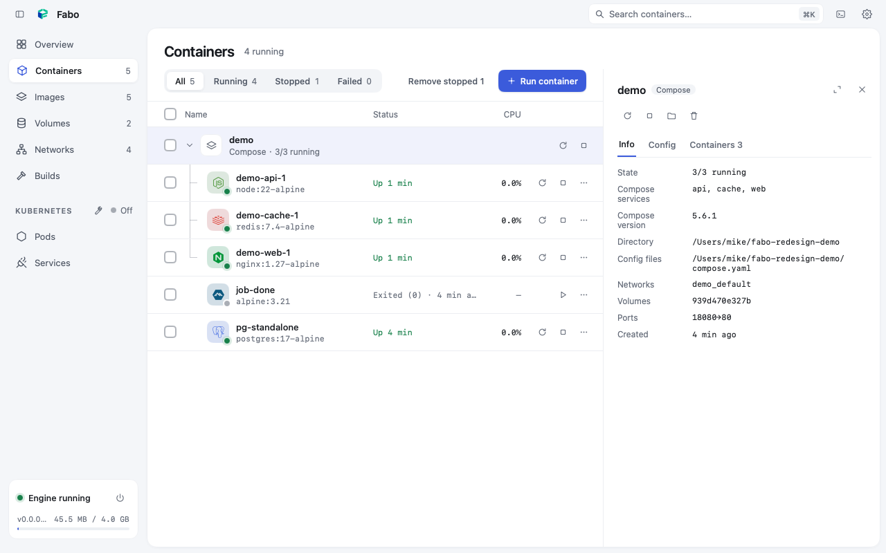

<p align="center">
  
</p>

<h1 align="center">Fabo</h1>

<p align="center">
  <b>OpenFabrica 的本地容器引擎与桌面管理工具</b><br>
  Go 引擎和 MyGo 桌面，兼容 Docker CLI、Compose 和 Buildx，功能对齐 Kiri。
</p>

<p align="center">
  <a href="docs/compatibility-baseline.md">功能对齐基线</a> ·
  <a href="docs/development.md">构建与开发</a> ·
  <a href="docs/desktop-overview.md">桌面与引擎说明</a> ·
  <a href="https://github.com/libracoder/kiri">上游 Kiri</a>
</p>

<p align="center">
  <a href="LICENSE"></a>
</p>

## 当前状态

<p align="center">
  
</p>

Fabo 是独立项目，源码只有 Go：引擎（`engine/`）和桌面（`desktop/`）。应用显示为 Fabo，命令入口为 `fabo`；状态目录、Docker context、环境变量、程序名和引擎协议也都使用 Fabo 的名字，详见[品牌与命令入口](docs/branding.md)。

- 能用的：macOS 上的 Go 引擎和虚拟机、MyGo 主窗口和托盘、通过 `docker` CLI 使用的容器、镜像、网络、卷、Compose 和 Buildx、`fabo` Docker 命令透传、`fabo machine` Linux 开发环境、`k8s` / `import` / `usb` / `bench` / `raw` 命令，从 OrbStack / Docker Desktop 迁入镜像、卷和容器（命令行和桌面都可以），以及用 `fabo migrate` 从 Kiri 离线导入数据。
- 还没有的：原 WebView 窗口的高级功能、Linux 安装包、macOS 自动更新。Windows 版（WSL 2）已移植，尚待在 Windows 上验收，见 [Fabo for Windows](docs/windows.md)。完整清单和验证结果见[功能对齐基线](docs/compatibility-baseline.md)。

```sh
make guest kernel disk                 # guest，内核和数据盘模板各做一次
FABO_SIGN_IDENTITY=- make app-dev      # target/dev/Fabo Dev.app，与已安装的 Kiri 或 Fabo 并存
open "target/dev/Fabo Dev.app"         # 首次打开会注册 fabo-dev context、builder 和登录自启
docker --context fabo-dev run --rm alpine echo hello
```

新命令的使用、数据边界和验证结果见 [CLI 工具说明](docs/cli-tools.md)。

### 从 OrbStack 或 Docker Desktop 迁过来

源引擎只会被读取，不会被改动；容器迁入后处于停止状态。

- **桌面**：设置 → 导入，选择来源，勾选要带过来的镜像、卷和容器，逐项导入并显示结果。源引擎里还有 Fabo 没有的东西时，列表底部会出现提示条，点「查看」即可挑选。
- **切换 docker**：`docker` 仍指向 OrbStack 或 Docker Desktop 时，容器和镜像页会提示切换到 Fabo，可顺带把全部镜像带过来；之后随时可以切回。
- **命令行**：

```sh
fabo import orbstack --list            # 看看源引擎有什么、哪些已在 Fabo 中
fabo import orbstack                   # 带过来 Fabo 缺的全部镜像、具名卷和容器
fabo import desktop-linux volume app-data   # 只带一项
fabo context use fabo                  # 让 plain docker 使用 Fabo（macOS）
```

## 工作原理

```
docker CLI ─┐
compose ────┼─ Docker Engine API ─► fabo-daemon ── guest 协议 ──► fabo-init ─► clone3 → 容器
buildx ─────┤   (unix socket)                    (macOS：vsock 进 VM；
MyGo 桌面 ──┘                                     Linux / WSL：宿主进程)
```

`fabo-daemon` 提供 Docker Engine API 并保存全部状态；macOS 上它用
Virtualization.framework 起一台小 Linux 虚拟机，`fabo-init` 在里面作为 PID 1，
一次 `clone3` 把容器放进命名空间和 cgroup，没有 runc、shim 和 dockerd。网络直接用
netlink / nftables。`fabo` 启动器负责算出本安装的路径、拉起引擎和桌面。详见
[构建与开发](docs/development.md)。

## 文档

- [功能对齐基线](docs/compatibility-baseline.md)：已对齐和待对齐的功能、回归结果与复验方式
- [构建与开发](docs/development.md)：从源码构建、运行、架构和目录结构
- [桌面与引擎说明](docs/desktop-overview.md)：MyGo 主窗口和 Go 引擎的行为规格
- [CLI 工具说明](docs/cli-tools.md)：`fabo` 的 k8s、import、context、usb、bench、raw 等命令
- [Linux 机器](docs/machines.md)、[调试 shell](docs/debug-shell.md)、[桌面多语言](docs/languages.md)
- [品牌与命令入口](docs/branding.md)、[更新日志](CHANGELOG.md)

## 与上游 Kiri 的关系

Fabo 起源于 [Kiri](https://github.com/libracoder/kiri)（Rust），用 Go 逐步对齐它的功能。
[docs/features.md](docs/features.md) 保留了上游的功能清单作为对齐目标，
[docs/releases](docs/releases) 是上游的历史发布说明。已装 Kiri 的机器可以并存使用 Fabo，
也可以在 Fabo 首次启动前用 `fabo migrate` 导入 Kiri 的数据。

## 参与贡献

欢迎提交 issue 和 pull request，参见 [CONTRIBUTING.md](CONTRIBUTING.md) 和
[行为准则](CODE_OF_CONDUCT.md)。私下报告安全漏洞请见 [SECURITY.md](SECURITY.md)。

## 许可证

[Apache-2.0](LICENSE)。第三方许可见 [NOTICE](NOTICE)。guest 内核是 Linux（GPL-2.0），
其配置、补丁和源码提供说明在 [`guest/kernel`](guest/kernel)。

"Kiri" 名称和标志不在许可范围内。
