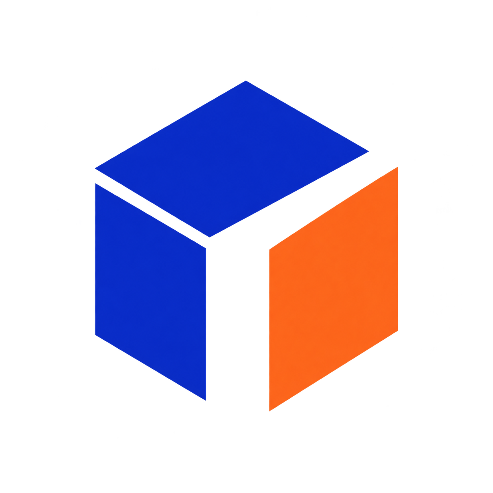
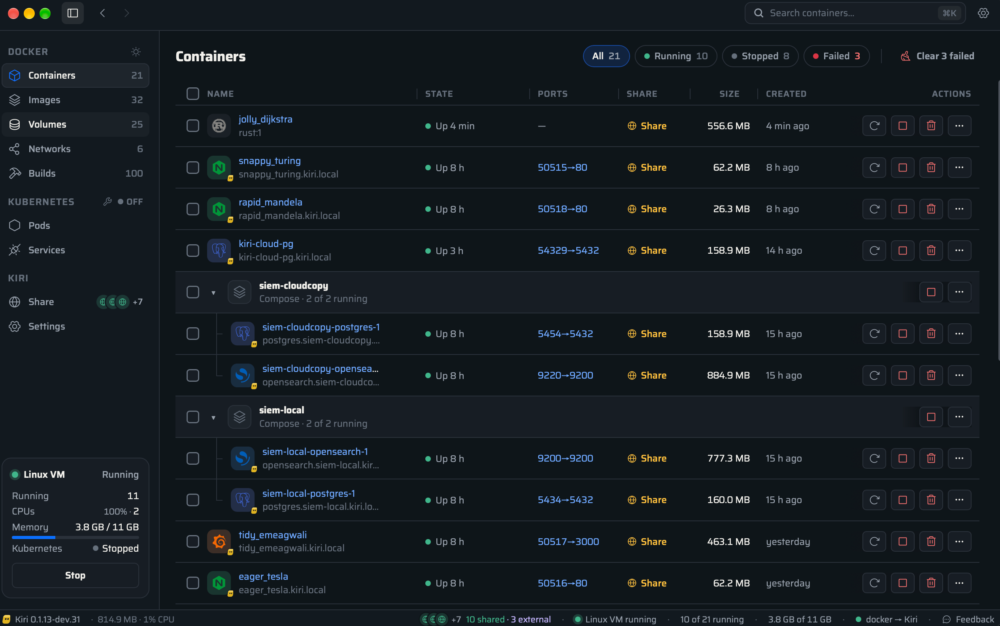

<p align="center">
  
</p>

<h1 align="center">FabriBay</h1>

<p align="center">
  <b>OpenFabrica 的本地容器引擎与桌面管理工具</b><br>
  Go 引擎和 MyGo 桌面，兼容 Docker CLI、Compose 和 Buildx，功能对齐 Kiri。
</p>

<p align="center">
  <a href="docs/compatibility-baseline.md">功能对齐基线</a> ·
  <a href="docs/development.md">构建与开发</a> ·
  <a href="docs/desktop-overview.md">桌面与引擎说明</a> ·
  <a href="https://github.com/libracoder/kiri">上游 Kiri</a>
</p>

<p align="center">
  <a href="LICENSE"></a>
</p>

## 当前状态

FabriBay 是独立项目，源码只有 Go：引擎（`engine/`）和桌面（`desktop/`）。二进制、Docker context 和状态目录暂时沿用 Kiri 的名字。

- 能用的：macOS 上的 Go 引擎和虚拟机、MyGo 主窗口和托盘、通过 `docker` CLI 使用的容器、镜像、网络、卷、Compose 和 Buildx，以及从 Kiri（Rust）离线导入数据。
- 还没有的：Docker 命令透传、`k8s`、`machine` 等命令行、原 WebView 窗口的高级功能、Windows 宿主、Linux 安装包、自动更新。完整清单和验证结果见[功能对齐基线](docs/compatibility-baseline.md)。

```sh
make guest kernel disk                 # guest，内核和数据盘模板各做一次
KIRI_SIGN_IDENTITY=- make app-dev      # target/dev/Kiri Dev.app，与已安装的 Kiri 并存
open "target/dev/Kiri Dev.app"         # 首次打开会注册 kiri-dev context、builder 和登录自启
docker --context kiri-dev run --rm alpine echo hello
```

## 上游 Kiri

以下为上游 Kiri 的介绍和安装说明，是 FabriBay 对齐的目标，其中的 `kiri` 子命令和安装包不等于本仓库现状。

<p align="center">
  
</p>

---

Kiri is a lightweight replacement for Docker Desktop and OrbStack, written in
Rust. It runs containers in one small Linux VM (or straight on the kernel on
Linux) and speaks the Docker Engine API, so your tools just work.

The name comes from the Igbo word *ntakịrị*, "small".

## Why Kiri

- **Fast**: a container starts and exits in about 2.5 ms through the Docker API. That's around 80 times faster than Docker Desktop.
- **Light**: the VM sleeps after 60 s idle, the daemon stays at about 15 MB, and it wakes in about 0.15 s.
- **Compatible**: `docker`, Compose, buildx, `docker login` and amd64 images through Rosetta.
- **Local domains**: `http://<name>.kiri.local`, with HTTPS from Kiri's own certificate authority.
- **More than containers**: a one-command Kubernetes cluster and Linux machines.
- **A native window** for containers, images, volumes and networks, plus a menu bar item.

## 上游 Kiri 安装包

| Platform | Get it |
|----------|--------|
| macOS 14+ (Apple silicon or Intel) | `.dmg` from [runkiri.com/releases](https://runkiri.com/releases/) |
| Windows 10 and 11 (x86-64 or Arm, through WSL 2) | `.msi` from [runkiri.com/releases](https://runkiri.com/releases/) |
| Linux (Ubuntu, Fedora and others) | `.deb` or `.rpm` from [runkiri.com/releases](https://runkiri.com/releases/) |

The first time you open Kiri, it sets up a `kiri` Docker context. Kiri updates itself, and checks each new release's signature first.

## Quick start

```sh
docker --context kiri run --rm alpine echo hello
docker --context kiri compose up -d
kiri k8s start                      # single-node Kubernetes as the `kiri` kubectl context
kiri machine create dev --distro ubuntu && kiri machine shell dev
kiri import                         # bring images, volumes and containers over from OrbStack or Docker Desktop
```

Docker's commands also work as `kiri` commands (`kiri run`, `kiri ps`,
`kiri compose up`, and so on), and always target Kiri.

## Numbers

`alpine` running `true` and removed, median of 30 runs, same `docker` CLI for all three:

|                | Docker Engine API | `docker` CLI |
|----------------|------------------:|-------------:|
| **Kiri**       | **2.55 ms**       | **14.2 ms**  |
| Docker Desktop | 213 ms            | 243 ms       |
| OrbStack       | 380 ms            | 442 ms       |

Method and every other figure are in [`bench/results.json`](bench/results.json). Rerun with `kiri bench`.

## How it works

```
docker CLI ─┐
compose ────┼─ Docker Engine API ─► kiri daemon ── vsock ──► guest agent (PID 1)
buildx ─────┤                         owns the VM           clone3 → container
kiri UI ────┘
```

The VM uses a custom 10 MB kernel, and its PID 1 is a ~900 KB Rust agent.
That agent starts containers with a single `clone3` into namespaces and a
cgroup. There's no runc, no shim and no dockerd. More detail is in
[docs/development.md](docs/development.md#architecture).

## Documentation

- [Features](docs/features.md): everything supported today, release files and known issues
- [Development](docs/development.md): building, running from source, architecture and repository layout
- [Desktop overview](docs/desktop-overview.md): MyGo main window and the Go engine's behaviour
- [功能对齐基线](docs/compatibility-baseline.md) — Go 引擎覆盖范围、回归结果与复验方式
- [Release notes](docs/releases)

## Roadmap

Next is a built-in builder. Kiri will serve Docker's own build endpoints, so
buildx uses its docker driver against Kiri as it does against Docker
Desktop. This brings `host-gateway` support to BuildKit builds, and images
load straight into Kiri.

## Contributing

Issues and pull requests are welcome. See [CONTRIBUTING.md](CONTRIBUTING.md)
and the [Code of Conduct](CODE_OF_CONDUCT.md). To report a vulnerability
privately, see [SECURITY.md](SECURITY.md).

## License

[Apache-2.0](LICENSE). Third-party licences are in [NOTICE](NOTICE). The guest
kernel is Linux (GPL-2.0); its config, patches and the source offer are in
[`guest/kernel`](guest/kernel).

The name "Kiri" and the Kiri logo are not covered by the licence. Forks are
welcome, under a different name and logo.
