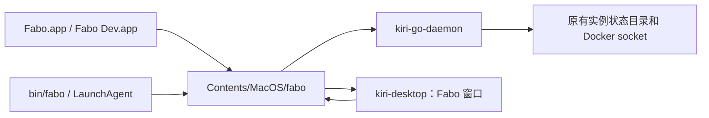

# Fabo 品牌与命令入口

Fabo 使用已选的“开放容器”标志：青绿色 F 字形与深蓝盒体。面向用户的应用和 CLI 采用 Fabo 名称；本次不迁移已有镜像、容器、Docker context 或设置。

## 构建与安装契约

| 入口 | 当前名称 |
| --- | --- |
| macOS 应用 | `target/Fabo.app`；开发版 `target/dev/Fabo Dev.app` |
| 应用包启动器 | `Contents/MacOS/fabo` |
| Linux 构建入口 | `target/linux/release/fabo` |
| `fabo setup` 的命令链接 | 当前实例的 `~/.kiri[-flavor]/bin/fabo`；正式安装可写时另建 `/usr/local/bin/fabo` |
| 桌面入口 | 窗口、托盘菜单和关于页显示 Fabo；内部辅助进程仍为 `kiri-desktop` |
| 应用图标 | `brand/icon/png/fabo-app-icon-*.png` → app 内 `Resources/Fabo.icns` |

`fabo --help` / `fabo -h` 输出用法并正常退出。`fabo run`、`fabo ps` 等已实现子命令沿用原命令契约。`fabo build-with fabo` 使用本实例的构建器，旧参数 `kiri` 仍可读取和使用，持久化值不变。

应用包标识 `dev.kiri.app[.flavor]`、LaunchAgent 标识、`~/.kiri[-flavor]`、Docker context / builder、`KIRI_*` 环境变量、`/kiri/*` API、`*.kiri.local*` 域名和 Go module 路径继续兼容既有环境。正式构建仍占用原正式实例的身份；与本机上游 Kiri 并存验证时使用 Dev 构建，不运行正式实例。

`setup` 和 LaunchAgent 都指向 `fabo`。安装新命令不会替换已有的 `kiri` 命令或 `/usr/local/bin/kiri`。原有 shell profile 和 Testcontainers 的所有权注释保持原文，以便识别已有配置、避免重复并正确卸载。



## 图标来源

- 完整 Logo：`brand/logo/fabo-open-container.png`。
- 不带文字的图形：`brand/logo/fabo-mark.png`，由内置图像工具按已选 Logo 生成。提示词要求保持青绿/深蓝开放容器 F 图形，移除文字，居中于透明正方形画布。
- `sips` 仅负责生成 16–1024 px 的打包尺寸；`iconutil` 打包 ICNS。开发版沿用 `scripts/dev-icon.swift` 叠加 flavor 标记。
- 桌面嵌入 `desktop/fabo-mark.png`；托盘使用 `desktop/tray.png` 的透明轮廓，由 macOS template 模式着色。

## 验证

```sh
make check
KIRI_SIGN_IDENTITY=- make app-dev
"target/dev/Fabo Dev.app/Contents/MacOS/fabo" --help
mkdir -p target/fabo-check/screenshots
KIRI_SHOTS="$PWD/target/fabo-check/screenshots" go -C desktop test -run TestScreenshots -count=1 .
```

图标检查使用实际渲染的浅色/深色关于页以及打包后的 ICNS。CLI 检查覆盖安装链接、LaunchAgent 路径、保留旧 `kiri` 命令、旧 builder 配置与新 `fabo` 参数的兼容。

2026-11-13 本轮验证：`make check`、macOS Dev app 构建和 ad hoc 签名校验、Linux arm64 构建均通过；ICNS 的 16–1024 px 图层完整，浅色/深色关于页已实际渲染检查。打包后的 `fabo` 在隔离 HOME、Docker 配置和 socket 下完成 daemon 启动、`setup --no-agent`、经安装链接执行命令、Alpine 容器输出和退出码 37 验证。测试引擎及临时状态已清理。验证记录、CLI 哈希和构建时间见 `target/fabo-check/verification.json`。

本轮 guest agent 从当前源码重建；内核和空磁盘模板复用本机已安装 Kiri 的资源。未运行全局安装、原生 Dock/菜单交互、Linux 实机运行、DMG 及公证。
