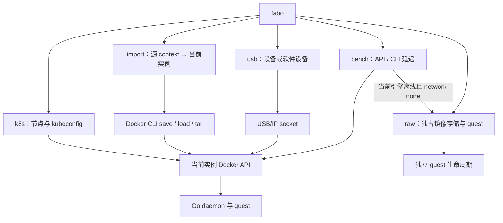

# Kubernetes、迁入、USB、基准、raw 与 MCP 命令

这五组命令对照 `/Users/mike/source/project/tmp/kiri` 的 `a649319` 实现。公开入口为 `fabo`；资源名、context、标签、`FABO_*` 环境变量和 socket 都使用 Fabo 的名字。`AGENTS.md` 已记录本地参考源码路径。`fabo mcp` 是 Fabo 自己加的，上游没有对应命令。

## 命令与状态归属

| 命令 | 用途 | 状态与边界 |
| --- | --- | --- |
| `fabo k8s start [--use]`、`stop`、`status`、`delete`、`set` | 单节点 k3s 集群 | 当前实例的 Docker API、`fabo-k8s` 容器和卷；设置在实例目录的 `k8s.json` |
| `fabo import [orbstack\|desktop-linux] [--list \| image\|volume\|container NAME]` | 从另一 Docker context 复制资源 | 默认源为 `orbstack`，目标始终是当前实例的 socket |
| `fabo usb [list\|ls]`、`attach DEVICE`、`detach DEVICE` | 设备枚举与 macOS USB 透传 | 位置、VID:PID 或名称匹配，歧义拒绝；Linux 使用本机设备与 `--device` |
| `fabo usb helper remove` | 删除 macOS 特权 helper | 仅删除本 flavor 的 helper、LaunchDaemon 和 socket；`setup --uninstall` 也清理它 |
| `fabo usb fake serial\|mouse [OPTIONS]` | 无硬件 USB 端到端测试 | 与物理设备共用 USB/IP；支持 `--location`、`--stall-once`、`--unplug-after`、`--reports` |
| `fabo bench [--runs N] [--image IMAGE] [--network none\|bridge] [--only fabo\|orbstack\|docker]` | 容器创建至删除的延迟 | 默认 50 次，另有 5 次预热；输出 p50、p99、均值，分别测 API 和 CLI |
| `fabo raw pull IMAGE`、`images`、`rmi IMAGE...`、`run [OPTIONS] IMAGE [COMMAND...]` | 绕过 Docker API 使用独立 guest | 当前实例的 `raw/` 目录，独占锁；不连接 daemon、不恢复其容器 |

`k8s`、`import` 和物理 USB attach 需要当前引擎在线。`FABO_SOCKET` 只覆盖 Docker API 的目标，不改变 flavor 的设置、kubeconfig 或 raw 状态目录。自动化验证应同时隔离 HOME、Docker 配置和 socket。



## Kubernetes

```sh
fabo k8s start --use
fabo k8s status
fabo k8s set --port 16443 --tls-san dev.example.test
fabo k8s stop
fabo k8s delete
```

使用上游固定的 `rancher/k3s:v1.37.1-k3s1` 镜像，特权容器、持久卷、`unless-stopped` 重启策略与宿主目录共享。启动等待节点 Ready，写入 CoreDNS 宿主名称配置；默认为回环 API，`set --lan on` 才监听所有 IPv4 接口。默认端口 6443 被占用时，启动在其后 20 个端口内寻找空闲端口；显式设置被占用的端口会报错。

运行中修改设置会重建节点，保留集群卷；已停止的节点下次启动应用设置。`delete` 删除节点及卷，只忽略资源不存在的 404，其他失败返回错误。

导出的专用 kubeconfig 位于实例目录的 `kubeconfig`，同时合并到 `KUBECONFIG` 的第一个非空路径或 `~/.kube/config`。仅 `--use` 改变当前 context；已有其他 cluster、context、user、注释和换行格式保留。写入权限 0600，原文件备份为 `.bak.fabo`，支持现有符号链接。无法安全处理的 JSON、flow-list 或重复顶层键直接拒绝覆盖。删除仅移除本实例的条目。

与上游的剩余差异：当前在 `start`、`status` 时同步 kubeconfig，尚未挂接 daemon 启动时的后台同步。迁移或重启后需要刷新时运行 `fabo k8s status`。

## 从其他引擎迁入

```sh
fabo import orbstack --list
fabo import orbstack
fabo import desktop-linux volume app-data
```

镜像通过 `docker save | load`，卷通过源端只读挂载和 tar 管道复制，保留文件所有者与权限。失败时终止并清理本次临时容器，删除本次新建的部分目标卷；若清理失败则明确报告残留位置。不存在的源卷在创建 helper 前拒绝，避免 Docker 自动创建空源卷。

整批导入跳过目标已有资源、悬空镜像标签和 64 位十六进制匿名卷。单独指定已有目标卷会拒绝覆盖。容器按 inspect 的配置和支持的 HostConfig 字段重建，保留网络名称/别名，始终保持停止。与上游一样，不复制容器可写层、不迁移宿主 bind 目录、不完整复制自定义网络的驱动/IPAM 参数。需要应用一致性快照时，应先停止源端写入。

源端会运行短暂的只读卷 helper；原有镜像、容器和卷数据不删除或修改。源 context 若指向目标同一 Unix socket，命令直接拒绝。

## USB 实现与验证边界

macOS 枚举和捕获由 `fabo-daemon usb` 承担，使用 IOUSBHost；CLI 可以保持 `CGO_ENABLED=0`。首次物理 attach 按需安装 root helper，会出现系统管理员授权窗口。每个设备有独立子进程，通过 UNIX fd 传递已连接的 USB/IP socket；helper 校验调用 UID、设备位置和描述符类型，不接收任意文件路径。设备解绑、断连或 helper 结束后释放捕获。

`engine/internal/usbhost` 隔离设备枚举、macOS 原生调用和 USB/IP 协议，供 launcher 与 daemon 共用。USB/IP 按端点保持顺序，区分排队取消与运行中取消，断开后中止阻塞传输并回收 worker；等时传输返回不支持。软件串口覆盖 CDC ACM 控制与 bulk 流，鼠标覆盖 HID interrupt；stall 故障会保持 halted 状态直到驱动 CLEAR_FEATURE，防止恢复期间提前消费数据。

物理 USB 捕获及 root helper 安装需要实机设备专项验证；本轮只做真实枚举、helper 边界测试及软件设备端到端测试，没有接管用户的 USB 硬件。Linux/WSL 的设备说明与枚举代码已编译，未做 Linux 实机验证。

## 基准与 raw

API 基准先订阅 `wait?condition=removed`，再启动容器，确认成功退出和自动删除后结束计时。CLI 基准使用同一 Docker CLI 和各引擎的指定 socket，避免当前 context 影响比较。镜像应提前拉入各待测引擎；离线外部引擎跳过。当前引擎离线时，仅 `--network none` 可以回退到独立 guest 的协议基准。结果是本次运行的测量值，不替代 README 中保留的上游历史数据。

```sh
fabo raw pull alpine:latest
fabo raw run --rm --timings -e CHECK=yes -u 1234 -w /tmp alpine sh -c 'id; echo "$CHECK"'
fabo raw images
fabo raw rmi alpine:latest
```

raw 支持镜像 Entrypoint/Cmd、环境变量覆盖、用户、工作目录、stdout/stderr 和退出码；只支持 `--network none`。`--rm` 清理该次可写层，`--timings` 报告启动和 guest 阶段耗时。并发访问同一个 raw 存储在启动 guest 前因独占锁失败。macOS 使用 bundle 的内核/Go initramfs，源码验证可用 `FABO_GUEST_DIR`；Linux 使用 `FABO_AGENT` 或相邻的 `fabo-init`。

与上游的存储差异：Go raw 使用独立 `~/.fabo[-flavor]/raw`，不共享 daemon 或 Rust 的镜像索引/数据盘。`images` 输出规范化镜像名、配置 digest、字节大小和层数，未复刻 Rust 的显示格式及拉取时间列。

## 给 agent 的 MCP

`fabo mcp` 在 stdin/stdout 上运行只读的 Model Context Protocol 服务（JSON-RPC 2.0，按行分隔，协议版本 `2025-06-18`）。它只发 GET 请求，不启动、停止、删除或拉取任何东西；写操作仍交给 agent 已有的 `docker` / `docker compose`。每个工具都带 `readOnlyHint`，结果同时给文本和 `structuredContent`。

| 工具 | 内容 |
| --- | --- |
| `engine_info` | 引擎版本、容器与镜像数量、虚拟机是否醒着、本地地址后缀和端口 |
| `list_containers` | 容器名、镜像、状态、Compose 项目与服务、端口、本地地址；可按 `project`、`running` 过滤 |
| `container_logs` | 最近 `tail` 行（默认 200，上限 5000），可用 `grep` 和 `level`（error / warn / info / debug）筛 |
| `compose_projects` | 每个项目的工作目录、配置文件、Compose 版本、服务和运行数 |
| `find_local_images` | 按仓库分组的本地镜像：标签、大小、创建时间、正在使用它的容器；Docker Hub 的完整写法折回 `postgres:17` 这样的常用名 |
| `image_scan` | 镜像的漏洞扫描结果；还没扫描时返回 `scanned: false` |

`initialize` 的说明要求 agent 写 compose 文件、`docker run` 或 `FROM` 之前先调 `find_local_images`：本地已有大版本一致、变体合适的镜像就沿用，不另拉标签，也不悄悄换成另一个变体。本地地址按桌面端的规则算：`dev.fabo.domain` 标签优先，其次 `服务.项目`，最后容器名，再接上 `fabo domains` 的后缀、协议和非默认端口。

注册到 agent（路径换成实际的 `fabo`）：

```sh
claude mcp add fabo -- /Applications/Fabo.app/Contents/MacOS/fabo mcp
```

`FABO_SOCKET` 照常覆盖目标引擎，试迁移的实例可以这样接：`claude mcp add fabo-trial -e FABO_SOCKET=$HOME/.fabo-trial/run/docker.sock -- /path/to/fabo mcp`。

## 2026-11-13 验证

- `make check`：engine vet、race tests，desktop vet/tests，以及 Linux ARM64 vet/测试交叉编译。Linux 的 `-exec true` 只证明编译。
- 当前源码构建的 macOS daemon、guest 和纯 Go CLI；内核与空盘模板只读复用已安装的 Kiri。
- 独立 k3s 节点 Ready、真实 TLS API、端口修改、ConfigMap 状态保留、启停、kubeconfig 合并/删除，其他 context 字节级保持不变。
- 两套独立 Go 引擎模拟源/目标 context，验证迁入内容、UID/GID/权限、停止容器、网络及别名、重复导入跳过与缺失源卷失败。未连接真实 OrbStack / Docker Desktop 数据。
- `tests/usb.sh`：41 通过、0 失败；未启用可选的自定义空闲超时一项。覆盖 1 MiB 回环、重复开关、stall、取消、断连、多设备、VM 生命周期与鼠标输入。
- raw 环境/用户/工作目录、stderr、退出码 37、1 MiB 输出；API / CLI 的 none、bridge 基准与离线 raw 基准实际运行。

结果与产物指纹归档在 `target/cli-alignment-check/`。未运行完整 `tests/e2e.sh`、物理设备捕获、真实外部引擎迁移或应用发布。
