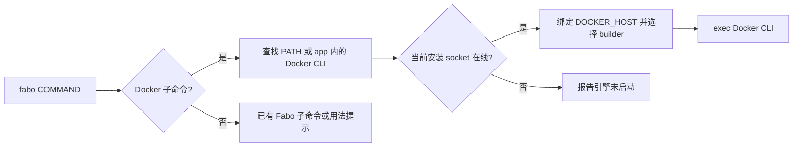

# Fabo 功能对齐基线

初始记录于 2026-11-11，待对齐清单更新于 2026-11-19（本地上游参考 `faca538`；上一轮参考 `a649319`，其后上游的增量见「上游 `a649319..faca538` 增量」）。Fabo 是独立项目，源码里只有 Go。上游 [libracoder/kiri](https://github.com/libracoder/kiri) 是功能对齐的参考，本仓库的起点是上游提交 `4418009e3f9f8cd234e37531348dd900f78e84e1`。

目标是覆盖 Kiri 的 Docker API、现有客户端工作流和数据迁移能力，容器引擎与 guest agent 用 Go 实现，MyGo 承担主窗口和托盘。Docker CLI 的交互与流式能力属于引擎兼容范围。上游由 Rust 提供的其余功能按下面的「待对齐功能」逐步补回。架构和构建方式见[开发说明](development.md)和[桌面与引擎说明](desktop-overview.md)。

## Fabo 品牌入口（2026-11-13）

应用显示名和图标已切换为 Fabo，公开命令入口为 `fabo`。下文的历史验证记录已改用现行名称（原记录写作 `kiri`）；现行构建产物、标识和验证方式见[品牌与命令入口](branding.md)。

## 移除 Rust 之后

2026-11-11 删除了全部 Rust 代码（`crates/`、`xtask/`、Cargo 配置）以及只为它服务的 WebView 页面测试。原来由 Rust 承担的启动和构建改由 Go 完成，并在本机验证过：

| 范围 | 现在的实现 | 验证 |
| --- | --- | --- |
| 启动引擎、打开桌面 | `engine/cmd/fabo`：`fabo daemon`、`fabo` / `fabo ui`、`fabo migrate` | Apple Silicon macOS，`Fabo Dev.app`：引擎启动后 `/version` 返回 `"FaboEngine":"go"`，`docker run --rm alpine` 输出正常，Finder 挂载出现；`fabo ui` 在引擎未运行时把它拉起并打开窗口，关窗后引擎继续运行，SIGTERM 后正常退出并卸载。这次用的是已安装 Fabo 0.1.18 的内核，不是本仓库构建的 |
| 打包 initramfs | `engine/cmd/fabo-mkinitramfs` | 与删除前 `cargo xtask guest-go` 的输出逐字节一致 |
| 构建 app | `Makefile`、`scripts/macos-app.sh`、`scripts/macos-dmg.sh` | `make app-dev` 产出可运行的 `Fabo Dev.app`（ad hoc 签名）。`make dmg`、Developer ID 签名和公证没有跑过 |
| Linux 启动 | `engine/cmd/fabo`（`make linux`） | `tests/linux-host.sh`：引擎在特权容器里启动成功，**8 通过、18 失败**。失败有两个原因，都出在用例环境没按 Go 引擎调整：外层容器在 `172.17.0.0/16` 上，与内层默认网桥冲突；启动时没有委派 cgroup，资源限制和特权容器被拒绝 |

### 首次设置（2026-11-11 对齐）

`fabo setup`、`fabo setup --uninstall`、`fabo build-with` 和从 Finder 打开 app 时的首次设置已用 Go 实现（`engine/cmd/fabo/*_darwin.go`），对照上游 `setup.rs`、`builds.rs`、`buildwith.rs`。

| 做什么 | 验证 |
| --- | --- |
| 写 Docker context | `Fabo Dev.app` 实机：`docker context ls` 认出 `fabo-dev`，`docker --context fabo-dev version` 连通 |
| `~/.fabo/bin` 里的 `fabo`、`docker` 链接；正式安装还写 shell profile、`/usr/local/bin/fabo`、默认 context、`cliPluginsExtraDirs` | Dev 版实机验证了链接。正式安装独有的几项只在沙盒 HOME 的单元测试里验证，没有在真实环境跑 |
| LaunchAgent（登录自启） | 实机：`launchctl` 显示 running；引擎正常退出后不重启；再次打开 app 时由 launchd 拉起 |
| Buildx builder 和以 context 命名的副本 | 实机：`docker --context fabo-dev build` 构建成功，镜像直接可 `docker run` |
| 从 Finder 打开时自动设置 | 实机 `open "Fabo Dev.app"`：以上各项都就位，真实的 `~/.docker/config.json` 没有被改动 |
| `--uninstall` | 实机：LaunchAgent、context、builder、链接都移除，引擎停止，已安装的 Kiri 不受影响 |

与上游的三处差异：

- 带 flavor 的 app 不会在没人选择时接管全机的 `docker build`（上游会）。
- 卸载只移除自己加进 `cliPluginsExtraDirs` 的那一项。上游按 `Kiri.app/...` 子串匹配，会连同另一份 Kiri 的条目一起删掉。
- 设置前先确认引擎能启动，不能启动时直接报错，不改任何东西。

`make kernel` 和 `make disk` 的命令与原 `xtask` 相同，但这次没能跑完：本机 Kiri 虚拟机的时钟比宿主慢约 3 小时，容器里 `apt-get` 校验签名失败。

### Docker 命令透传（2026-11-13 对齐）

`engine/cmd/fabo/docker.go` 对照上游 `docker.rs`：支持 `fabo run`、`ps`、`exec`、`compose`、`buildx` 等 Docker 子命令。优先使用 PATH 上的 Docker CLI，回退到当前 app 内的 CLI；以当前安装的 socket（含 `FABO_SOCKET` 覆盖）设置 `DOCKER_HOST`，清除 `DOCKER_CONTEXT`。仅当用户未设置 `BUILDX_BUILDER` 且当前安装的 builder 已登记时，选择该 builder。

命令执行前检查引擎是否在线，不自动启动引擎；通过 `exec` 保留标准输入输出、终端和退出码。`import` 仍为迁移命令保留；macOS 的 `update` 为应用更新保留，容器资源更新使用 `fabo container update`。

验证覆盖命令边界、CLI 查找、三种 Buildx 配置路径、显式 builder，以及独立 Unix socket 上的子进程参数、标准输入输出、退出码、SIGTERM 和引擎离线失败。`make check` 通过，实际编译的启动器通过模拟 Docker CLI 和独立 socket 验证命令分发、端点隔离及退出码；Linux 侧仅交叉编译通过。实际 Docker/VM 和交互终端尚未在本轮验证。上游执行前的 CLI/引擎版本差异提醒及 Fabo Lite 下载 CLI 回退尚未对齐，分别随版本管理和 Lite 补齐。



### Linux machine 命令行（2026-11-13 对齐）

`engine/cmd/fabo/machine.go` 对照本地上游 `crates/kiri/src/machine.rs`（参考 checkout `a649319`），补齐 `create`、`list` / `ls`、`shell`、`start`、`stop`、`restart`、`delete` / `rm`，支持七种发行版、自定义镜像和 `--systemd`。沿用 `machine-NAME` 容器名与 `dev.fabo.machine` 标签、宿主用户映射、共享 home、免密 sudo、重启策略和 systemd 配置。完整规则和流程见 [machines.md](machines.md)。

与上游的明确差异：参数缺值、未知参数和多余参数直接报错，避免静默使用默认值；镜像 digest 原样传递；重复启动/停止的 HTTP `304` 视为成功，匹配现有端到端用例。宿主用户名进入初始化脚本时按 shell 参数引用。shell 使用进程替换，保留 Docker 的终端、信号和退出码。

验证：`make check` 通过（engine / desktop vet 与测试、engine race、Linux ARM64 交叉编译）。独立 macOS Go VM 中成功创建 Alpine machine，后续 **22 项检查全部通过**，覆盖宿主用户名及 UID/GID、共享文件、工作目录、HOME、hostname、stdin、非零退出码、sudo、真实 TTY、重复启停、重启、删除与错误参数。使用当前源码构建的启动器、daemon、guest agent；内核与空数据盘模板取自已安装 Fabo，只读使用。未连接日常 Fabo 的 socket，也未注册 context 或 LaunchAgent。

Ubuntu `--systemd` 实机也已验证：首次软件包安装约 4 分钟（最初的 120 秒就绪检查未通过，安装完成后复验通过），随后 `systemctl is-system-running` 返回 `running`，PID 1 为 systemd；默认 login shell 与退出码检查通过，另外 **8 项检查全部通过**，包括 sudo、停止、再次启动和删除。测试容器与专用 VM 数据已清理，日志保留在 `target/cli-machine-check/`。

Linux 宿主和其余发行版的真实运行、完整 `tests/e2e.sh` 尚未复验。

### Kubernetes、import、USB、bench、raw（2026-11-13）

五组 CLI 已用 Go 实现，对照本地上游 `a649319`；公开入口为 `fabo`。`k8s` 管理 k3s 节点、设置、CoreDNS 和 kubeconfig；`import` 从指定 Docker context 复制镜像、卷和停止的容器；`usb` 提供 macOS 设备枚举、特权 helper、USB/IP 和软件测试设备，以及 Linux 设备指引；`bench` 测量 API / CLI 的完整容器生命周期；`raw` 独占独立存储并直接管理 guest。

`make check`、当前源码构建通过。隔离 macOS VM 验证了 k3s Ready、TLS API、重建保留 ConfigMap、启停和 kubeconfig 清理；两套独立引擎验证迁入文件所有者/权限、网络、停止状态及源数据保留；USB 软件设备 **41 通过、0 失败**；raw 退出码 37、1 MiB 输出与三种基准路径已实测。详细契约和限制见 [CLI 工具说明](cli-tools.md)。

剩余差异：kubeconfig 暂在 start/status 同步，未接 daemon 启动后台同步；raw 使用独立 Go 存储，镜像列表格式与 Rust 不同。物理 USB 捕获/helper 安装、真实 OrbStack/Docker Desktop 迁移、Linux 宿主尚未实测。未运行全量端到端套件。

### 桌面高级功能（2026-11-14）

对照本地 Kiri `a649319`，MyGo 新增三组操作：容器详情中的环境变量和 TCP / UDP 端口编辑；设置中的仓库登录、退出及凭据拉取；Kubernetes Pods / Services、Pod 日志和删除、集群启停与网络设置。详细规则、接口和失败语义见 [桌面高级操作](desktop-advanced.md)。原有文件浏览、镜像分层与扫描、代理及域名设置继续保留。

验证：`make check`、desktop race（含专用 Keychain 创建 / 更新 / 删除测试）、深浅主题渲染通过；Linux ARM64 与 Windows AMD64 桌面交叉编译通过，仅 macOS 实际运行。当前源码构建的原生窗口、daemon 和 guest agent 配合隔离 VM，**12 项验收通过**，覆盖环境保存后容器 ID / 卷文件保留、即时端口修改及非法输入、真实本地 Registry 鉴权与 helper 存取、k3s 启动、Pod / Service / 日志、删除确认、网络重建后 ConfigMap 保留及集群清理。Pod 尚在 ContainerCreating 时，日志显示原因，运行后手动刷新读取成功。内核复用现有 Dev 包，与本轮 Advanced 包的内核哈希相同。

原生窗口截图及逐项结果保留在 `target/desktop-advanced-check/`。专用 VM、临时 HOME / Docker 配置 / kubeconfig、测试容器和数据卷均已清理，日常 Dev 引擎未重启。`target/dev/Fabo Advanced.app` 已构建并通过 ad hoc 签名检查，未安装或发布。

该批实现当时的终端与日志限制已由下节增量补齐。剩余边界：Linux 引导、其余 13 种语言、Kubernetes forwards、Import / Diagnostics / Build with、USB 界面，以及文件预览 / 下载和扫描历史 / SBOM 导出尚未补齐。仓库 token 与私有镜像鉴权头由接口测试覆盖，未使用真实私人仓库账号；Linux / Windows 的真实桌面和全量 `tests/e2e.sh` 未在本轮验证。

### 连续终端与日志（2026-11-14 增量）

对照上游 `ui/term.rs` / `termwire.rs`、`detail.rs`、`k8s.rs`，新增宿主多会话 PTY、容器交互式 TTY，以及容器 / Pod 持续日志。终端复用 MyGo 的 Ghostty 组件；容器会话支持连续输入、resize、Ctrl+C、导航时保留状态和实际退出码。关闭会话结束对应 exec，正常退出窗口 / 应用或 SIGTERM 时回收相关进程。

容器日志初始读取 5,000 行，Pod 日志初始读取 2,000 行；之后持续追加，切换目标或关闭详情取消旧订阅并回收 kubectl。被动请求携带后台标记；日志保留最多 5,000 行 / 1 MiB，支持跨帧和无末尾换行的输出。专用 `/fabo/exec/{id}/stop` 和 `FaboExecStop` 能力标记用于显式回收，不改变普通 Docker detach 的语义。完整规则见 [连续终端与日志](desktop-streams.md)。

`make check` 和显式开启真实 PTY 的 desktop race 检查通过；macOS app 的运行库打包及 ad hoc 签名通过；Linux ARM64 / Windows AMD64 桌面仅交叉编译。隔离 macOS Go VM 中的原生窗口 17 项专项验收通过，覆盖真实 shell / 容器 TTY、状态保留、resize、Ctrl+C、静默保持、非零退出码、进程回收、持续日志及 SIGTERM 退出。记录位于 `target/desktop-streams-check/`；测试 VM、临时配置和进程已清理，日常 Dev 实例未重启。底部终端面板、分屏和完整搜索入口仍未逐项复刻，其他待验证边界不变。

### 多语言（2026-11-14 增量）

新增繁体中文、德语、西班牙语、法语、巴西葡萄牙语、意大利语、波兰语、俄语、土耳其语、日语、韩语、越南语和印度尼西亚语，连同原有简体中文和英文共 15 种。设置支持立即切换、保存与跟随系统；按上游规则匹配地区和旧语言标签，兼容旧 `zh` 设置，缺词回退英文。14 份译表各含 407 条桌面消息，覆盖导航、设置、资源操作、终端及日志入口；参数和覆盖检查纳入 desktop tests。desktop race 与 `make check` 通过；原生窗口 17 项专项覆盖各语言切换、保存、重启恢复、系统选项及旧设置兼容，app 签名检查与 Linux ARM64 / Windows AMD64 交叉编译通过（两者未实机运行）。记录位于 `target/language-check/`。详情见 [桌面多语言](languages.md)。首次语言选择引导仍待对齐；CLI、引擎输出和真实 Linux / Windows 桌面不在本轮验收范围。

### 公网共享（2026-11-15 对齐）

`fabo share PORT|HOST:PORT|CONTAINER`、`fabo PORT` 简写，以及 login / logout / status / names / reserve / release，对照上游 `crates/kiri/src/share.rs`；桌面「共享」页对照 `ui/sharing.rs`。上游的中继 `edge.runkiri.com` 闭源，本仓库新增自建中继 `fabo-edge`（`make edge`，见 [fabo-edge](share-edge.md)）。线协议与 `kiri-share-proto` 逐字节一致，测试比对上游 Rust 生成的固定帧。与上游有意不同的地方：

- 隧道由引擎 supervisor 托管，经 `/fabo/share` 供 CLI 和窗口使用；CLI 那条请求就是隧道的租约，没有上游的 traffic 文件。
- ALPN 为 `fabo-share/1`。
- 容器通过 guest relay 连接，不需要 `-p`。
- 没有 attest、lanes、名字人工审核、自定义域名、限速和月流量。

验证见 [CLI 工具说明](cli-tools.md) 的 Share 一节；公网服务器和真实 GitHub OAuth App 尚未验证。

### 构建页（2026-11-19 对齐）

桌面「构建」页对照上游 `crates/kiri/src/builds.rs`（`list` / `detail` / `layers` / `remove`）和 `ui/index.html` 的 `renderBuilds` / `buildDetail` / `blLayers` / `blSecurity`，由窗口经 docker CLI 的 `buildx history` 读取 BuildKit 自己的构建历史（`desktop/builds.go`、`desktop/builds_view.go`）。构建器的状态、缓存上限和清理缓存只留在设置 → 构建，与上游一致。与上游的差别：

- 用 `DOCKER_HOST` 指向本安装的 socket，而不是 `--context`；只认 endpoint 为本安装 context 且 `buildx_buildkit_<node>` 容器已存在的 docker-container builder，共用一个节点的 builder（`fabo` 与 `fabo-build`）都会问到，同一条构建只留一条，取能给出名称的那个 builder 的记录：buildx 把构建的名称、上下文和 Dockerfile 路径记在执行构建的 builder 的本地状态里，经另一个 builder 读出来是空的。
- 版式按本仓库的列表 + 详情坞：列表在左、详情在右，元信息放在详情坞标题下；状态筛选、搜索、「清理 N 个失败的构建」与上游相同。
- 首次进入页面读一次（可能唤醒 VM），之后只在 VM 醒着时每 15 秒、有构建在跑时每 2 秒读一次。
- 英文界面里失败状态显示为 BuildKit 自己的 "Error"（"Failed" 已被容器的「异常」占用）。

验证：`make check` 通过；`desktop/testdata/builds` 是 buildx v0.38.1 对 Fabo 托管 BuildKit 的真实输出（成功、`RUN exit 3` 失败、两条 lint 警告、无名称的经典 `POST /build`），解析、builder 过滤、参数校验和页面交互都以它为准。隔离的 `~/.fabo-dev` 引擎 + 临时 `DOCKER_CONFIG` 上，`FABO_LIVE_SOCKET=… go -C desktop test -run TestLiveBuilds` 用真实 CLI 读出全部记录，逐条读取步骤、分层和安全扫描成功。构建进行中时 `history logs` 会跟随到构建结束，窗口因此只读 2 秒内已有的进度：实测进行中的构建显示为构建中，步骤在 2 秒内出现，按进程组结束后没有残留的 `docker-buildx` 进程；`-race` 构建的真实窗口在构建进行中打开构建页 30 秒，无竞态和崩溃（画面未人工查看）。未在 Linux / Windows 窗口上运行。

### 待对齐功能

下面只列当前仍有实现差异的范围；已实现但缺少实机覆盖的内容另列于「待补验证」。容器环境与端口设置、仓库登录及认证拉取、Kubernetes 基本管理已随 `6c93c03` 完成，连续终端与日志由上述增量补齐，不再作为整组缺失功能；范围和限制见 [桌面高级操作](desktop-advanced.md)。

#### 桌面剩余差异

| 模块 | 当前实现与待补内容 | 上游参考 |
| --- | --- | --- |
| 终端工作区扩展 | 宿主多会话和容器交互式 TTY 已实现；待复刻上游底部面板、横向 / 纵向分屏及完整终端搜索入口 | `ui/index.html` 的内嵌终端面板 |
| 文件浏览增强 | 当前依赖运行中容器的 `ls`，仅列目录和文件名；待补文件信息、预览、下载及从桌面打开 Finder 文件位置等操作。Finder 只读浏览与容器 archive API 已有实现 | `ui/detail.rs`、`ui/index.html` |
| 构建工作容器 | 构建页已对齐（见上文）；上游在容器列表里隐藏 `buildx_buildkit_*` 容器、在设置 → 构建里显示 BuildKit 镜像与缓存卷占用，本仓库的容器页仍列出构建器容器 | `ui/index.html` 的 `isBuildWorker`、`builderPref` |
| 扫描历史与导出 | 镜像分层、最新扫描和重新扫描已有界面；待接扫描历史选择和 CycloneDX SBOM 导出。引擎已有 `/fabo/images/scans`、`/fabo/images/sbom` | `ui/index.html` 的扫描历史 / `savesbom`，`ui/mod.rs` |
| Kubernetes 转发 | Pods / Services、持续日志、Pod 删除、集群启停和网络设置已有界面；待补 Pod / ClusterIP 的本地端口转发入口及生命周期管理。引擎已有 `/fabo/k8s/forward` 接口 | `ui/k8s.rs`、`ui/index.html` |
| 首次引导 | macOS launcher 的首次设置已实现；桌面尚无首次语言选择及 Linux 设置检查、修复、跳过和恢复流程 | `ui/lang.rs`、`ui/linux.rs` 的 `onboarding`、`ui/index.html` |
| Import / Build with | `fabo import`、`fabo build-with` 已实现；桌面导入流程已对齐（设置 → 导入、列表底部提示条、查看窗口、切换 docker 的对话框与进度卡片）。Windows 窗口已有构建引擎选择（设置 → 构建，另有引擎时问一次）；macOS 窗口仍待补该入口。底部状态栏已显示 `docker → 引擎`，指向其他引擎时可打开切换对话框 | `buildwith.rs`、`ui/index.html` 的 `buildAsk` |
| USB | 三个平台的 USB 页都已接上：Windows 经 fabo-win 和 usbipd-win，macOS 经 `fabo usb list --json` / `attach` / `detach`（首次 attach 装 helper），Linux 只列设备与 `--device` 路径。未做：上游显示的设备在容器里的 `/dev` 节点（引擎没有 `/fabo/usb/nodes`）、按名称猜设备类型图标 | `ui/index.html`、上游 `crates/kiri/src/usb.rs` 的 `ui_list`、`crates/kiri-win/src/usb.rs` |
| Share 余项 | Share 页和 `fabo share` 已对齐（见上文「公网共享」）；未做上游的账号用量面板、账号在其他电脑上的链接列表（`/v1/tunnels/live` 已有，未接界面）以及 Pod / Service 的 Kubernetes 共享 | `ui/sharing.rs`、`ui/index.html` |
| 更新与诊断入口 | Windows 窗口已接更新检查 / 下载 / 安装（fabo-win）和诊断（打开日志文件夹、生成脱敏报告）；macOS / Linux 桌面仍未接入更新与诊断，所有平台都没有窗口内日志查看、报告上传和崩溃报告设置 | `ui/mod.rs`、`ui/index.html`、`update.rs`、`diag/` |

上表的 `ui/` 等相对路径均位于上游 `crates/kiri/src/`。表中列为「引擎已有」的接口不代表桌面流程已完成。

#### CLI、平台与交付剩余差异

| 模块 | 待补内容 | 对照位置或相关说明 |
| --- | --- | --- |
| 需要管理员密码的设置 | `fabo setup --docker-socket`：创建 `/var/run/docker.sock` 链接、安装开机恢复用的 LaunchDaemon，并在卸载时清理。域名解析和 HTTPS 信任已实现，但尚未像上游那样合并域名与 socket 设置的授权；系统密码框标题仍来自 `osascript` / `security` | 上游 `crates/kiri/src/setup.rs` 的 `docker_socket` |
| CLI / 引擎版本提示 | Docker 命令透传已实现；执行前的 CLI / 引擎版本差异提醒未对齐 | 上游 `crates/kiri/src/docker.rs`；见前文「Docker 命令透传」 |
| Kubernetes 后台同步 | kubeconfig 目前在 `start` / `status` 时同步；待接 daemon 启动时的后台同步，覆盖迁移或重启后的刷新 | 上游 `crates/kiri/src/kubeconfig.rs`；见 [CLI 工具说明](cli-tools.md) |
| raw 兼容差异 | Go raw 使用独立存储，不共享 daemon / Rust 镜像索引；`images` 未复刻 Rust 的显示格式与拉取时间列。后续需决定保留差异还是进一步对齐 | 上游 `crates/kiri/src/main.rs` 的 `raw` 分发；见 [CLI 工具说明](cli-tools.md) |
| 自动更新与诊断 | Windows 的更新（`engine/cmd/fabo-win/update*.go`）、诊断报告与日志脱敏（`engine/internal/redact`、`engine/internal/winhost/diag.go`）已有 Go 实现；macOS / Linux 的更新源检查、下载与安装、崩溃报告和诊断报告仍无 | 上游 `crates/kiri/src/update.rs`、`diag/` |
| Windows 宿主余项 | 宿主（named pipe、docker_engine 让位、`fabo bridge`、首次设置、引擎启停、更新）、窗口与托盘、凭据管理器、`bin\fabo.exe`、bundle / MSI 打包链，以及 `*.fabo.local`（NRPT + 127.0.0.1:53 应答）、回环代理中继（`fabo hostrelay`）、usbipd-win 的 USB 页、`.wslconfig` 资源设置、诊断报告（含脱敏）和「用 Docker 还是 Fabo 构建」已移植，见 [Fabo for Windows](windows.md)。剩余：Windows 窗口里的打包 / 解包、调试终端、从其他引擎导入仍隐藏。MSI 与 exe 不做代码签名（有意，不列为缺口） | 上游 `crates/kiri-win/`；本仓库 `engine/cmd/fabo-win`、`scripts/windows-bundle.sh`、`scripts/windows-msi.ps1` |
| Linux 包与 host-access | Linux 构建 / 打包链仍要求 Cargo / Rust 窗口或旧 `fabo-init`，需改为 Go launcher、daemon、guest 与 MyGo；`fabo host-access` 尚无 Go 版本 | 本仓库 `packaging/linux`、`scripts/ci/linux-build.sh`、`scripts/ci/linux-packages.sh`、`contrib/linux`；上游 `hostaccess.rs` |
| 发版与 Lite | 更新源 JSON、发版 tarball、Kiri Lite 与首次 Docker CLI 下载回退待补；`NOTICE` 需按 Go 依赖重新生成。macOS app 和 DMG 构建脚本已有实现，发布验证另见下表 | 上游 `xtask/src/main.rs` 的 `release`；本仓库 [发版说明](release.md) |
| CI | 尚无执行 Go vet / 测试 / 构建的工作流；当前仅保留 CodeQL | `.github/workflows/` |

#### 上游 `a649319..faca538` 增量

2026-11-19 逐条核对上游这 74 个提交。

**已在本轮补齐：**

- **内核**：补丁 0004（GRO frag_list 触发的 skb_segment BUG）、0005（AT_HWCAP3 只在非 0 时给出，macOS 14 / 15 的 Rosetta 才能跑 amd64 容器），以及 `CONFIG_BLK_DEV_LOOP`。
- **guest**：
  - 每个容器和 exec 自成会话（setsid），`docker stop` / `kill` 仍只发给主进程；
  - 层和 `docker cp` 允许硬链接指向符号链接（Nix 镜像）；
  - 缺失的工作目录在切换用户和根变只读之前以 root 0755 创建；
  - 引擎自建的卷挂载点带 xattr 标记，重启不再把 tmpfs 卷和空卷的根重置为 root 0755；
  - 文件视图以 O_NONBLOCK 读，`/proc/kmsg` 不再卡住控制循环。
- **API**：
  - `/version` 与 `/info` 报 Docker 27.5.1，Fabo 自己的版本在 `FaboVersion` 和 "Fabo" 组件（读取方缺字段时回退旧字段）；
  - Entrypoint / Cmd 按 Docker 规则合并（`Cmd: []` 取镜像的），inspect 补 `Config.Cmd` / `Entrypoint`；
  - 不带 `Upgrade` 头的 exec / attach 回 200 加原始流；
  - `/info` 的 `SystemTime`；
  - 容器、网络、卷的 name 过滤按正则（k3d），卷列表支持 name / label / dangling / driver；
  - 镜像列表从新到旧。
- **状态容错**：
  - 坏的容器记录、`image-index.json`、`networks.json` 改名为 `*.corrupt-<时间>` 保留，引擎照常启动；
  - 只要状态目录里还有 `.corrupt-` 文件，层 GC 和卷删除就停用；
  - 网络引用失效的容器在启动时报 409。
- **kill**：SIGKILL 等容器退出后才回答（`killed-code`），`kill` 和 `stop` 在 SIGKILL 后最多等 10 s。
- **动态内存**（早于 `a649319` 的缺口）：VM 配气球设备，daemon 每秒按 guest 上报的已用内存设目标为「已用 + 256 MiB」，收缩每次最多 256 MiB；guest 用 PSI 触发器在内存停顿时发 MemoryPressure，宿主一次加 1 GiB。`FABO_NO_BALLOON=1` 关闭。实测（macOS 27.2.1）：能压住页缓存增长（容器读写 3 GiB 文件后 VM 占用 2.5 GB，关闭时 3.4 GB），但 Apple 的气球不把已用过的页还给 macOS（设备不提供 free page reporting），已涨上去的占用只有休眠或停止 VM 才会回落。
- **daemon**：VM 启动失败时 daemon 不退出，无 guest 服务并在后台按 10 s 起、翻倍、最多 5 min 重试；原因见 `/fabo/resources` 的 `boot_error`。
- **启动器与导入**：
  - shell profile 是悬空链接、读不了或只读时跳过，读失败绝不写入；setup 错误带步骤名；
  - 导入的卷助手只用 RepoDigests 证明来自官方库的 alpine / busybox / debian / ubuntu，带 `--pull never --entrypoint sh` 运行，不再从源引擎搬镜像。
  - 与上游不同：源侧不是 create + `docker cp`，而是同样要求官方镜像。
- **桌面**：Compose 标签给出的文件和目录必须是本机绝对路径、`.yml` / `.yaml`、解析链接后是普通文件且不是 `/net` 或 UNC 网络路径，才会读写、`up` 或打开。

**仍待对齐：**

| 范围 | 待补内容 | 上游提交 |
| --- | --- | --- |
| VM 崩溃恢复 | 无主动恢复：`always` / `unless-stopped` 要等下一个需要 guest 的请求；无崩溃退避、崩溃日志和 guest 控制台日志。另：`New` 每次唤醒都按 boot 规则重启，用户 `docker stop` 过的 `always` 容器在空闲休眠再唤醒后会被拉起（读代码推断，未实测） | 193dfd7 |
| 生命周期细节 | start 已暂停的容器应回 409（现 304）；已停止的容器 stop 应回 304；宿主侧启动失败一律 255，ENOEXEC / 缺解释器的退出码与 runc 不同，`--init` 下无 `/bin/sh` 回退 | f3d5b47、41744d4、ea383a4 |
| seccomp | 默认拒绝列表缺约 15 项及 `personality` 白名单，`clock_adjtime` 比 Docker 严；`--security-opt seccomp=<json>` 明确报不支持；`docker info` 无 SecurityOptions | 231d230 |
| Mac 文件改动通知 | bind 挂载的 Mac 侧保存不会触发容器里的 inotify（Vite、nodemon 热重载）；需宿主 FSEvents、协议新消息、guest 注入和内核补丁 0006 | 260cf66 |
| bind 挂载 `/etc` | `-v /etc/passwd` 等挂上的是 macOS 的文件（上游生成 Linux 版）；Mac 上不存在的路径被拒绝而不是当作 VM 路径 | acfae6e |
| `/distribution/{name}/json` | 未实现，Watchtower / Arcane / Portainer 的更新检查用它 | 4283aea |
| 端口 | 端口被占用时不报占用者程序名 | 80a185d |
| 导入 | 正在使用的卷照拷（可能拷到写到一半的数据），无 `--force`；不导容器的卷、`container:` 网络模式、按 digest 固定的镜像；create 字段不全；CLI 默认源写死 orbstack；无 `tests/import.sh` | ad301e3、af5cf1b |
| Linux 宿主 | overlay 未固定 `index=off` / `redirect_dir=nofollow,metacopy=off`，开着这些特性的发行版内核上 commit 可能丢数据；启动时不清扫残留的网桥、nft 表和 WSL cgroup | ae3467e、0012871 |
| USB | 设备掉线后回来不会自动重接；没有等待列表和「停止等待」 | 23226f8、59de5f6 |
| Windows | Stop 状态不持久化，登录时自启会撤销 Stop；WSL 重启后 bridge 不当场拉起引擎、无 503 原因、`wsl.exe` 调用无超时；不能从 Docker Desktop 导入；引擎版本落后不自动重启 | 2b16713、2e8168b、4df9bfb、7dc72ea |
| 桌面 | Compose 独立区（结构图、变更计划、冲突检测、项目日志、未创建的服务、`compose down`）；38 种语言与 RTL（MyGo 已支持 RTL）；首次启动和设置里可搜索的语言列表；拉取镜像的仓库选择、标签列表和 GitHub / ECR 网页登录；日志跨行选择；VM 卡片长名称截断；休眠时三处开关按钮不一致；桌面不显示 `boot_error` | ace80dc、ab43ec6、def2b5b、99b63c0、98790f7、ec91e72、89f2d6b、2f8de03、b37ed29 |
| 测试 | 上游发版前的 `tests/edge.sh`、`tests/upgrade.sh` 未移植 | 177d2d4 |

无需对齐（已有等价行为或架构不同不存在该问题）：

- 1e50ad4、df89116、efcfb17、2124a4e、b7f082f、94adc76、faca538；
- 5ce108b、baa2d41、58d8d87、63ddbf2；
- 7846fe0、3c3c321、56a6b30、e85f95d、ccf612b、2182531、94ae06d；
- 85a0798、876055c、89d37f7、4645536。

#### 待补验证

以下是已实现能力的验收缺口，不表示相应功能尚未开发。这些用例未在本轮重新执行；连续终端与日志的专项验证见上文。

| 范围 | 待完成的验证 |
| --- | --- |
| 全量回归 | 重跑 `tests/e2e.sh`，复核下文保留的历史失败与跳过项；machine、Kubernetes、USB 和桌面专项不能替代全量结果 |
| 宿主与文件系统 | 在适用环境复跑 `tests/finder-mount.sh`、`tests/kernel-features.sh`；修正并复跑 `tests/linux-host.sh` 的网桥冲突和 cgroup 委派环境 |
| Windows / Linux 桌面 | 桌面仅交叉编译通过，真实 Linux 窗口仍需验证。Windows 宿主、窗口、`bin\fabo.exe` 及新移植的域名、代理中继、USB、资源、诊断、构建选择只在 macOS 上交叉编译并单元测试（桥接与中继协议含进程内端到端测试），x86_64 与 arm64 bundle 已实际组装并通过 `scripts/check-wxs.py`；MSI 构建、安装升级卸载、named pipe、WSL 启停、凭据管理器、更新、UAC 相关操作和 `tests/wsl.sh` 都未在 Windows 上运行，逐项清单见 [Fabo for Windows](windows.md#需要在真实-windows-上验证) |
| 私人仓库 | 本地 Registry 鉴权、credential helper、macOS Keychain 和认证头已有专项；真实私人仓库账号、token 与私有镜像拉取仍需实测 |
| 公网共享 | 本机自签名中继和开发版引擎已实测；还需在公网服务器（真实泛域名证书、DNS）和真实 GitHub OAuth App（设备码、组织白名单）上验证，以及 Linux 宿主引擎上的 `fabo share` |
| USB 硬件 | 物理设备捕获、root helper 安装 / 移除、解绑与断连恢复仍需设备验证；软件 USB 专项已通过。窗口 USB 页：macOS 上 `fabo usb list --json` 已对本机真实设备实跑（只读），窗口内 attach / detach、首次密码框和取消只有界面测试；Linux 页只交叉编译，未在真实 Linux 桌面运行 |
| 迁移与 machine | 真实 OrbStack / Docker Desktop 数据迁入、更多 machine 发行版和 Linux 宿主仍需实测；隔离 Go 引擎之间的迁入及 Alpine / Ubuntu machine 已有专项 |
| 协议交叉校验 | 原 Rust / Go 编解码器交叉用例已随 Rust 删除，当前只有 Go 对 Go；需恢复跨实现或固定协议样本的兼容性验证 |
| 安装与发布 | 正式安装特有的 profile / 默认 context / 全局链接行为、DMG、Developer ID 签名与公证仍需验证；开发 app 的 ad hoc 构建与签名已通过 |

下面是历史引擎回归快照。失败项保留当时的判定与已记录的专项修复；本次未重跑，不能据此断言当前版本仍以同样方式失败。

## 验证快照

| 范围 | 环境 | 结果 |
| --- | --- | --- |
| 上游默认端到端用例 `tests/e2e.sh` | Apple Silicon macOS，隔离的 `fabo-parity` 实例，存储修复前 | **496 通过、17 失败、6 跳过** |
| 上游默认端到端用例 `tests/e2e.sh`（2026-11-19，对齐 `faca538` 之后） | Apple Silicon macOS，`FABO_OWN_ENGINE=1` 的 Fabo Dev（`~/.fabo-dev`），新内核和 guest | **505 通过、18 失败、6 跳过**。失败项见下表；其中 login / push 一组 9 项是因为用例从真实 `~/.docker` 链接 contexts，而测试机没有 `fabo-dev` context，在 CLI 初始化时就失败，没有测到引擎 |
| 原版网络用例选集 | Apple Silicon macOS | **105 通过、1 失败**。剩余用例是 `default-bridge-no-names`，同环境的 Rust 原版也失败 |
| 原版 Finder 用例 | Apple Silicon macOS | **14 通过、0 失败**。额外验证 1,800 项目录分页及退出后的卸载 |
| 原版存储和绑定挂载用例 | Apple Silicon macOS，存储修复后 | **28 通过、0 失败**。额外验证 Go 重启和 Rust 离线迁移后的匿名卷清理 |
| 存储、运行时和迁移专项 | Debian ARM64 | 验证嵌套卷初始化、匿名卷清理、tmpfs 和 bind 退出码。另有容器网络、日志、exec、服务生命周期和 Rust 数据迁移记录 |
| Kubernetes 专项 | Apple Silicon macOS，Linux ARM64 | macOS 验证 k3s 启停与恢复、应用部署、TCP/UDP LoadBalancer、Pod 与 ClusterIP 转发。Linux ARM64 验证基础能力与转发 |
| USB 专项 | Apple Silicon macOS，软件 USB 设备 | **42 通过、0 失败**。覆盖软件串口和 HID |
| Windows WSL | Linux 上的 WSL 启动脚本验证环境；macOS 上的 Windows 交叉构建 | Alpine 和 systemd 启停验证通过（新增的 `fabo-start stop` 未复验）。Go 宿主与桥接只有单元 / 进程内端到端测试，真实 Windows 上的安装、更新、named pipe 和代理仍需整机回归 |

各专项覆盖全量用例的一部分，计数有重叠。存储修复之后尚未重跑全量套件，保留原全量结果作为历史基线。

## 已实现范围

| 模块 | 对齐内容 |
| --- | --- |
| 容器与资源 | 生命周期、日志和 attach、exec、健康检查、重启策略、事件、统计、资源更新、暂停与恢复。具备 capabilities、seccomp、只读根、特权模式和设备映射 |
| 网络 | IPv4/IPv6 桥接和 IPAM、静态 IP/MAC、端口发布、动态网络连接、共享和 host 网络、别名 DNS、`--domainname`、`--link`、Mac 宿主服务访问。端口发布支持 TCP/UDP |
| 存储 | 命名和匿名卷、嵌套 bind 下的镜像内容初始化、tmpfs、双向 `docker cp`、`diff`、`export`、`commit`。旧 Go 记录缺少匿名卷归属时保留卷数据 |
| 镜像与构建 | 拉取、标签、归档导入导出、历史、清理、仓库登录和推送、Compose、BuildKit/Buildx、Apple Silicon 上的 Rosetta |
| macOS 与桌面 | Go VM 启停、空闲休眠、资源设置，Finder 只读浏览，MyGo 主窗口（深浅主题、15 种语言、可折叠侧栏；概览、容器、镜像、卷、网络、构建历史（步骤、分层、安全扫描）、设置；详情坞含持续日志、交互式容器终端、文件浏览、环境变量与端口设置、镜像分层与安全扫描；仓库登录与凭据拉取；Kubernetes Pods / Services、持续 Pod 日志与集群管理；原生宿主多会话终端）、托盘 |
| 安装与数据 | macOS 和 Linux 已验证 Rust 离线导入。Windows：WSL 引擎、Go 宿主、首次设置、更新、域名、代理中继、USB、资源、诊断、构建选择与 MSI 打包链已实现，平台验证范围见上表 |

## 最近一次全量回归的失败项

| 状态 | 用例 | 记录 |
| --- | --- | --- |
| 修复后专项通过 | `bind-mount-missing`、`vol-copyup-under-bind`、`tmpfs-mount`、`rm-v-anon` | 缺失 bind 源返回退出码 125，空卷从镜像填充，tmpfs 显示与原版一致，匿名卷按归属清理 |
| 同环境 Rust 也失败 | `default-bridge-no-names` | 上游 DNS 对短名称返回了地址 |
| 已修复（2026-11-19） | `killed-code`、`rm-running-refused`、`rm-force` | `docker kill` 现在等 SIGKILL 后的退出再回答；原先紧随其后的 `start` / `rm` 会碰上尚未退出的容器 |
| 未覆盖（测试环境） | `login-wrong`、`login`、`push`、`push-again`、`push-repo-digest`、`pull-auth`、`pull-no-auth`、`push-no-auth`、`push-failed-no-digest` | 用例要求真实 `~/.docker/contexts` 里有被测实例的 context |
| 待修复或复验 | `domain-ports-same`、`domain-ports-taken`、`domain-ports-unchanged`、`domain-ports-yield` | 涉及冲突提示、设置回滚和端口让渡 |
| 待修复 | `filter-images-ref`、`filter-volume-label-only` | 镜像引用筛选和卷标签筛选 |
| 待复验 | `disconnect-dns-gone` | 断开网络后，客户端报错与用例期望不同。待使用受控上游 DNS 对照 Rust |
| 待实现 | `search`、`search-official` | Go API 的 `/images/search` 返回 404 |
| 修复后专项通过 | `machine-mac-files`、`machine-cwd` | 2026-11-13 使用 Go machine CLI，在真实 `/Users/mike` 下建立临时共享目录，验证文件访问及工作目录一致；原全量套件尚未重跑 |

另有 6 项在隔离实例中跳过，分别是 `domain-http`、`domain-unknown`、`domain-port-yield`、`domain-port-back`、`domain-ports-old-free` 和 `compose-domain`。这些用例涉及标准实例的域名与默认监听端口。

## 复验方式

从仓库根运行快速检查。

```sh
go -C engine test -race ./...
go -C engine vet ./...
go -C desktop test ./...
GOOS=linux GOARCH=arm64 go -C engine test -exec true ./...
```

`make check` 跑的就是这一组。最后一条仅交叉编译 Linux 测试，Linux 行为需要在真实 Linux 环境执行。构建需要 Go 1.27.3 或更新版本。

macOS 全量回归使用与日常实例隔离的 App、HOME、Docker 配置、Docker context、socket 和 VM 数据盘。历史记录使用 App 标识 `com.openfabrica.fabo.parity`、Docker context `fabo-parity`、Buildx builder `fabo-parity-build` 和 `~/Fabo Parity`。先在被测 socket 的 `/version` 中确认 `"FaboEngine":"go"`。将 `DOCKER_CONFIG` 指向隔离 HOME 下的 `.docker`，确保 Registry 用例也能找到隔离的 context。运行域名端口用例时清除 `FABO_HTTP_PORT` 和 `FABO_HTTPS_PORT` 覆盖。

```sh
DOCKER_CONTEXT=fabo-parity bash tests/e2e.sh
```

发布前还需在对应平台运行 `tests/linux-host.sh`、`tests/wsl.sh` 和 `tests/kernel-features.sh`，并补齐迁移、Kubernetes、USB、默认域名及实际桌面交互的验证。验收记录按平台列出测试命令、结果、跳过原因和仍存在的差异。当前全量基线尚未达到可直接替换的验收条件。

### 默认 fsync 同步策略（2026-11-14）

经用户确认，macOS 虚拟磁盘默认显式使用 `Cached + Fsync`，宿主 `saveJSON` 状态文件默认使用 `syscall.Fsync`，对齐 Kiri 的 VM 磁盘策略。原子替换和错误传播保留；不新增持久化格式或配置项。Linux 同样使用 fsync。更改将在重建后的 daemon / VM 启动时生效，无数据迁移。

fsync 不保证断电时驱动器内部缓存已写入永久介质，区别于 macOS 的 F_FULLFSYNC / VM Full 模式。常规重启验证不代表断电安全验证。性能分段、对照条件、原始样本和最终验收见 [性能报告](performance/2026-11-14/README.md)。
