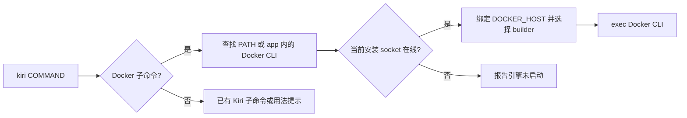

# FabriBay 功能对齐基线

记录于 2026-11-11。FabriBay 是独立项目，源码里只有 Go。上游 [libracoder/kiri](https://github.com/libracoder/kiri) 是功能对齐的参考，本仓库的起点是上游提交 `4418009e3f9f8cd234e37531348dd900f78e84e1`。

目标是保留 Kiri 的 Docker API、现有客户端工作流和数据迁移能力，容器引擎与 guest agent 用 Go 实现，MyGo 承担主窗口和托盘。Docker CLI 的交互与流式能力属于引擎兼容范围。上游由 Rust 提供的其余功能按下面的「待对齐功能」逐步补回。架构和构建方式见[开发说明](development.md)和[桌面与引擎说明](desktop-overview.md)。

## 移除 Rust 之后

2026-11-11 删除了全部 Rust 代码（`crates/`、`xtask/`、Cargo 配置）以及只为它服务的 WebView 页面测试。原来由 Rust 承担的启动和构建改由 Go 完成，并在本机验证过：

| 范围 | 现在的实现 | 验证 |
| --- | --- | --- |
| 启动引擎、打开桌面 | `engine/cmd/kiri`：`kiri daemon`、`kiri` / `kiri ui`、`kiri migrate-rust` | Apple Silicon macOS，`Kiri Dev.app`：引擎启动后 `/version` 返回 `"KiriEngine":"go"`，`docker run --rm alpine` 输出正常，Finder 挂载出现；`kiri ui` 在引擎未运行时把它拉起并打开窗口，关窗后引擎继续运行，SIGTERM 后正常退出并卸载。这次用的是已安装 Kiri 0.1.18 的内核，不是本仓库构建的 |
| 打包 initramfs | `engine/cmd/kiri-mkinitramfs` | 与删除前 `cargo xtask guest-go` 的输出逐字节一致 |
| 构建 app | `Makefile`、`scripts/macos-app.sh`、`scripts/macos-dmg.sh` | `make app-dev` 产出可运行的 `Kiri Dev.app`（ad hoc 签名）。`make dmg`、Developer ID 签名和公证没有跑过 |
| Linux 启动 | `engine/cmd/kiri`（`make linux`） | `tests/linux-host.sh`：引擎在特权容器里启动成功，**8 通过、18 失败**。失败有两个原因，都出在用例环境没按 Go 引擎调整：外层容器在 `172.17.0.0/16` 上，与内层默认网桥冲突；启动时没有委派 cgroup，资源限制和特权容器被拒绝 |

### 首次设置（2026-11-11 对齐）

`kiri setup`、`kiri setup --uninstall`、`kiri build-with` 和从 Finder 打开 app 时的首次设置已用 Go 实现（`engine/cmd/kiri/*_darwin.go`），对照上游 `setup.rs`、`builds.rs`、`buildwith.rs`。

| 做什么 | 验证 |
| --- | --- |
| 写 Docker context | `Kiri Dev.app` 实机：`docker context ls` 认出 `kiri-dev`，`docker --context kiri-dev version` 连通 |
| `~/.kiri/bin` 里的 `kiri`、`docker` 链接；正式安装还写 shell profile、`/usr/local/bin/kiri`、默认 context、`cliPluginsExtraDirs` | Dev 版实机验证了链接。正式安装独有的几项只在沙盒 HOME 的单元测试里验证，没有在真实环境跑 |
| LaunchAgent（登录自启） | 实机：`launchctl` 显示 running；引擎正常退出后不重启；再次打开 app 时由 launchd 拉起 |
| Buildx builder 和以 context 命名的副本 | 实机：`docker --context kiri-dev build` 构建成功，镜像直接可 `docker run` |
| 从 Finder 打开时自动设置 | 实机 `open "Kiri Dev.app"`：以上各项都就位，真实的 `~/.docker/config.json` 没有被改动 |
| `--uninstall` | 实机：LaunchAgent、context、builder、链接都移除，引擎停止，已安装的 Kiri 不受影响 |

与上游的三处差异：

- 带 flavor 的 app 不会在没人选择时接管全机的 `docker build`（上游会）。
- 卸载只移除自己加进 `cliPluginsExtraDirs` 的那一项。上游按 `Kiri.app/...` 子串匹配，会连同另一份 Kiri 的条目一起删掉。
- 设置前先确认引擎能启动。有未导入的 Kiri（Rust）数据时直接报错，不改任何东西。

`make kernel` 和 `make disk` 的命令与原 `xtask` 相同，但这次没能跑完：本机 Kiri 虚拟机的时钟比宿主慢约 3 小时，容器里 `apt-get` 校验签名失败。

### Docker 命令透传（2026-11-13 对齐）

`engine/cmd/kiri/docker.go` 对照上游 `docker.rs`：支持 `kiri run`、`ps`、`exec`、`compose`、`buildx` 等 Docker 子命令。优先使用 PATH 上的 Docker CLI，回退到当前 app 内的 CLI；以当前安装的 socket（含 `KIRI_SOCKET` 覆盖）设置 `DOCKER_HOST`，清除 `DOCKER_CONTEXT`。仅当用户未设置 `BUILDX_BUILDER` 且当前安装的 builder 已登记时，选择该 builder。

命令执行前检查引擎是否在线，不自动启动引擎；通过 `exec` 保留标准输入输出、终端和退出码。`import` 仍为迁移命令保留；macOS 的 `update` 为应用更新保留，容器资源更新使用 `kiri container update`。

验证覆盖命令边界、CLI 查找、三种 Buildx 配置路径、显式 builder，以及独立 Unix socket 上的子进程参数、标准输入输出、退出码、SIGTERM 和引擎离线失败。`make check` 通过，实际编译的启动器通过模拟 Docker CLI 和独立 socket 验证命令分发、端点隔离及退出码；Linux 侧仅交叉编译通过。实际 Docker/VM 和交互终端尚未在本轮验证。上游执行前的 CLI/引擎版本差异提醒及 Kiri Lite 下载 CLI 回退尚未对齐，分别随版本管理和 Lite 补齐。



### 待对齐功能

上游这些功能由 Rust 实现，本仓库现在没有。对照实现在上游的 `crates/` 下。

| 模块 | 缺什么 | 上游位置 |
| --- | --- | --- |
| 需要管理员密码的设置 | `kiri setup --docker-socket`（把 `/var/run/docker.sock` 链到本引擎，并装开机恢复它的 LaunchDaemon），卸载时也不会清理它。`*.kiri.local` 和 HTTPS 证书信任已对齐（`kiri domains`、`kiri setup --domains`、设置 → 域名），但开启本地域名时不像上游那样用同一次密码顺带链接 `/var/run/docker.sock`；密码框由 `osascript` 和 `security` 弹出，标题不是 Kiri | `crates/kiri/src/setup.rs` 的 `docker_socket` |
| `kiri` 命令行 | `k8s`、`machine`、`import`（从 OrbStack / Docker Desktop 迁入）、`usb`、`bench`、`raw`。引擎一侧的 Kubernetes 转发、USB、域名接口已在 Go 里，缺的是命令行入口 | `crates/kiri/src/main.rs` 及同目录各文件 |
| 桌面高级功能 | 原 WebView 窗口的全部界面：引导、文件浏览、镜像分层与扫描、容器设置、代理与域名设置、Kubernetes、仓库登录、内嵌终端、14 种语言。对应的 `/kiri/*` 接口仍由引擎提供 | `crates/kiri/src/ui/` |
| 自动更新与诊断 | 更新源检查与安装、崩溃报告和日志脱敏 | `crates/kiri/src/update.rs`、`diag/` |
| Windows | `kiri-win` 宿主（named pipe、托盘、设置、更新）、WSL 里的 `kiri bridge`、MSI。`installer/windows`、`contrib/windows`、`contrib/wsl`、`scripts/kiri-linux.sh` 仍按 Rust 二进制编写 | `crates/kiri-win/`、`crates/kiri/src/bridge.rs` |
| Linux 包 | `packaging/linux`、`scripts/ci/linux-build.sh`、`scripts/ci/linux-packages.sh`、`contrib/linux` 仍要求 Rust 的 `kiri`、`kiri-init` 和 GTK 窗口；`kiri host-access` 没有 Go 版本 | `packaging/linux`、`crates/kiri/src/hostaccess.rs` |
| 发版 | 更新源 JSON、发版 tarball、Kiri Lite；`NOTICE` 要按 Go 依赖重新生成 | 上游 `xtask/src/main.rs` 的 `release` |
| 测试 | `tests/e2e.sh` 里调用 `kiri` 命令的用例（machine、Kubernetes）、`tests/finder-mount.sh`、`tests/wsl.sh`、`tests/linux-host.sh` 的环境。协议交叉校验（Rust 编解码器对 Go）已随 Rust 删除，现在只有 Go 对 Go | `tests/` |
| CI | 没有跑 Go 测试的工作流，只剩 CodeQL | `.github/workflows` |

下面各节是删除 Rust 之前的引擎回归记录。引擎代码此后只改过两处注释。

## 验证快照

| 范围 | 环境 | 结果 |
| --- | --- | --- |
| 上游默认端到端用例 `tests/e2e.sh` | Apple Silicon macOS，隔离的 `kiri-parity` 实例，存储修复前 | **496 通过、17 失败、6 跳过** |
| 原版网络用例选集 | Apple Silicon macOS | **105 通过、1 失败**。剩余用例是 `default-bridge-no-names`，同环境的 Rust 原版也失败 |
| 原版 Finder 用例 | Apple Silicon macOS | **14 通过、0 失败**。额外验证 1,800 项目录分页及退出后的卸载 |
| 原版存储和绑定挂载用例 | Apple Silicon macOS，存储修复后 | **28 通过、0 失败**。额外验证 Go 重启和 Rust 离线迁移后的匿名卷清理 |
| 存储、运行时和迁移专项 | Debian ARM64 | 验证嵌套卷初始化、匿名卷清理、tmpfs 和 bind 退出码。另有容器网络、日志、exec、服务生命周期和 Rust 数据迁移记录 |
| Kubernetes 专项 | Apple Silicon macOS，Linux ARM64 | macOS 验证 k3s 启停与恢复、应用部署、TCP/UDP LoadBalancer、Pod 与 ClusterIP 转发。Linux ARM64 验证基础能力与转发 |
| USB 专项 | Apple Silicon macOS，软件 USB 设备 | **42 通过、0 失败**。覆盖软件串口和 HID |
| Windows WSL | Linux 上的 WSL 启动脚本验证环境 | Alpine 和 systemd 启停验证通过。真实 Windows 上的安装、更新、named pipe 和代理仍需整机回归 |

各专项覆盖全量用例的一部分，计数有重叠。存储修复之后尚未重跑全量套件，保留原全量结果作为历史基线。

## 已实现范围

| 模块 | 对齐内容 |
| --- | --- |
| 容器与资源 | 生命周期、日志和 attach、exec、健康检查、重启策略、事件、统计、资源更新、暂停与恢复。具备 capabilities、seccomp、只读根、特权模式和设备映射 |
| 网络 | IPv4/IPv6 桥接和 IPAM、静态 IP/MAC、端口发布、动态网络连接、共享和 host 网络、别名 DNS、`--domainname`、`--link`、Mac 宿主服务访问。端口发布支持 TCP/UDP |
| 存储 | 命名和匿名卷、嵌套 bind 下的镜像内容初始化、tmpfs、双向 `docker cp`、`diff`、`export`、`commit`。旧 Go 记录缺少匿名卷归属时保留卷数据 |
| 镜像与构建 | 拉取、标签、归档导入导出、历史、清理、仓库登录和推送、Compose、BuildKit/Buildx、Apple Silicon 上的 Rosetta |
| macOS 与桌面 | Go VM 启停、空闲休眠、资源设置，Finder 只读浏览，MyGo 主窗口（深浅主题、中英文、可折叠侧栏；概览、容器、镜像、卷、网络、构建器、设置；详情坞含日志、逐条执行的终端、文件浏览、镜像分层与安全扫描）、托盘 |
| 安装与数据 | macOS 和 Linux 已验证 Rust 离线导入。Windows WSL 的引擎一侧已实现，平台验证范围见上表 |

## 最近一次全量回归的失败项

| 状态 | 用例 | 记录 |
| --- | --- | --- |
| 修复后专项通过 | `bind-mount-missing`、`vol-copyup-under-bind`、`tmpfs-mount`、`rm-v-anon` | 缺失 bind 源返回退出码 125，空卷从镜像填充，tmpfs 显示与原版一致，匿名卷按归属清理 |
| 同环境 Rust 也失败 | `default-bridge-no-names` | 上游 DNS 对短名称返回了地址 |
| 待修复 | `killed-code` | `docker kill` 后测试得到 0，原版用例期望 137 |
| 待修复或复验 | `domain-ports-same`、`domain-ports-taken`、`domain-ports-unchanged`、`domain-ports-yield` | 涉及冲突提示、设置回滚和端口让渡 |
| 待修复 | `filter-images-ref`、`filter-volume-label-only` | 镜像引用筛选和卷标签筛选 |
| 待复验 | `disconnect-dns-gone` | 断开网络后，客户端报错与用例期望不同。待使用受控上游 DNS 对照 Rust |
| 待实现 | `search`、`search-official` | Go API 的 `/images/search` 返回 404 |
| 待复验 | `machine-mac-files`、`machine-cwd` | 全量测试使用 `/private/tmp` 下的临时 HOME，虚拟机中的文件和工作目录检查失败。待使用可共享的用户目录复测 |

另有 6 项在隔离实例中跳过，分别是 `domain-http`、`domain-unknown`、`domain-port-yield`、`domain-port-back`、`domain-ports-old-free` 和 `compose-domain`。这些用例涉及标准实例的域名与默认监听端口。

## 复验方式

从仓库根运行快速检查。

```sh
go -C engine test -race ./...
go -C engine vet ./...
go -C desktop test ./...
GOOS=linux GOARCH=arm64 go -C engine test -exec true ./...
```

`make check` 跑的就是这一组。最后一条仅交叉编译 Linux 测试，Linux 行为需要在真实 Linux 环境执行。构建需要 Go 1.27.3 或更新版本。

macOS 全量回归使用与日常实例隔离的 App、HOME、Docker 配置、Docker context、socket 和 VM 数据盘。历史记录使用 App 标识 `dev.kiri.app.parity`、Docker context `kiri-parity`、Buildx builder `kiri-parity-build` 和 `~/Kiri Parity`。先在被测 socket 的 `/version` 中确认 `"KiriEngine":"go"`。将 `DOCKER_CONFIG` 指向隔离 HOME 下的 `.docker`，确保 Registry 用例也能找到隔离的 context。运行域名端口用例时清除 `KIRI_HTTP_PORT` 和 `KIRI_HTTPS_PORT` 覆盖。

```sh
DOCKER_CONTEXT=kiri-parity bash tests/e2e.sh
```

发布前还需在对应平台运行 `tests/linux-host.sh`、`tests/wsl.sh` 和 `tests/kernel-features.sh`，并补齐迁移、Kubernetes、USB、默认域名及实际桌面交互的验证。验收记录按平台列出测试命令、结果、跳过原因和仍存在的差异。当前全量基线尚未达到可直接替换的验收条件。
