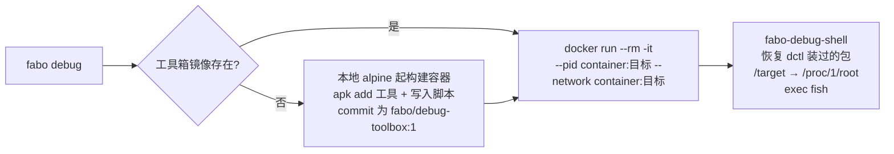

# 调试 shell

`fabo debug CONTAINER` 在任何运行中的容器旁边打开一个带调试工具的 shell，没有 shell 的容器（distroless、scratch、只读根文件系统）也可以。桌面端在容器的"更多"菜单里选"调试终端"，会在窗口的终端页新开一个标签运行同一条命令。功能对照 OrbStack 的 Debug Shell；Kiri 没有对应功能。

```sh
fabo debug shop-web-1
```

会话里可以：

- 用 fish shell，有自动补全、语法高亮和带颜色的输出。
- 直接用 `htop`、`ps`、`strace`、`lsof`、`curl`、`wget`、`ip`、`dig`、`tcpdump`、`jq`、`vim`、`nano`。
- `ps`、`htop` 看到的是目标容器的进程（目标的主进程是 1 号），`strace -p` 可以挂到这些进程上。
- 通过 `/target` 访问目标的根目录，会话开始时就在目标的工作目录下。目标是只读容器时，`/target` 也是只读的。
- `curl localhost:PORT` 访问目标监听的端口，网络和目标完全相同。
- `dctl install COMMAND` 按命令名找软件包并安装，`dctl remove`、`dctl list`、`dctl search` 管理已装的包。输入不存在的命令时，会提示可以安装的包。

## 实现



- **工具箱镜像**：第一次调试时，用本地已有的 alpine 镜像（没有才拉 `alpine:3.22`）装好工具，写入 `fabo-debug-shell`、`dctl` 和 fish 配置，commit 成 `fabo/debug-toolbox:1`。工具或脚本变化时改标签，下一次调试会自动重建。
- **会话**：每次调试运行一个 `--rm` 的工具箱容器，加上 `SYS_PTRACE`、`SYS_ADMIN`、`NET_ADMIN`、`NET_RAW` 能力。它和目标共享 PID 和网络命名空间，带 `dev.fabo.debug=<目标名>` 标签；shell 退出后容器自动删除。目标容器本身不会被修改，也不会得到额外权限。
- **软件包**：`dctl` 用 apk 把包装进工具箱，包名记在 `fabo-debug` 卷的 `packages` 文件里，下载的包缓存在同一个卷里。之后每次会话开始时重新安装这些包，所以对所有容器都可用。目标没有网络（`--network none`）时，只能装已经缓存过的包。
- **PID 命名空间共享**：引擎支持 `HostConfig.PidMode: "container:<名字或ID>"`。创建时把目标解析成完整 ID，作为 `fabo.pidns=<ID>` 运行选项存进容器记录；启动时目标必须在运行。guest 打开目标进程的 `ns/pid`，不再新建 PID 命名空间，而是在锁定的线程上 `setns` 后启动容器进程，和 exec 进入容器的做法一样。容器挂载的 `/proc` 因此列出目标的进程，`/proc/1/root` 就是目标的根目录。目标停止时，命名空间里的进程（包括工具箱）一起结束。`PidMode` 只接受 `container:`，不支持 `host`：VM 自己的进程属于 Fabo，不属于用户。

## 限制

- 只能调试运行中的容器；停止或暂停的容器会提示先启动。
- 第一次调试需要网络，用来安装工具。
- 包管理器是 alpine 的 apk，不是 OrbStack 用的 Nix，包的数量少一些。
- 引擎和 guest 都要更新到支持 `PidMode` 的版本；旧 guest 会以 `unsupported Go guest run options` 拒绝。

## 验证

```sh
go -C engine test ./cmd/fabo ./internal/localengine
go -C desktop test ./...
```

自动测试覆盖：`PidMode` 的解析、规范化和持久化，`host` 等模式被拒绝，目标未运行时拒绝启动；`docker run` 参数；工具箱脚本的打包；桌面端菜单打开调试终端，以及 machine 页的列表、启动、终端、新建和删除。

实机在独立的测试引擎上验证过：

- 对没有 shell 的只读 `registry.k8s.io/pause:3.10` 容器：`/target` 是它的根目录，写入时报只读；网络和目标相同；工具都可用；`dctl install tree` 后，下一次会话里还在。
- 对 postgres 容器：`ps -e` 列出 postgres 进程，`strace -p 1` 能挂上主进程。
- 对迁移来的 aihot-web-1：能看到它的进程和 `/target/app`，`curl localhost:3000` 返回 200。
- 会话结束后，没有留下工具箱容器。
