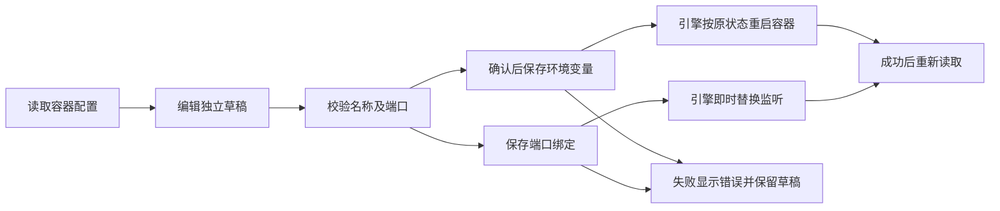
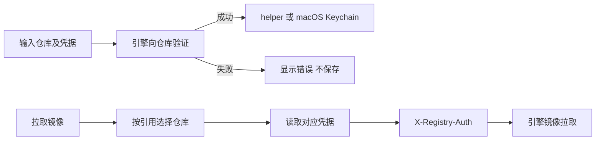
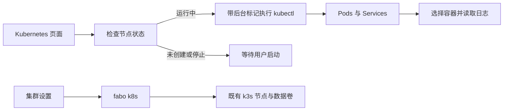

# 桌面高级操作

MyGo 主窗口接管原 Fabo WebView 的容器设置、仓库登录和 Kubernetes 管理。保持当前引擎、Docker CLI 和 `fabo k8s` 的行为；窗口通过既有接口工作，不另建容器或集群状态。

参考源码为本地 Fabo checkout `a649319`：`ui/mod.rs` 的 `set_env` / `set_ports`、`ui/logins.rs`、`ui/k8s.rs`、`ui/k8s_items.rs` 及 `ui/index.html`。后续连续终端和日志订阅见 [连续终端与日志](desktop-streams.md)。代理、域名、文件浏览和镜像扫描的现有实现见 [桌面与引擎说明](desktop-overview.md)。

## 容器设置

在容器详情坞选择「设置」，可分别编辑环境变量与发布端口。

- 草稿读取 `/containers/{id}/json`。环境变量在第一个 `=` 处分隔，值中的 `=` 保留；空列表表示移除所有变量。变量名称、NUL 与端口范围在发送前校验。
- 环境变量保存通过 `POST /fabo/containers/{id}/env`。保存前说明正在运行的容器会重启，并要求确认；容器 ID、文件和挂载由原引擎保留。运行中的 auto-remove 容器等不支持的状态由引擎拒绝。
- 发布端口通过 `POST /fabo/containers/{id}/ports`，可编辑 IPv4 / IPv6 绑定地址、主机与容器端口、TCP / UDP。主机端口 `0` 自动分配，空地址监听所有接口；空列表移除所有绑定。
- 端口草稿来自 `HostConfig.PortBindings`，保留配置中的 `0` 和停止容器的映射；实际地址显示仍来自运行时的 `NetworkSettings.Ports`。端口修改即时生效，不重建容器。
- 两组保存独立，避免环境变量保存成功而端口失败被表述为整体成功。保存失败保留草稿并显示引擎错误；「已保存但重启失败」意味着下次启动会用新环境，应按提示处理后重新读取。
- 定时刷新不覆盖草稿；切换容器时重新加载，丢弃属于旧加载请求的回答。读取失败时不提供保存按钮，防止把未读到的配置保存为空。



## 镜像仓库

「设置 → 镜像仓库」列出账户、登录、退出登录；镜像拉取使用目标仓库的登录信息。

- 配置目录为 `DOCKER_CONFIG`，未设置时是 `~/.docker`。读取兼容带 BOM 的 `config.json`，保留未知字段、数值和其他仓库；修改通过临时文件替换，跟随用户的配置文件软链接。
- Docker Hub 的常见域名统一为 `https://index.docker.io/v1/`；其他仓库以主机及可选端口为键。镜像首段含 `.`、`:` 或为 `localhost` 时视为仓库，其余引用属于 Docker Hub。
- 登录先调用引擎 `POST /auth`，通过后才保存。若返回 `IdentityToken`，保存 token 以代替密码。密码输入框隐藏内容，提交后清空，不写入桌面偏好或提示信息。
- `credHelpers[registry]` 优先于 `credsStore`；helper 经 `docker-credential-NAME` 的 `list/get/store/erase` 协议工作，密码经 stdin 传递。配置指定但不存在或失败的 helper 会报错，不静默把密码存到另一个位置。
- macOS 未配置 helper 时，使用 Security.framework 的 internet password，标签为 `Docker Credentials`，与 Docker 的 osxkeychain helper 和 Fabo 兼容。列举只请求属性，不取密码。没有 helper 的 Linux 和 Windows 暂不提供系统存储回退，登录会明确要求配置 helper。
- 查找登录信息依次读取配置指定的 helper（或 macOS Keychain），再兼容 Docker 配置中已有的 `auth`、`identitytoken` 或用户名密码。无法读取存储时报告错误；没有凭据则允许匿名拉取。
- 拉取发送 `X-Registry-Auth`，支持普通 tag 与 `@sha256:` 引用；流式读取进度直至结束，响应内的错误也会显示。没有真实私人仓库账号的测试不代表所有云仓库的 token、设备登录或自动续期均已验证。
- 退出登录须确认，先删除选定存储中的凭据，再移除该仓库的 `auths`。外部凭据存储与 Docker 配置不是同一事务；保存凭据成功而配置更新失败会明确报告部分完成，可刷新列表或重试。



## Kubernetes

侧栏 Kubernetes 提供 Pods / Services，Pod 信息和日志、删除 Pod、集群启停。「设置 → Kubernetes」提供 API 地址复制、局域网访问、TLS SAN、API 端口和集群删除。

- 窗口不依赖宿主 `kubectl`，通过引擎 exec 在 `fabo-k8s` 中运行 kubectl，节点与数据卷完全沿用 `fabo k8s`。
- 浏览先 inspect 节点，仅当节点运行时读取 `kubectl get pods,services -A -o json`。这些 POST exec 请求、流和 inspect 都带 `X-Fabo-Background: 1`，不会因刷新阻止 VM 空闲休眠。停止或不存在的节点不执行 kubectl。
- 一次只允许一个列表查询。节点未就绪或查询失败显示原因，至少 10 秒后重试；手动刷新可立即重试。列表查询的 guest 命令限制为 20 秒，API 请求另有超时；持续日志使用独立会话，不受该命令时限影响。
- Pod 状态按上游优先级显示删除、init 阶段和容器等待/退出原因，另显示就绪数量和重启次数。Service 显示类型、Cluster IP、端口和 LoadBalancer ingress。
- Pod 日志可切换容器和上一次运行，初始读取最近 2,000 行，并持续追加当前运行的输出；上一次运行有限读取，刷新可重新订阅。关闭详情时回收对应 kubectl，见 [连续终端与日志](desktop-streams.md)。仅名称合法的 namespace、Pod 和容器参数会进入 kubectl。
- 删除 Pod 须确认，并提示控制器可能重建；使用 `--wait=false`，随后由列表更新反映状态。集群删除另行确认，明确删除全部集群数据。
- 集群启停和网络保存调用同安装的 launcher：`fabo k8s start/stop/set/delete`。一次只运行一个操作，期间显示进行中；命令失败显示原因。未找到 launcher 时可浏览，但禁用集群管理并说明从应用打开。
- 网络草稿读取同安装根目录的 `k8s.json`，默认 API 端口为 6443；实际 API 地址使用节点真正绑定的端口。`set` 由 CLI 校验 SAN、保存并重建节点，沿用原数据卷。
- 命令输出的流结束后还检查 exec 的退出码；非零退出，或命令仍在运行时流已结束，不能当作成功。该规则用于有限命令和文件目录读取；交互终端另在会话退出时读取实际退出码。



## 验证入口

```sh
make check
go -C desktop test -race ./...
FABO_SHOTS=/absolute/output/directory go -C desktop test -run 'Test(AdvancedScreenshots|Screenshots)$' -count=1
# 在 macOS 上创建、读取、更新和删除一个专用 .invalid 测试记录：
FABO_KEYCHAIN_TEST=1 go -C desktop test -run TestNativeRegistryCredentialsRoundTrip -count=1 -v
```

原生窗口可在开发构建中开启 MyGo 自动化；正式构建不导入该插件：

```sh
go -C desktop build -tags e2e -o /absolute/output/fabo-desktop .
FABO_SOCKET=/isolated/home/.fabo/run/docker.sock \
DOCKER_CONFIG=/isolated/docker \
FABO_LAUNCHER=/absolute/path/to/fabo \
MYGO_AUTOMATION=/private/tmp/fabo-desktop-check.sock \
/absolute/output/fabo-desktop
```

MyGo 的窗口级协议通过该私有 Unix socket 读取元素、操作控件和捕获窗口；使用明确的 window ID，不需要向当前工作应用发送全局输入。真实 VM 验证必须隔离 HOME、Docker 配置、socket、kubeconfig 和数据盘，不覆盖日常实例的 app 或存储。
