# Native desktop

The primary window uses MyGo. It shows the engine's state and its
containers, images, volumes and networks, controls container and VM
lifecycle, and edits the VM's resources. The tray reopens the main window.
CLI behavior is independent of the window.

Upstream Kiri's WebView window, which this document calls **Advanced tools**,
was hosted by the Rust binary and left the tree with it. The daemon still
serves the `/fabo/*` endpoints that window used. The sections below describe
them as the contract for the workflows the MyGo window has yet to take over:
onboarding and Kubernetes forwards. Continuous terminals, live logs, container
settings, registry logins and Kubernetes browsing are now provided by MyGo;
see [Advanced desktop operations](desktop-advanced.md).

The window is a light grey shell holding the title strip and the sidebar, with the page on a white rounded card beside them.

- **Appearance.** Dark and light palettes share one layout. The window
  follows the system or the choice in Settings, which also picks the
  language (the system's, one of 15 supported languages), one of five accents (indigo `#3B5BDB` by default), the
  interface and monospace fonts, the text size of the whole window, the log
  text size and the row density. These preferences live in `desktop.json` in
  the installation's state directory, so each flavor keeps its own.
- **Sidebar.** Open, it names each page with its count and carries the
  engine card, as Kiri's: "Linux VM" with its state (Running, Asleep, Off,
  Starting…, Stopping…), and while it is up the running containers, the
  CPUs (with the current load when awake) and memory in use against the
  VM's ceiling, then a full-width Stop VM or Start VM button. The engine's
  version is the card's first line whenever the engine answers, stopped VM
  included, and also the card head's tooltip. When the engine runs another
  version than the window, as after replacing the app while the old engine
  kept running, a strip under the lists says so and offers Restart engine
  (`fabo engine restart`: running containers stop, those with a restart
  policy start again). Later hides it until the window opens again; the
  card's version stays in the warning colour, its tooltip naming the
  installed version. A development window (0.0.0-dev) compares nothing. An engine running directly on Linux is named
  "Engine" and has no button. Folded (Command/Ctrl+B, or the button beside
  the window buttons) it shows icons only, and "Linux VM · state" moves to
  the title strip. A window narrower than 1040 points folds it on its own; unfolding
  it there lasts until the window widens, without changing the saved choice. Kubernetes is a group of its own: its heading shows the cluster's
  state and opens its settings, and Pods and Services open their lists.
  USB devices lists the machine's USB devices: on Windows through
  fabo-win and usbipd-win (see docs/windows.md), on a Mac and on Linux
  through the launcher (see USB passthrough on macOS). Without either it
  is not built and stays out of the sidebar. Share lists
  public share links (see [Public share links](#public-share-links)).
- **Title strip.** On the right sit the search field of the page's table
  (Command/Ctrl+K focuses it), then Terminal and Settings.
- **Lists.** Every page is a table with a detail panel, under the page's
  title on its card. The search field filters the page's table. Filters sit in a segmented row above the table. Up and
  Down move the selection and Escape closes the dock. Only visible rows are
  built. Removal always asks first.
- **Dock.** Selecting a row opens its detail panel to the right of the
  table, at most half of the page. A table that is narrow, beside the panel
  or in a small window, leaves out its secondary columns, and a very narrow
  one its state columns as well. The left edge drags to
  resize it, and it can take the whole page.
- **Containers.** Each row leads with a tile showing the image's brand logo
  (Kiri's Simple Icons table, generated into `desktop/brands.go` by
  `scripts/desktop-brands.py`), the name and the image. Compose members hang
  under their project's heading by a tree line; the heading folds, starts,
  restarts or stops all of them, and opens the project's panel: state,
  services, Compose version, directory, config and environment files,
  networks, volumes and ports; a Config tab that edits the Compose file in
  place (Save, or Save and apply, which runs Compose's `up -d` with
  `DOCKER_HOST` set to the window's engine, through the Compose plugin
  itself when it is found, so no docker context is needed); and the members. A row's tile is its
  checkbox: the box takes the tile's place while the pointer is on the row,
  and on every row once anything is picked (a row's menu has Select, for
  picking without the pointer); a project's box picks its members. While
  any are picked the filters give way to select all shown, start, stop and
  delete for all of them. The page opens on the Running
  filter. Rows show state (a running container's uptime as `Up 3 min`,
  `运行 3 分钟` in Chinese), the first published port, CPU, memory and age.
  Start, stop and restart, of one container, a project or the picked
  ones, turn the status to Starting…, Stopping… or Restarting… until the
  engine answers, then show one notice: the container's name, or a count
  for several, with each failure reported on its own. A running container with
  published ports shows its local address where the image would be, as
  Kiri does: the first name of `dev.fabo.domain`, else its Compose
  `service.project`, else its name, under `fabo.local` once the machine's
  names are on and `fabo.localhost` otherwise (which macOS resolves with no
  setup), over https once the certificate is trusted, with the router's
  port when it is not the scheme's default. The ⋯ menu (of containers and
  machines) closes, besides Escape, Tab and a press elsewhere, once the
  pointer has been off both the button and the menu for 0.3 s; a menu the
  keyboard opened stays until the pointer has been on it. It opens the address first, and
  the detail panel shows it beside the state and in Info. The dock has Info (from
  inspect), Logs (a live subscription starting with the last 5,000 lines,
  numbered on a dark ground, warnings, errors and debug lines in their own
  colors; under the tabs a bar finds text, keeps one level, follows the end
  and clears what was read), Terminal, Files and Settings. Files lists a
  folder through the container (folders first, with size, age and link
  marks), opens folders by their rows or the path's parts, previews text
  files up to 256 KB and saves any file to Downloads through the archive
  endpoint. The Settings tab edits the container's domain names (its
  `dev.fabo.domain` label, at once), the environment
  (with a confirmed restart) and live TCP/UDP port bindings while retaining
  the existing container and its data. In Info a web address, such as the
  local address, is a link that opens it.
  - Terminal opens a persistent `/bin/sh` TTY with native terminal emulation,
    continuous input and resize. Navigation preserves the shell; Close terminal
    ends only its exec. See [Continuous terminals and logs](desktop-streams.md).
  - Files lists one directory at a time by running `ls -1Ap` in the
    container, so it needs the container running and an `ls` in the image.
- **Images.** The dock shows layers (`/fabo/images/layers`), the stored
  scan with a button to scan again (`/fabo/images/scan`), and the image's
  config. An image in use cannot be removed. A pull shows only that it is
  running, because the engine reports no per-layer progress.
- **Volumes and networks.** Both list the containers using them, which open
  the container. A volume in use, a network in use and the three built-in
  networks cannot be removed.
- **Kubernetes.** Pods and Services are read through kubectl in the existing
  k3s node. The dock shows details and live Pod logs, starting with 2,000
  lines, with a container and previous-run choice. Pod deletion asks for confirmation.
  Browsing never starts the cluster, and passive execs use background headers.
- **Builds.** The engine keeps no record of past builds. The page shows the
  BuildKit builder from `/fabo/builder`, sets its cache limit, and clears
  the build cache.
- **Overview.** Counts, the engine's CPU history and memory, disk use, the
  five busiest containers, and the last hour's events.
- **Settings.** Six sections laid out as Fabo's are, each row a title, an
  explanation and its control. Appearance is described above. Resources
  starts or turns off the engine and saves the VM's CPUs and memory through
  `/fabo/resources`; when a running VM still has its old size it offers a
  restart, which is `/fabo/sleep` followed by `/fabo/wake`. Network picks the VM's network
  mode (saved with the VM's size through `/fabo/resources`, offering the
  same restart) and edits the proxy through `/fabo/proxy`. Engines that
  report no mode get no choice. Builds shows the builder, its cache limit
  and clears the build cache. Domains changes the HTTP and HTTPS ports
  through `/fabo/domains`, and switches Local names and HTTPS through the
  launcher's `fabo domains` command (see Container domains). Registries
  shares Docker credential helpers or macOS Keychain records
  for sign-in, sign-out and authenticated pulls. Kubernetes controls the
  cluster and its network settings through `fabo k8s`. Import brings
  images, volumes and containers over from OrbStack or Docker Desktop (see
  Importing from another engine). About lists the versions. On Windows,
  Builds also chooses whether plain `docker build` builds with Docker or
  with Fabo (fabo-win's `/buildwith`, `engine/internal/buildwith`), and the
  window asks once when another engine is on the PC; Resources sizes WSL
  through `.wslconfig`, and Diagnostics opens the logs folder and saves a
  redacted report, all through fabo-win (see docs/windows.md). The Mac has
  `fabo build-with` but no control in the window yet, and no Diagnostics.

### Importing from another engine

Once the engine answers, the window asks the launcher which context plain
docker uses (`fabo context`, macOS only) and which source engines are
installed (`fabo import --sources`), and reads the inventory of the chosen
source: the one docker uses when it runs, else a running one. Each item
then imports through `fabo import <source> <kind> <name>`, one at a time,
images first; a failed item shows its error and is unticked like the rest.
The source is only read, and containers arrive stopped.

- **Settings → Import** picks the source, lists images, volumes and
  containers with a Select all / Select none per kind (anonymous volumes are
  never ticked by it), marks what Fabo already has, and imports the ticked
  items. The footer says what importing leaves alone, then the last import's
  outcome, which is also a toast.
- **The strip under the lists** (every page but Settings and Terminal) says
  what the source has that Fabo lacks. Review opens the review window; × hides
  the strip until the source has more than it had then (`import_seen` in
  `desktop.json`).
- **The review window** lists the kinds on the left, each with a tick for all
  of it and how many are ticked, and the chosen kind's items on the right.
  Opened with nothing ticked, it ticks the images Fabo lacks.
- **Switching docker.** While docker uses another context, Containers and
  Images show a strip offering to switch; × asks again in a week
  (`ctx_snooze`). The dialog shows both engines, what switching changes and
  keeps, and a "bring all my images" tick, unticked when they add up to more
  than 10 GB. Switch runs `fabo context use <ours>` and starts the image
  import; "Choose what to bring…" opens the review window, whose button then
  switches as it imports. A card in the corner follows the images over and
  offers Switch back (to the context saved as `ctx_back`, which also quiets
  the strip for a week) and Show images.

The window refreshes resource lists every two seconds while it is visible.
Container and Pod logs use cancellable streams rather than repeated tail reads. Those
reads are background reads and never keep an idle VM awake. Usage comes from
one `stats` sample per running container, taken only while the VM is awake.
Disk use comes from `/system/df`, which would boot a sleeping VM, so the
window reads it once per visit to the Overview and only while the VM is
already up. Volume sizes come from the same read and show a dash until then.

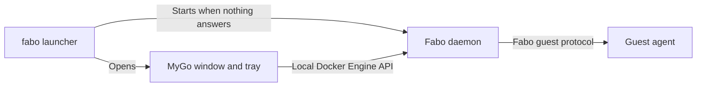

The desktop reads from the existing Unix socket on macOS and Linux, or named
pipe on Windows. Reads include `X-Fabo-Background: 1` so they do not extend the
idle timer. An explicit `FABO_SOCKET` can direct the MyGo window to a different
daemon.

## Build and run

On macOS, `make app` builds `target/Fabo.app` with Go 1.27.3 or newer: the
`fabo` launcher, the engine and its guest, the MyGo window, and the docker
CLI, Compose and buildx. It needs the guest first: `make guest`, `make kernel`
and `make disk`. Run `make kernel` again before assembling an app with a new
guest kernel configuration, including USB/IP support.

The launcher (`engine/cmd/fabo`) handles first-launch setup, starts the
engine when nothing answers on the socket and opens the MyGo window. Once
its LaunchAgent is installed, launchd is the engine's one owner and the
launcher asks it to start the engine rather than spawning a second one. It uses the `fabo` Docker context's
`~/.fabo/run/docker.sock` path. A Kiri store on the same machine is left
alone and does not stop Fabo from starting; to bring its data over, run
`fabo migrate` before Fabo's first start, since the import needs Fabo's state
directory to be absent. Stop any other daemon on the same socket first. On Linux, `fabo ui`
opens the MyGo executable when the package includes it.

To run beside an installed Fabo, build a flavored bundle with
`FABO_SIGN_IDENTITY=- make app-dev`. The result is `target/dev/Fabo Dev.app`,
and `FLAVOR=go` makes `Fabo Go.app` instead. The bundle identifier
`com.openfabrica.fabo.<flavor>` gives the bundle its own names: the daemon listens on
`~/.fabo-dev/run/docker.sock`, keeps its state and VM disk in
`~/.fabo-dev/go-engine`, mounts `~/Fabo Dev` in Finder, and leaves the default
domain ports to the installed app. Existing Fabo containers, images and
volumes stay on the original disk. Opening the bundle, or its `fabo setup`,
registers the `fabo-dev` Docker context, the `fabo-dev-build` Buildx builder
and a LaunchAgent; `fabo setup --uninstall` removes them.

### Intel Linux images on Apple Silicon

When the Mac provides Rosetta for Linux, the Go daemon adds its read-only
VirtioFS share alongside the host directories. The Go guest registers the
x86-64 ELF interpreter before accepting containers and reports registration
in the startup handshake. The engine can then execute native ARM64 and
translated AMD64 images in the same VM. `GET /info` reports the active
guest capability as `FaboRosetta`.

The registry resolver uses the platform supplied by Docker. An implicit
pull prefers ARM64 and falls back to AMD64 when the registry only offers
AMD64 and the guest can execute it. A local tag points to one config digest.
When the requested platform differs from the one under the tag, create
returns an image-not-found response so Docker can pull the requested
manifest. Image inspection, commit, archives and offline Rust import
retain the config's architecture. An AMD64 image can be stored for
transfer when translation is unavailable.

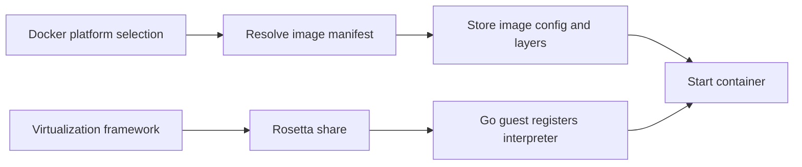

### Import an offline Kiri store on macOS

Stop Kiri's containers and shut down the Kiri daemon. Keep it off while
taking the snapshot or running the migration. Run the command from the Fabo
bundle before creating Fabo's engine state. The destination's parent must
exist, and the destination itself must be absent. The source and
destination must be on the same APFS volume.

```sh
mkdir -p -m 700 "$HOME/.fabo"
"/path/to/Fabo.app/Contents/MacOS/fabo" migrate \
  --snapshot "$HOME/Library/Application Support/Kiri" \
  --source-socket "$HOME/.kiri/run/docker.sock" \
  --source-config "$HOME/.kiri" \
  --state "$HOME/.fabo/go-engine"
```

The next start of the standard app uses the imported data on its `fabo` Docker
context; Kiri's data and context stay as they were. To test the import with a
flavored build, run the command from `Fabo Dev.app` and use
`$HOME/.fabo-dev/go-engine` as the destination.

Pass the actual source daemon socket and store path for a customized
installation. The command checks for a listening source daemon and
rejects running container records. It validates the source indexes and
image blob digests, clones the VM disk, and publishes the staged state
directory without overwriting an existing destination. The Go guest
replays any pending journal on its own clone.
An image-only store with no containers or volumes can be imported before
the original engine has created a VM disk. The Go bundle provisions its disk
on the next start.

The migration preserves container and image IDs, image references, scan history and SBOMs,
container writable layers, local volume contents and labels, supported
IPv4 and IPv6 bridge settings, and the recent logs that fit the Go log buffer.
Host bind mounts still refer to their original paths and must lie
inside the Go bundle's host directory shares. A bind whose host file is
gone, as a `/tmp` file is after a restart, keeps its container, as Docker
keeps one: starting it fails and says why. json-file's `max-size` and
`max-file` carry over and bound the container's kept output, below the
engine's 1 MiB per container, as they do for a new container. The migration
retains anonymous volume data and records the container that allocated it.

### Image layers and security scans

The Advanced tools WebView reads layers and scan history from the current
daemon on macOS, Linux and Windows WSL. Go serves
`/fabo/images/layers`, `/fabo/images/scan`, `/fabo/images/scans` and
`/fabo/images/sbom` while the VM is stopped. The daemon resolves the image
to its config digest, prepares an OCI layout from its local layers, and runs
the checksum-pinned Grype release. Scanner downloads and database updates
use the daemon's proxy settings. If an update fails, Grype can use a valid
cached database.

Each successful scan publishes its result and CycloneDX SBOM together.
History is keyed by image digest, survives daemon restart, and retains the
latest 20 scans per image. The report uses image history to identify the
layer that introduced a package. Offline Rust import retains existing
reports and SBOMs. Grype and its database are downloaded for the Go store
on its first new scan. The current database takes about 3 GiB unpacked.

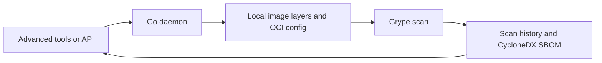

The command preserves local volume driver options. Bind devices keep their
original host paths, and the Go daemon mounts them when a container starts.
The command rejects unsupported volume plugins, mount types
and security profiles. Device mappings, device cgroup rules and the supported
security options below are preserved.

The optional `--source-config` imports saved VM CPU and memory limits,
proxy settings, and HTTP and HTTPS listener ports from the offline Rust
daemon directory. The migration validates those settings before publishing
the destination. A missing file leaves the corresponding Go default.
The JSON report lists the copied settings by name, without their values.
The parallel bundle still has its own HTTPS authority and does not modify
the system resolver or keychain. Docker credentials and UI preferences
stay in their original locations.

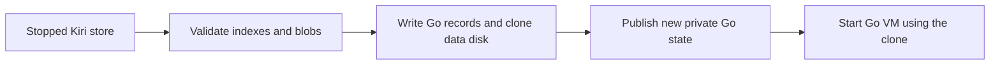

For development against an already running engine:

```sh
cd desktop
go run .
```

Set `FABO_SOCKET` or `FABO_PIPE` to use a development instance. On Windows
the window also talks to `fabo-win` on `\\.\pipe\fabo-win` for first-run
setup, engine start and stop, and updates; see [Fabo for Windows](windows.md).

### Engine selection in Windows WSL

The Windows host (`fabo-win`: the named pipe, setup, engine control and
updates) and the `fabo bridge` that carries its connections into the distro
are Go; [Fabo for Windows](windows.md) describes them. This section
describes the distro side. Both Windows architectures use static Linux Go
binaries for the daemon and guest agent, installed in `/usr/libexec/fabo`.

New distros use `auto` in `/etc/fabo/wsl-engine`. The launcher starts the
engine when both Go binaries are installed and cgroup v2 is available.
`go` means the same and survives updates. Any other value is an error,
since this tree has only the Go engine.
Restart with `/usr/local/bin/fabo-start restart` (or `stop`) on Fabo Linux or with
`systemctl restart fabo` on a distro using systemd. From Windows,
`docker --context fabo version` checks the connection. The raw
`/version` response identifies Go with `"FaboEngine":"go"`.

The Go engine writes to `/var/lib/fabo-daemon/.fabo/go-engine`. For an
offline import in WSL, pass `--source-socket` with
`/var/lib/fabo-daemon/.fabo/run/docker.sock` to the Linux migration command.

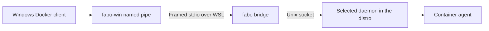

## Go engine migration

`engine/internal/guestwire` implements the version 0.5 framing and the
Hello/Ping/Pong and resource-statistics exchanges. The version is
major.minor, carried at Hello as one 16-bit field with the major in the high
byte, so the earlier plain 4 reads as 0.4. Host and guest must match
exactly; a mismatch is refused at Hello. The engine reports the protocol as
`FaboGuestProtocol` in `/version` and `/info`, as the `fabo-init` component
that `docker version` lists, and on the engine row of Settings → About. `fabo-guest-check` listens
on a private test agent directory and reports the hello and stats as JSON.
The daemon serves the Docker API and manages the Go guest. The guest
executes containers and reports their state over this protocol.

The engine migration retains Fabo's own guest agent design and container
mechanisms. The existing Docker, host, WSL and kernel suites in `tests/` are
the compatibility baseline.

The Go host-process launcher uses a private directory under `/run` for
the Linux agent's control and auxiliary sockets. It waits for a compatible
Hello before returning the process to its caller. If startup fails or is
canceled, it closes the control socket, reaps the agent and removes the
directory. The control protocol has a single owner.

In an isolated Linux test environment, `fabo-guest-check -agent /path/to/test-agent`
runs through that launcher, then requests a ping and a resource sample. Use
`-agent-dir` instead when the peer is started separately.

The Go host encodes the container Run request. One session reader dispatches
Started, stdout, stderr and Exited by container ID, alongside memory pressure
events. Startup requests share one reply slot because guest errors carry no
container ID. Canceling while queued prevents submission. Once submitted,
the request consumes its reply or returns the connection error.

Session tests cover interleaved events, a rejected start followed by a
successful one, and disconnect while awaiting a reply.

Layer lookup and upload share the same reply slot as container start. The
host sends a LayerBegin frame followed by exactly the advertised raw bytes,
then waits for LayerStored before writing another request. A short source
or a guest upload error ends the session because the stream can no longer
guarantee where the next frame starts.

On Linux, `fabo-host-run -agent /path/to/fabo-init -spec /path/to/run.json`
exercises the complete host path for a local image. The JSON has `Run`
(the protocol run spec, including top-to-base layer digests and argv) and
`Layers` (local blobs with `Digest`, `MediaType` and `Path`). It starts the
agent, uploads missing layers, streams stdout and stderr, and returns the
container's exit code. Use it only in an isolated Linux test environment
with its own agent state, cgroups and network namespace.

This path was checked on Linux ARM64 using the repository's protocol-v4
Rust agent and a local OCI tar layer containing a static test program.
The Go host received both output streams and returned the program's
nonzero exit code.

`fabo-daemon -agent /path/to/fabo-init -socket /private/dir/docker.sock
-images /path/to/catalog.json -state /private/state` serves the initial Docker API on Linux. The
catalog maps image references to objects with `Layers` in base-to-top OCI
order and optional `Entrypoint`, `Cmd`, `Env`, `WorkingDir` and `User`.
Layer entries have `Digest`, `MediaType` and `Path`. The daemon requires
an existing private socket directory. It accepts the default bridge and
network-none containers. It implements create, start, inspect, list, wait and snapshot
logs. Container creation and startup are recorded before acknowledging creation or
submitting the start. The private state directory is locked to one daemon.
Records are replaced atomically, and up to 1 MiB of recent logs is saved
with the terminal state. A record left starting or running after a crash
is restored as exited with a failure; the daemon does not replay it. Logs
that had not reached a terminal state can be lost on a crash.
For the Go-to-Go Linux path, pass the `fabo-init` executable as
`-agent`. The daemon uses the private `-state` directory for container
records, the image index and local volumes. It also passes
`<state>/guest` to the agent as its persistent root. OCI layers live in
`guest/layers` and writable container files in `guest/containers`. The
temporary `/run/fabo-agent-*` directory holds only the agent's communication
sockets and is removed on clean shutdown. Keep the state directory on a
filesystem suitable for OverlayFS and retain it when restarting the
daemon or rebooting the host. Explicit `FABO_LAYER_DIR` and
`FABO_CONTAINER_DIR` overrides keep their existing precedence.

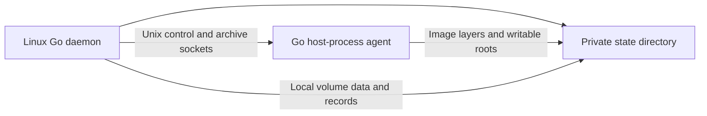

#### Linux socket access

Set `FABO_SOCKET_GROUP=fabo` for a Linux host daemon whose socket should
be usable by the system's `fabo` group. The socket directory must be owned
by the daemon account and cannot be writable by other users. A typical
system service uses a root-owned `/run/fabo` directory with mode 0755
and a `root:fabo` socket with mode 0660. The separate engine state
directory remains private. Without the group setting, the socket and its
directory retain their private modes.

The Go daemon uses the system's `/usr/bin/getent` to resolve current
accounts and membership. It adds named members to the POSIX ACL so their
existing sessions can connect, and checks the peer UID at admission.
It rechecks open connections every two seconds and closes those whose
account no longer belongs to the group. Filesystems without POSIX ACL
support rely on the Unix group mode, so a newly added member signs in
again. Membership gives the same engine control as the original Fabo
service's group.

#### Linux package service

Linux packages built with the Go daemon and agent include both under
`/usr/libexec/fabo`. The installed `fabo.service` uses the `fabo daemon`
entry point, which needs cgroup v2. On a fresh installation it starts the
engine. The Go daemon
uses the package's usual `/run/fabo/docker.sock` and group. It keeps its
state in `/var/lib/fabo-daemon/.fabo/go-engine`. The daemon and agent
run in the unit's `fabo-host` leaf, and containers use the sibling
`fabo` subtree for delegated CPU, memory, process and I/O controls.
On SIGTERM it gives running containers their configured stop signals
and a bounded shutdown window before closing the agent.

The Go engine never writes to the Kiri store, which keeps its own
directories, and an existing Kiri store does not stop it from starting.

#### Import an offline Linux Kiri store

Stop Kiri's workloads and service before migrating. For a default
package installation, run:

```sh
sudo systemctl stop kiri
sudo install -d -m 700 /var/lib/fabo-daemon/.fabo
sudo fabo migrate --source-config /var/lib/kiri-daemon/.kiri
```

The default metadata and image-blob source is
`/var/lib/kiri-daemon/.local/share/kiri`, Kiri's agent data tree is
`/var/lib/kiri`, and the new directory is
`/var/lib/fabo-daemon/.fabo/go-engine`. Override them with
`--snapshot`, `--source-data`, and `--state`, respectively. Use
`--source-socket` for a customized socket. The destination must be
absent and its parent must exist. Start the service after the command
succeeds. An existing explicit engine selection still takes precedence.

The migrator verifies the image layer blobs, imports supported records
and recent logs, and uses GNU `cp` to preserve writable OverlayFS
metadata and local volume trees. Go recreates its image layer cache from
the verified blobs. Host bind sources keep their existing paths.
The command rejects an active daemon or agent, nested source mounts, and
unsupported storage, network or container options. The staged directory
is published without overwriting an existing destination. The Rust
store remains available for switching back.

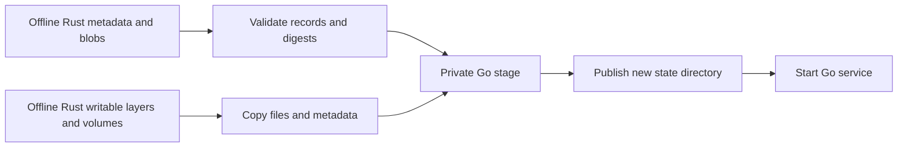

### Go VM on macOS

`make guest` builds the Go Linux guest and packs
`guest/out/initramfs-go.cpio`. The Intel output is under
`guest/out/x86_64` when built with `ARCH=x86_64`. The Darwin daemon
uses Apple's Virtualization framework through a platform binding.
The host registers port 1024 before boot and keeps the framework's
connection object alive for the lifetime of the Go control session.
The Linux guest runs as PID 1, switches off the initramfs root, sets up
its kernel filesystems and connects back over vsock. The host synchronizes
the VM clock before serving Docker API requests and refreshes it once a
minute while the VM runs. The same Docker API and container lifecycle
run over that session.

From the repository root on macOS, build and sign the test daemon:

```sh
make guest
make daemon    # target/fabo-daemon, signed with packaging/macos/fabo.entitlements
```

Run it against a Fabo kernel for the Mac's CPU architecture and private
directories for the test socket and state:

```sh
instance=$(mktemp -d /tmp/fabo-vm.XXXXXX)
mkdir -m 700 "$instance/run" "$instance/state"
target/fabo-daemon -socket "$instance/run/docker.sock" -state "$instance/state" \
  -kernel /path/to/Fabo-kernel -initrd guest/out/initramfs-go.cpio \
  -console "$instance/console.log"
```

Use `docker --host "unix://$instance/run/docker.sock"` to address this
instance. Omitting `-console` discards guest console output and keeps
the guest serial port available during boot.
Optional `-disk` attaches a dedicated raw ext4 data image, where
the guest keeps OCI layers and writable container layers across VM boots.
Without it, guest files live in memory. On normal daemon shutdown, the
guest stops containers, unmounts the data disk and powers off.

On macOS, `POST /fabo/sleep` stops the workloads gracefully and releases
the VM. A client restarts it by following sleep with
`POST /fabo/wake`, which applies saved CPU and memory settings. Sleep
keeps the daemon available for metadata reads, and a Docker operation
requiring the guest boots it again. `POST /fabo/stop` instead records
that the engine must remain off until explicitly started, including
across daemon restarts. `/info` reports VM availability and the manual
stop flag independently.

On macOS the VM also sleeps after `FABO_IDLE_SECS` (60 seconds by
default, 0 disables it). Background UI polls do not reset the timer.
Running containers, live exec sessions, queued restarts, and in-flight
guest requests keep it awake. An idle BuildKit container can be paused and
then stopped when the VM sleeps. BuildKit keeps its cache in its existing
named volume. Setting the builder idle timeout to zero keeps the running
builder awake until explicitly paused or stopped.

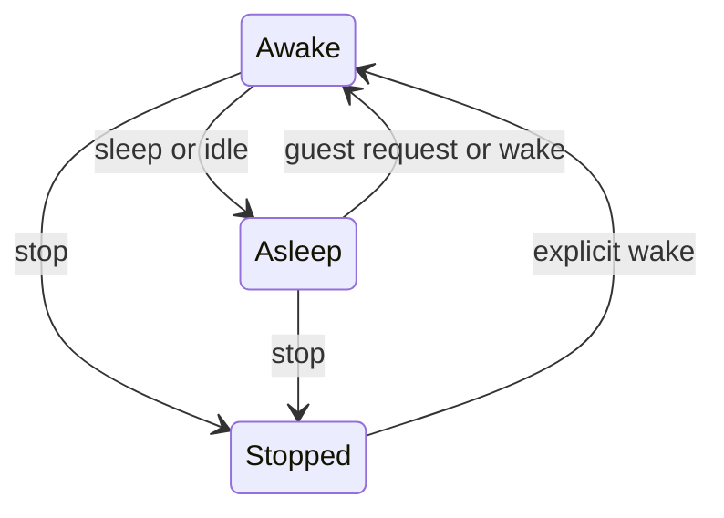

The VM has one network interface, whose MAC is stable for a given state
directory. The guest obtains and renews its IPv4 lease, installs the
default route and writes DHCP resolvers for newly started containers.
The guest bridge forwards outbound IPv4 to that uplink. What sits behind
the interface is the VM's network mode, saved as `network` in
`vm-settings.json` and changed through `/fabo/resources` (it applies at
the next boot; `running_network` reports the running VM's mode):

- `user` (the default, also for settings saved before the mode existed):
  the interface is a `VZFileHandleNetworkDeviceAttachment` on a datagram
  socket pair whose other end is a gVisor network stack inside the daemon
  (gvisor-tap-vsock). It serves DHCP on `192.168.127.0/24` with a fixed
  lease of `192.168.127.2` for the VM's MAC, and DNS on the gateway
  `192.168.127.1`, answered by the macOS resolver, so `/etc/resolver/*`
  and VPN split DNS apply. Every TCP and UDP flow is opened by the daemon
  as an ordinary macOS socket, so it follows the Mac's routes: VPNs,
  Tailscale subnet routes and proxy apps' TUN modes reach containers.
  The subnet never appears on a macOS interface. IPv4 only. Every frame
  passes through the daemon, so throughput tops out lower: a 1 GB
  download from the Mac took about 1.9 s against 0.22 s over NAT
  (Apple silicon, 2 vCPUs), which is still above ordinary internet
  speeds. When the stack stops on an error the daemon logs it; the VM is
  offline until it restarts.
- `nat`: Apple's `VZNATNetworkDeviceAttachment` on `192.168.64.0/24`,
  with macOS's resolver at the vmnet gateway. It is the fastest path, but
  macOS does not translate the VM's addresses into VPN tunnels, so
  destinations that the Mac reaches through a VPN or Tailscale time out
  from containers.

Neither mode is used to reach the VM from the Mac: publishing, domains,
`host.docker.internal` and the engine API all travel over vsock.
Use `-offline` to boot with only the internal container bridge and
vsock. Host port publishing remains available in offline mode.

#### MyGo desktop with the Go VM

With the private daemon from the example above running, use
`(cd desktop && FABO_SOCKET="$instance/run/docker.sock" go run .)`.
The Overview reads Docker's `/info`, and the containers page can open a
retained log snapshot. The daemon exposes image inspection, volume
inspection, and built-in and custom bridge networks. Built-in
networks cannot be removed. Image actions can inspect and remove local
references.

On macOS, the daemon owns the socket independently of the VM. Stop closes
admission for writes, stops containers using their configured stop
signals and timeouts, and then releases the VM. A 25-second shutdown
budget bounds container stops. The socket continues to serve passive
queries while the guest is stopped. Start opens a new guest and restores
the host records. A stopped engine rejects container starts until the
user starts the engine.

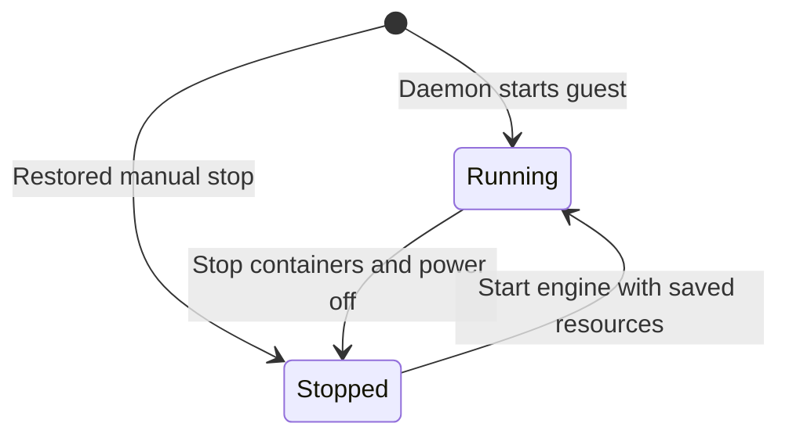

VM settings are validated against the host virtualization limits and
saved in the private state directory. CPU and memory changes apply at
the next boot. The bundled engine starts with Fabo's usual CPU and memory
defaults unless Go VM settings have already been saved. An explicit stop
is persisted across daemon restarts.
Use `-disk` for durable guest data across these boots. Linux host-process
mode exposes its resource lists but has no VM controls.

The macOS app shares `/Users`, `/Volumes`, `/private` and the user's home
over VirtioFS, including the host directories used by Fabo's Kubernetes
node. A standalone Go daemon can pass `-share /absolute/host/directory`
once for each directory it should share. Both `-v` and
`--mount type=bind` support files, directories and read-only bindings.
`-v` creates a missing source directory within the share, while
`--mount` requires an existing source. The daemon stores the original
host path for inspect and resolves it again at each start. A source
whose resolved path is outside the configured shares is rejected.

Local named volumes on macOS require `-disk`. The daemon stores volume
metadata and container references in its state directory. The guest
creates volume data under `/var/lib/fabo/volumes/<name>/_data` on ext4
when first mounted. Use the same state directory and data disk across
boots. Empty volumes can be populated from the image, and
`volume-nocopy` skips that step. `docker rm -v` and `docker run --rm`
remove anonymous volumes allocated for that container if no other
container refers to them. Existing Go records written before ownership
was tracked retain their volume data. Volume removal rejects any
container reference and drops the
metadata only after the Go guest acknowledges deletion. The original
one-way guest protocol command remains separate.

### Managed Kubernetes

`fabo k8s` uses the Docker API to manage the existing single-node k3s
cluster and its `fabo-k8s` volume. It publishes the API port and writes
the `fabo` kubeconfig context. `start` waits for the API server and the
node to become ready. An offline Rust import preserves the node and its
cluster state in the volume. The Go agent enables `cpuset` where the
kernel or parent cgroup delegates it. Privileged containers get device
nodes in their own `/dev`, including the kernel log device used by kubelet.

While the node runs, the Go daemon queries k3s for LoadBalancer services.
It publishes their TCP and UDP ports using the node's API listener scope,
loopback by default or all interfaces in LAN mode. The former Advanced tools
window could request a loopback TCP forward to a pod or ClusterIP service;
the MyGo window has not taken over that control yet.
The Go agent routes only the cluster's default pod and service ranges
through the node. Routes and forwards are released when the node stops.

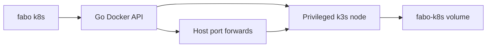

The Go daemon also accepts `docker pull` and `docker image ls`. Registry
pulls select the native Linux architecture and verify each downloaded
compressed layer's size and SHA-256 before publishing it to the cache.
The image index is atomically saved in the state directory. The optional
`-images` catalog still supplies preloaded local images. Registry images
can be used without a catalog, and their OCI command and environment
defaults are applied when a container is created.

#### Registry login and push

```sh
docker login registry.example.com
docker image tag example/app registry.example.com/team/app:v1
docker image push registry.example.com/team/app:v1
```

The daemon validates login with the registry. Docker CLI manages the
credentials and sends them with each push or pull. An explicit tag
pushes one image. `docker image push --all-tags` pushes the local tags
in that repository.

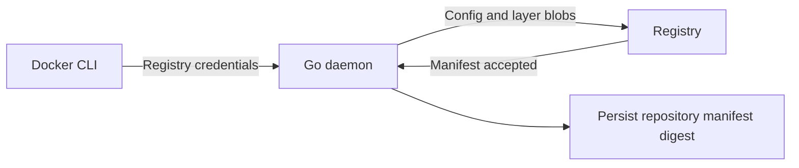

The upload reads from a pinned snapshot of the local image. It writes
a single-platform OCI manifest using the config and layer bytes. The
named image's `RepoDigests` reports the digest in its own repository.
If a tag was removed or changed to another image during upload, the
push result does not change that local tag. Older images missing the
original config use the same reconstructed config as offline exports.

#### Image references and layer reclamation

The Go engine supports `docker image tag`, `docker image rm`, and
`docker image prune`. It groups tags by image ID. Removing a tag leaves
other tags for the same image available. Replacing the last tag for an
image leaves that image dangling. Prune removes unused dangling images
by default, and `-a` also removes tagged images without container
references.

A container records the image ID and its layer paths at creation.
Removing the last reference to an image used by a container requires
`--force`. The container keeps its layers and can start again after the
tag disappears. A startup catalog entry without a config digest gets
a stable local ID derived from its metadata and layer digests. Removal
of catalog references is persisted in the daemon index, so restarting
with the same catalog does not reintroduce them. The index imports the
previous registry-only format when needed.

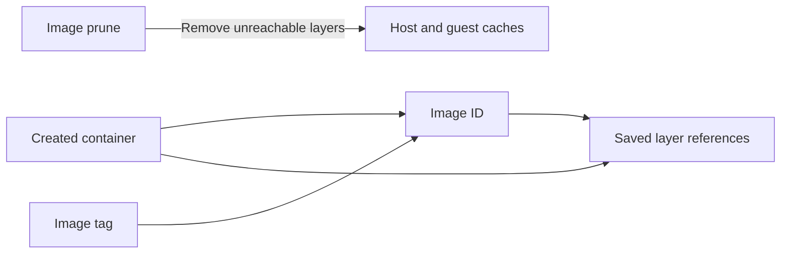

After writing the index, the daemon reclaims unreferenced compressed
blobs from its private cache and asks the guest to remove unreferenced
unpacked layers. Both checks retain layers needed by any saved
container. The prune response counts the bytes removed from the host
blob cache. Catalog archives outside that cache are user-supplied and
are kept.

#### Offline image archives

```sh
docker image save -o images.tar example/app example/worker:stable
docker image load -i images.tar
```

Saving a repository includes its local tags. An explicit tag exports
just that tag. Selecting an image ID exports its config and layers
without tags. Shared layers are written once. Images pulled or loaded
by the Go daemon preserve their original config bytes and image IDs
on export. Catalog entries and older registry records without those
bytes use a reconstructed config and may load under a different ID.

The loader reads the Docker archive `manifest.json`, including
archives that also carry an OCI index. The outer tar can be plain,
gzip, bzip2, xz or zstd. It imports Linux images for the daemon's
native CPU with at least one filesystem layer. OCI archives with
only an index are outside this path. A manually stopped macOS
engine must be started before importing.

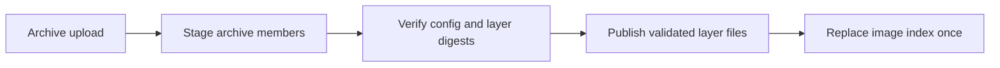

The loader checks the uncompressed digest of each layer against
the image config and verifies the SHA-256 of content-addressed
archive members. A bad image entry aborts the whole native-platform
import. If updating the index fails, the daemon removes the layer
files created by that import and leaves existing cache entries in place.

Standard Docker CLI can run foreground containers with `docker run --network
none` or start them detached with `-d`. Before start, Docker registers an
attach stream and a next-exit wait. The Go daemon upgrades the attach socket
and flushes the wait headers before the client starts the container.
Output is multiplexed using Docker's stream headers. Each subscriber has a
bounded queue; a client that stops consuming output can lose its attachment.
`docker run -i` and `docker start -ai` pass stdin to the container pipe.
Docker can attach before start, so the daemon waits for the guest to
start that run before sending input. It waits for the guest to return
credit for each chunk, and sends CloseStdin when the client half-closes
its socket. The guest drains input off the control reader, so a container
that is not reading can still be killed and waited on. When the container
exits, the daemon half-closes its output and briefly drains unread input
so the client receives EOF instead of a Unix socket reset. Output and
exit status continue after stdin closes.

### Docker CLI logs

```sh
docker logs --tail 50 --follow --timestamps app
docker logs --since 10m --until 2m app
```

The daemon retains up to 1 MiB of recent output per container. It
records the host timestamp when guest output arrives. A terminal
container record stores those timestamps across daemon restarts. Older
records keep their text and are skipped when filtering by time.

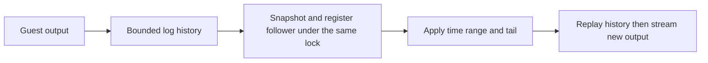

Follow ends when the run exits or the requested cutoff arrives, including
for a quiet container. A slow follower whose queue fills gets a
truncated-stream error. Pipes preserve stdout and stderr in separate
Docker frames. TTY output is combined. Timestamp formatting keeps a
line that spans several chunks together, including across the replay
boundary. The MyGo log view requests a 400-line snapshot and reads it again
every two seconds while the Logs tab is shown.

### Docker CLI terminals

`docker run -t` and `docker run -it` allocate a controlling terminal in the
container's private devpts mount. The guest binds the slave to
`/dev/console` and passes the master to the agent. The host returns combined,
unframed terminal output for attach and logs. It continues to use Docker's
multiplexed streams for containers with pipes. The guest keeps the terminal
open when the attached client closes its input stream, since a PTY has a
single master for input and output.

`HostConfig.ConsoleSize` and the Docker resize API carry rows and columns.
The host remembers a size supplied before start and sends it when the
guest reports Started. Later resize requests update the live terminal over
Fabo's existing Resize frame. Output drains before the guest reports Exited.

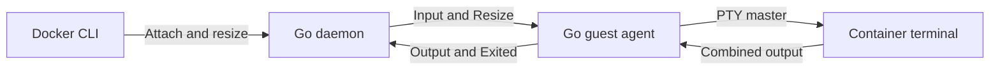

### Docker exec

The Go daemon implements Docker's create, start, inspect and resize requests
for execs. An exec inherits the container's environment, working directory
and user unless the caller overrides them. The guest starts it in the
container's PID namespace and cgroup. The bootstrap joins the network, UTS,
IPC, cgroup and mount namespaces and changes into the container's root before
resolving the user or command. It applies the same privilege and syscall
restrictions as the container's initial process.

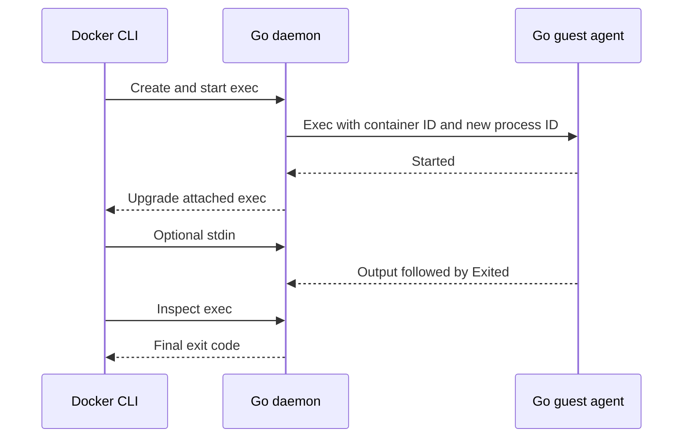

Attached execs support pipes or a separate PTY. An exec PTY shares the
container's devpts mount and leaves the main process's console in place.
For an attached exec, the paired Go host and guest use an Exec option and
credit message 77 to bound in-flight output. The host replenishes credit
as it flushes output to the Docker connection. A slow client applies
backpressure to its own exec, and disconnect lets that process keep running
with its remaining output discarded.
Detached execs can be inspected until their container is removed. Exec
records are in memory and a created exec belongs to the current run of its
container. Stopping the container also terminates its running execs.
`docker exec --privileged` grants the additional process the privileged
capability and syscall policy inside the existing container namespaces.
An exec in a privileged container inherits that policy. The guest still
applies the container's user, groups, resource limits and no-new-privileges
setting. The exec inspect response reports its effective privileged flag.
Container startup and exec create missing working-directory parents under
the process's selected identity. A directory it cannot create or enter
fails the command through the normal setup error response.
Before selecting a non-root identity, the agent gives that identity
ownership of its stdin, stdout and stderr pipes or PTY. This supports
applications that reopen the streams through `/proc/self/fd` or `/dev`.
Other inherited files retain their original ownership.
Attached container output and live log followers retain a bounded in-memory
queue. If a client falls behind, the daemon buffers its pending records in
a private temporary file and drains them in order. Completion drains the
buffer before EOF, and disconnect removes it. A buffer failure is reported
to the client. The shared guest control reader continues handling other
containers and lifecycle requests while a client is slow.

`docker kill` sends a named or numeric Linux signal to the guest. The Kill
frame has no reply, so it shares the session writer without taking a reply
slot. `docker stop` sends the container's configured stop signal, waits
for exit, and sends SIGKILL if the timeout expires. The signal and timeout
are retained in the container record. A stop timeout of `-1` waits
without escalating.

`docker rm` removes stopped or created containers. Forced removal sends
SIGKILL and waits for exit before deleting the record. `docker run --rm`
sets the guest cleanup flag and removes host state at exit, while a
registered removal waiter still receives the exit status. Guest Remove
is a one-way message. Crash recovery does not currently reconcile
writable layers left by an interrupted removal.

The new Linux `fabo-init` executable can connect to the host-process
control socket and serve the version-4 Hello, Ping and Stats exchanges.
Its metrics come from Linux boottime, procfs and cgroup v2. It exits
on Shutdown or host disconnect. To verify the Go-to-Go path in a test
environment, run `fabo-guest-check -agent /path/to/fabo-init`.
In the Go VM, the same executable runs as PID 1 from `initramfs-go.cpio`.

The Go guest accepts LayerQuery and LayerBegin. It verifies the transferred
blob digest, bounds decompression, unpacks beneath a confined archive root,
and publishes a completion marker only after successful installation. It
accepts plain, gzip and zstd tar layers and translates OCI whiteouts for
overlayfs. Set `FABO_LAYER_DIR` to a private persistent directory to
reuse layers across guest restarts. By default layers live in the temporary
host-agent directory.

The Go guest runs containers on Linux using
separate mount, PID, network, UTS, IPC and cgroup namespaces. A Go child
mounts the overlay, pivots into it, and prepares proc, sysfs and minimal
devices. Sysfs is read-only unless the container is privileged.
Container root retains the available capabilities from the original
Fabo fallback set without device-node creation. Non-root processes run
without capabilities.
The child applies the container's no-new-privileges policy before exec.
Its initial syscall filter blocks namespace changes, io_uring and non-IP/non-Unix
socket families. The host receives stdout, stderr and the exit status
through the existing protocol.

The guest reports a container started once its network is in place, before
the child has mounted its root and exec'd the command, as Kiri does. A
setup failure then ends the container instead of failing the start: a
missing command exits 127, one that cannot run exits 126, any other setup
error exits 127, and the reason appears on the container's stderr as
`fabo: cannot start container: …`. A TTY container is the exception: its
terminal comes back at the end of setup, so the guest still waits for the
exec and a failure still fails the start. The default device filter is
loaded once and attached to every container's cgroup.

Until the child reports on its status pipe that it has entered its own root
and namespaces, the guest holds back everything that reads them from its
process, and refuses it for good if the setup fails. On its serial control
channel it never waits for that report: anything can stall a setup (a pause,
a stop signal, or a process sharing the container's PID namespace stopping
it), and waiting there could hold the very request that resumes it. File
browsing and listening-port queries are answered with "still starting"
instead. Once the setup is over the guest sends a Settled event. The daemon
waits for it, holding no lock, before sending an exec into the container or
starting a container that joins its network, so `docker exec` right after a
start works and a stalled setup still leaves pause, signals and removal of
that container available. Archive copies and export wait in the guest, on
their own connection. Statistics report no network traffic until the setup
is over. Pausing and signals act on the container at once, as before.

A `--rm` container's record is not rewritten when it starts, as it has no
restart policy and is deleted when it exits. After a daemon crash, a `--rm`
container that was running therefore shows as Created rather than Exited
(255); removing it cleans up as before. Other containers are still recorded
as starting, with a cleared stop intent, before the guest runs them.

`docker run --init` keeps a Go supervisor as PID 1. It starts the workload
with the same identity and syscall restrictions, forwards signals to it,
reaps adopted children, and reports the workload's exit status. With a
TTY, the workload gets the terminal foreground process group. The init
setting persists across restarts and offline Rust migration.

`--group-add` accepts numeric GIDs and names from the container's
`/etc/group`. Explicit additions still apply when the user specifies a
primary group. `--ulimit` sets Linux soft and hard limits, including
unlimited values where the kernel allows them. The default open-file
limit is 1,048,576 subject to limits enforced by the host. These options
apply to startup, exec and health checks and survive offline Rust import.

`--sysctl` accepts container-local IPC and UTS settings and network
settings in private network namespaces. The guest applies them after
network setup and before starting the workload. A host or shared
network cannot receive network sysctls. Ordinary workloads see
`/proc/sys` read-only. Private networks allow unprivileged ports and
ping by default, and explicit values for those keys take precedence.
The daemon saves the settings for restart and offline Rust import.

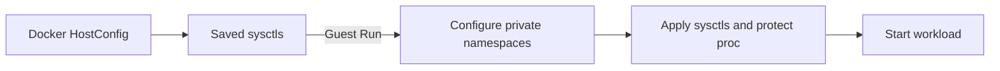

### Default container network

Plain `docker run` and `--network bridge` use `fabo0` with IPv4
`172.17.0.0/16`. The daemon saves each address with the container so a stop,
restart or daemon reload preserves the reservation. The guest creates a
veth pair before releasing the container bootstrap and sets its address
and default route before exec. Containers on the bridge can communicate
directly. `--network none` retains a separate loopback-only namespace.

When a container exits, the guest takes its host-side veth off the bridge,
brings it down and renames it to a `kr…` tombstone before reporting the
exit, so the address and the `kv…` name are free for the next start at
once. The kernel needs about 20 ms to delete a veth, so the deletion itself
runs in the background; agent shutdown waits for it. The kernel also removes
the pair when the container's namespace goes away.

The guest uses the default uplink for source NAT and allows replies back
to the bridge. A bind mount over `/etc/resolv.conf` takes precedence over
the generated DNS settings.
A container's hostname and `docker run --add-host` entries are saved with its
configuration. At start, the guest writes `/etc/hostname` and `/etc/hosts`
inside the container. A mount over either file or over `/etc` takes
precedence. On Linux bridge networks, `host-gateway` resolves to the
bridge's gateway address. In the macOS VM it resolves to Fabo's host relay.
Offline import preserves Rust's host mappings.
A subnet overlap in the main routing table fails before bridge creation.
Graceful agent shutdown removes the bridge and its nftables table and
restores per-interface forwarding settings that it changed.

#### Sharing another container's network

`docker run --network container:<name-or-id>` stores the target's full ID.
The target must be running when the new container starts. The guest joins
the target's network namespace and shares its hostname and network files.
The containers retain separate PID, mount and UTS namespaces. A joiner
cannot publish ports or attach its own bridge endpoint. After the owner
exits, its bridge interface is removed and active joiners can still use
the shared loopback. On daemon restart, containers eligible for automatic
restart wait for their network target's startup.

#### Host networking

`docker run --network host` shares the Linux network namespace used by
the Go guest. On Linux and WSL this is the Linux host or distro. On macOS
it is the Linux VM. The container keeps its own process, mount, hostname
and IPC namespaces. It uses Linux's resolver configuration unless a
mount supplies the resolver file. Host-network containers have no
bridge IP and cannot be attached to additional bridge networks.

Fabo's TCP and UDP publishing and HTTP domains can forward to the
container's IPv4 loopback listeners in the shared namespace. A mapping
that would forward a Linux port to its own listening socket is rejected.
HTTP domain routing and listening-port discovery select sockets owned
by the container's processes. In WSL, configured Windows proxy URLs
for host-network containers use the distro's loopback relay directly.

#### Custom networks and Compose

`docker network create` supports IPv4, dual-stack (`--ipv6`), and IPv6-only
(`--ipv4=false --ipv6`) custom bridges. Without an explicit IPv6 subnet,
the daemon chooses a /64 from a ULA prefix derived from its state directory.
IPv4 and IPv6 IPAM accept a gateway, allocation range and auxiliary
addresses. Dynamic allocation stays inside the configured range and skips
the gateway and auxiliary reservations. Fixed addresses can use the rest of
the subnet. Bridge driver and IPAM options are preserved as network metadata.
The daemon saves the network IDs and each container's addresses, including
those selected with `--ip`, `--ip6` and `--mac-address`. Stopped containers
retain their IP reservations. The guest checks for overlapping routes when
it creates a bridge. Offline Rust import preserves custom IPv4 and IPv6
networks, their options and pools, and fixed endpoint addresses.

Set `FABO_BRIDGE_IPV6=1` in the daemon environment to enable IPv6 on the
built-in bridge. The next start assigns addresses to its existing
endpoints as needed. The daemon persists the /64 pool and endpoint
reservations. Starting with the option disabled keeps the reservations
dormant until it is enabled again. For an offline Rust import with this
option enabled, set the same variable on the migration command. The
import uses the source store path to recover the default bridge pool,
so use the original store path when the original prefix is needed.

Each custom bridge runs a DNS listener at its gateway. The guest
registers IPv4 A and IPv6 AAAA records when it attaches an endpoint and
removes them on detach, exit or failed setup. The container resolver
at `127.0.0.11` reads the registries of its current bridges over UDP
and TCP. It forwards unmatched queries to the guest upstream only while
the container has a non-internal endpoint. Internal endpoints install no
default route. For non-internal endpoints, route selection follows
`GwPriority` and then interface order, independently for each address
family. IPv6 outbound traffic uses the host route and masquerades on
the external interface. The guest restores the original forwarding and
router-advertisement settings after removing the last external IPv6
bridge.

On macOS, the default bridge uses its gateway for DNS unless the container
specifies servers. The guest also handles UDP and TCP DNS queries sent to
the host relay address by containers on external bridges. Those queries
use the ingress bridge's resolver and alias records.
Containers sharing the VM network use the same host relay address through
their hosts file. The guest redirects their outgoing TCP connections to
the relay in the VM namespace.

`--dns`, `--dns-search` and `--dns-option` are saved with the container.
The default bridge and host modes write configured server addresses
directly to the resolver file. Custom bridges keep the embedded resolver
for their aliases, and it sends unmatched queries to configured servers
from the container namespace. An internal network can reach a DNS server
on the same bridge and retains its normal routing restrictions.
`--dns-search .` clears the search list. Offline import preserves the
Rust container's DNS settings.

`--domainname` sets the domain in the container's UTS namespace. The
generated hosts file lists the qualified hostname first, followed by the
short name. Containers that share another container's network inherit
its hostname, domain and managed network files.

Legacy `--link` and Compose `links` save the target container ID and alias.
At start, the daemon requires the target to be running and reads its
address on the specified bridge. The guest adds the alias and target
names to the new container's hosts file. Aliases that custom-bridge DNS
already serves continue to use DNS. The daemon rebuilds these entries
when the container declaring the link starts, and engine boot waits for
any target that is also scheduled to start. To add links with
`docker network connect`, stop the container first. Offline Rust import
keeps domain names and link targets.

The daemon persists additional endpoints alongside the original primary
endpoint record. A Run message prepares every configured interface before
the application starts. Live connect and disconnect use Fabo's NetAttach
and NetDetach messages and update the saved record after guest acknowledgment.
If saving fails, the daemon attempts the inverse operation. A live
primary endpoint with published ports must remain attached while the
listener targets its address.

When removing a network, the host waits for guest teardown before
releasing the subnet for reuse. Each bridge has its own firewall rules
and shares uplink forwarding with the other active bridges.

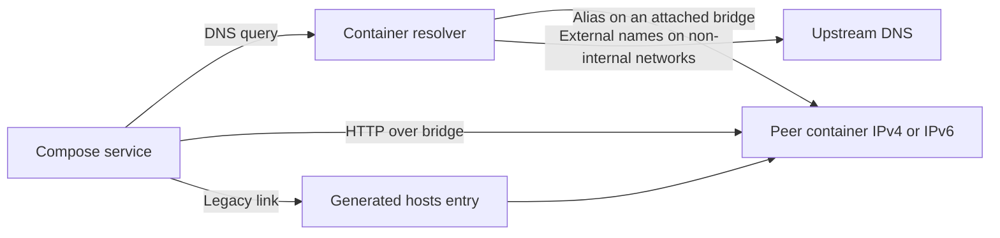

Compose projects can attach a service to multiple bridge networks,
resolve names on each at startup, and remove their own containers and
networks with `down`. The daemon retains project labels for filtering
containers and networks.

### Published ports

The Go daemon accepts `-p` for TCP and UDP on bridge networks on Linux
and macOS.
`-P` assigns host ports for exposed image and container ports. A binding
can select a host address, or omit the address to listen on the IPv4
wildcard and, when available, the IPv6 wildcard. `docker port`, `docker ps`
and inspect report the live bindings.

The daemon reserves every listener before starting the guest process and
rolls back the reservation if any required binding fails. Each running
container owns its listeners and relay sessions until exit. TCP preserves
half-close, and UDP replies use a session per client address. Fixed
bindings survive container and daemon restarts. Kernel-assigned ports
are selected on each start. When an endpoint has no configured MAC, the
guest derives its veth MAC from the endpoint address so host neighbour
entries remain usable after restart.

On Linux, the relay connects directly to the container address. On macOS,
the host sends the container's address and port through vsock. An IPv6-only
endpoint uses the IPv6 form of the guest relay header. The guest
uses the existing framed TCP relay on port 1030 and the UDP datagram relay
on port 1029. The TCP reply includes an explicit end frame so the host can
preserve half-close through Virtualization.framework. This path does not
use the VM's network interface, so it works in either network mode and
with the interface disabled. The original kernel DNAT
optimization is pending.

The guest resolves numeric and named users and groups using the container's
own account files after pivot_root. A user without an explicit group
inherits its primary and supplementary groups from the image. An explicit
group selects only that group. New writable roots and implicit archive
directories are traversable even when the daemon starts with umask 077.
Older experimental caches created with that umask can still contain
root-only directories. The guest does not rewrite already cached layers.

Set `FABO_CGROUP_DIR` to a delegated cgroup v2 parent to use memory,
CPU and PID limits. The Go guest creates a container cgroup, sets the
requested controls, and uses clone3 to start the child inside it. The
container sees a read-only cgroup view. The guest reports OOM kills and
removes the cgroup after exit. PID and memory limits include the short
Go setup process, so extremely small limits may prevent startup.
`--shm-size` uses a separate tmpfs and does not require delegation.

#### Updating resource limits

```sh
docker update --memory 256m --cpus 1.5 --cpu-shares 512 --pids-limit 64 app
```

Updates accept memory, CPU quota and period or `--cpus`, CPU shares
and PID limits. Omitted fields keep their values. Setting CPU quota
or the PID limit to `-1` removes that limit. The updated limits are
visible through `docker inspect` and apply at the next start as well.

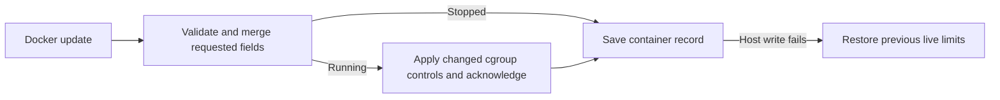

The guest reads the old control values before writing and rolls back
earlier writes if a later control rejects the update. A Linux
host-process guest needs delegated controllers. Shared-memory, swap
and cpuset updates are outside this path.

#### Pause and resume

`docker pause` and `docker unpause` control the whole container
cgroup, including descendants and existing exec processes. The Go VM
creates the required cgroups. A Linux host-process guest needs
`FABO_CGROUP_DIR` set to a delegated cgroup v2 parent.

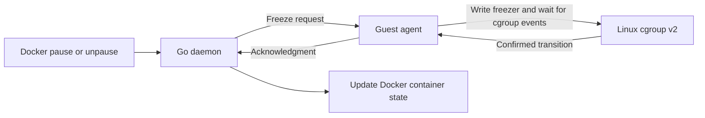

The host publishes the paused state only after the guest confirms the
transition. A paused run remains visible in `docker ps` and rejects new
exec requests. Graceful stop and restart thaw it before sending a
signal. Fatal kills and forced removal can terminate a frozen run
directly. Exit clears the pause flag.

#### Container history and list filters

The daemon records the start time when the guest acknowledges the run and
the finish time on exit. A VM shutdown or lost guest connection marks the
interrupted run as stopped by the engine. The last run's timestamps and
stop reason survive daemon restarts and offline Rust imports. Older Go
records with no known timestamps report Docker's zero time in inspect and
`null` in the Fabo list fields.

`docker ps` lists newest containers first and supports the original Fabo
filters for names, labels, image ancestors, networks, mounted volumes,
state, health and exit code. State and exit-code filters include stopped
containers automatically. The WebView uses the list timestamps and exit
reason for its status and troubleshooting views.

```mermaid
flowchart LR
    Ack[Guest confirms start] --> History[Persist run history]
    Exit[Guest exits or disconnects] --> History
    Import[Offline Rust import] --> History
    History --> API[Docker list and inspect]
    API --> UI[WebView status and troubleshooting]
```

#### Container statistics

```sh
docker stats app
docker stats --no-stream app
```

The guest samples CPU, memory, process count, network traffic and block
I/O using the existing protocol-v4 container stats reply. Linux
host-process mode needs a delegated `FABO_CGROUP_DIR` with the
accounting controllers available. Network and block I/O counters are
aggregated across the container's interfaces and devices.

```mermaid
flowchart LR
    Docker[Docker stats] --> Host[Go daemon]
    Host -->|StatsQuery| Agent[Guest agent]
    Agent --> Counters[Container cgroup and Linux proc counters]
    Counters --> Agent
    Agent -->|ContainerStats| Host
    Host --> Docker
```

The daemon sends raw memory usage and inactive file cache separately
so the CLI can compute its displayed memory usage. For a snapshot it
uses two samples to give the CLI a CPU delta, unless the API requests
`one-shot`. A stream is tied to a single container run, samples once a
second, and ends at exit. Stopped containers have no live counters.

#### Container process listing

`docker top app` returns the original Fabo columns for the live or
paused container. The guest enumerates process IDs in the container's
cgroup and descendant cgroups, then reads their metadata from Linux
`/proc`. This includes child processes and running exec sessions.
The guest checks membership again before replying, and the daemon
discards a reply if the run has already exited.

```mermaid
flowchart LR
    CLI[Docker top] --> Host[Go daemon]
    Host -->|TopQuery| Agent[Guest agent]
    Agent --> Membership[Read cgroup membership]
    Membership --> Proc[Read process metadata]
    Proc --> Check[Recheck membership]
    Check -->|Top reply| Host
```

PID and PPID are guest-visible on macOS and host-visible in Linux
host-process mode. Linux host-process mode needs a delegated
`FABO_CGROUP_DIR`. The table has fixed columns, as in the Rust
engine. Custom `ps` layouts are outside this path.

Linux host-process mode accepts existing absolute bind sources via
`--mount type=bind` and `-v`, plus `--read-only` for the overlay root.
The Go guest pins each source and prepares a private mount tree before
pivot_root. It attaches the tree inside the container using directory
descriptors, without following target symlinks. A read-only bind also
marks nested mounts read-only. Bind targets under /dev, /proc and /sys
are reserved. Custom propagation is still pending.

Named local volumes are persisted under the private daemon state directory
and may be used through `-v name:/path` or `--mount type=volume`. Docker
can create, inspect, list and remove them. Container records retain volume
references across restart. Removing a container leaves named volumes
intact, and removing a referenced volume returns a conflict. On first start,
the guest seeds empty volumes from the image directory before attaching
any user mounts. An enclosing bind mount can cover the destination after
that step. The guest preserves regular files, symlinks,
ownership, modes and modification times. A nonempty volume is left
alone. Use `volume-nocopy` or the legacy `:nocopy` option to skip seeding.
Volume seeding can leave partial data if interrupted. It does not preserve
hard-link topology or extended attributes.

The `local` driver accepts `type`, `device` and `o` through `docker volume
create --opt`, Compose `driver_opts` and `--mount ... volume-opt=...`. For
example, `type=none,device=/path/to/data,o=bind` uses an existing host directory,
and `type=tmpfs,device=tmpfs,o=size=32m` creates a memory-backed named volume.
On macOS, bind devices must be inside the VM share. Network mounts such as
NFS and CIFS require filesystem support in the Linux kernel running the agent.
The Fabo macOS guest kernel does not currently include those filesystems.
Volume plugins and per-volume quotas are unsupported.

The agent mounts a local driver volume when the first container starts and
shares that mount with subsequent containers. A tmpfs volume loses its
contents when the mount is removed or the agent stops. Removing a driver
volume detaches the filesystem before removing its metadata and never
deletes the external backing data. On Linux and WSL, the agent's private
mount namespace keeps driver mounts out of the daemon's filesystem view.

```mermaid
flowchart LR
    Create[Save local driver options] --> Start[Start container]
    Start --> Mount[Agent mounts filesystem at volume root]
    Mount --> Share[Containers bind the same volume]
    Share --> Release[Remove container references]
    Release --> Delete[Detach mount and delete volume record]
```

### Pruning Docker resources

The Docker CLI invokes separate prune endpoints for containers, networks,
images, volumes and build cache. Go container prune removes created and
exited containers. It preserves running, paused and restarting containers.
The managed BuildKit container is retained so the cache prune can reuse
its state. As in Docker, resource labels do not limit the build-cache
step. Network prune preserves built-in networks and networks
referenced by any container, including stopped containers.

Volume prune defaults to unused anonymous volumes. `docker volume prune
--all` can also remove unused named volumes. The daemon records anonymity
when Docker creates a volume without a name, when a mount omits its
source, and when the container or image declares a volume target.
Existing mount declarations take precedence for the same target. Rust
migration copies the anonymous flag when present. Older Go volume records
without that flag are treated as named volumes.

Container and network prune support `until`, `label` and `label!`.
Volume prune supports `label` and `label!`. Each resource is checked
again by the existing deletion path before removal. For a macOS VM
volume, the host removes its record after the guest acknowledges deletion.
Container and volume prune report the deleted objects with zero reclaimed
bytes, matching the original Fabo API.

### Docker disk usage

`docker system df` and `docker system df -v` report the same image,
container, volume and BuildKit breakdown as `GET /system/df`. The Go guest
answers the original Fabo usage frames from a separate worker. The scan
uses allocated blocks, counts hard links once per tree, and skips
symlinks and files on other devices. Linux host volumes are measured
through the same allocation walker. The `diskusage` package only owns
filesystem measurement and is shared by the engine and guest.

The host reports one image row per image ID, with all its tags and
digests. Shared layers count once in the overall layer total. Layers
that have not been unpacked count at their stored blob size.
Container writable layers and volume use are measured separately, and
stopped containers still count toward volume reference totals. BuildKit
usage comes from a running builder.

An explicit disk-usage request can wake an idle macOS VM. A manually
stopped VM stays stopped. In that case the host can return image and
reference metadata, and an unavailable VM volume size is reported as
`-1`.

```mermaid
flowchart LR
    CLI[Docker system df] --> Go[Go daemon]
    Go -->|Usage query| Guest[Go guest worker]
    Guest --> Disk[Allocated layer and volume blocks]
    Go -->|Read cache records| Builder[Running BuildKit]
    Go -->|Docker disk usage response| CLI
```

An exited container can be started again, including with `docker start -a`.
`docker restart` stops the current run and starts another with the same
ID, writable layer and log history. Lifecycle changes are serialized per
container. Each next-exit waiter retains the outcome of the run it
registered for, even if another run has already started. Auto-remove
containers cannot be restarted.

#### Automatic restart policies

`docker run --restart` and `docker update --restart` accept `no`,
`always`, `unless-stopped` and `on-failure[:max-retries]`. The daemon
keeps the retry count and manual-stop flag in the container record.
The initial retry delay is 100 ms and grows to at most 30 seconds.
A run lasting 10 seconds resets the delay. Explicit start or restart
clears the manual-stop flag and resets the retry count.

```mermaid
flowchart LR
    Exit[Guest reports exit] --> Check[Check restart policy and stop intent]
    Check -->|Eligible| Queue[Queue retry with backoff]
    Queue -->|Still eligible| Start[Start next run]
    Queue -->|Manual stop or removal| Cancel[Cancel retry]
    Check -->|Ineligible| Stopped[Keep stopped record]
```

A daemon restart restores previously started containers with
`always`, including ones stopped by the user. It also restores
`unless-stopped` containers that were active or awaiting a retry.
`on-failure` applies to process exits during the current daemon
session. The policy is incompatible with automatic removal.

#### Docker events

`GET /events` streams newline-delimited Docker event objects. The
daemon retains the last 256 events in memory. A request with `since`
starts with matching retained events and continues with live updates.
A request without `since` starts at the live cursor. The `until` query
closes the stream after its upper time bound. The daemon shares this
history across VM stop and wake. Restarting the daemon clears it.

```mermaid
flowchart LR
    Change[Container or resource changes] --> History[Daemon event history]
    History --> Replay[Snapshot and live cursor]
    Replay --> Filter[Apply time and resource filters]
    Filter --> Stream[Chunked Docker API stream]
```

The engine emits container lifecycle, pause, exec and update events,
image pull, tag, untag, delete, load, save and push events, explicit
network create, connect, disconnect and destroy events, and volume
create and destroy events. Slow clients that fall behind the retained
history lose the connection and can reconnect with their last event time.

#### Container health checks

Containers inherit the image's health check. Create requests can
override individual settings or disable the check with `["NONE"]`.
`CMD-SHELL` uses the configured shell, with `/bin/sh -c` as the default.
The engine runs probes through the Go guest's exec path using the
container's user, environment and working directory.

```mermaid
flowchart LR
    Start[Container starts] --> Probe[Run guest probe on its interval]
    Probe --> Result[Record result and update health]
    Result -->|Container still running| Probe
    Probe -->|Timeout| Kill[Kill and reap probe process group]
    Kill --> Result
```

Failures during the start period count only after the first success.
The monitor stops probing while the container is paused and resets the
failing streak at the next start. The inspect response keeps the last
five results with up to 4 KiB of output each. Docker CLI and Compose
read `State.Health`, and changes emit `health_status` events.

#### BuildKit in the Go engine

A privileged container can run BuildKit's OCI worker in the macOS Go VM
or on a Linux host with delegated cgroup v2. The worker uses the existing
container lifecycle and a named volume for its state. The Go agent lets
the worker create nested namespaces and cgroups while blocking vsock and
io_uring. The packaged Linux service delegates cgroups automatically.
For a manual Linux daemon, set `FABO_CGROUP_DIR` to a delegated parent.
The macOS managed builder requires a VM data disk.

```mermaid
flowchart LR
    Buildx[Buildx] -->|Exec and dial-stdio| BuildKit[BuildKit OCI worker]
    BuildKit -->|Cache| Volume[Named volume]
    BuildKit -->|Docker archive| Store[Go image store]
```

When BuildKit moves to a child cgroup, new execs join that cgroup.
Container exit removes the worker's empty descendant cgroups so the
builder can start again with the same state volume. The first Buildx
build creates Fabo's named builder and its state volume. Fabo writes
the managed worker configuration at each start. Separately named
Buildx builders can upload their own configuration before starting.

`GET /fabo/builder` reports the saved cache limit, effective limit in
bytes, idle timeout and builder state. `POST /fabo/builder` accepts
`cache_gb` (a whole number, with zero or `null` selecting the default)
and `idle_secs` (zero disables automatic pause). Omitted fields keep their
current value. The default cache cap is 10% of the state filesystem,
bounded to 1–20 GiB. The `FABO_BUILD_CACHE_GB` and `FABO_BUILDER_IDLE_SECS`
environment variables override the saved values. Offline Rust migration
copies the settings from `builder.json`.

The cache change applies on the next BuildKit start. The idle timeout
applies to a running builder without restarting it. The engine keeps the
builder active while a build, prune, or exec uses it. The next build
resumes a paused builder and reuses the named cache volume.
The daemon ends Buildx's `buildctl dial-stdio` relay when the client
disconnects so an abandoned relay cannot keep the builder awake.

The managed builder resolves `FROM` and `COPY --from` against Fabo's
tagged image store. At each start it configures the read-only mirror for
Docker Hub and the registries already represented in that store. New tags
from those registries are visible immediately. To add a registry that
was absent at the previous start, restart the managed builder. A missing
tag or digest lets BuildKit resolve the image from the original registry.
The mirror serves only repository-owned blobs through its private route.
macOS uses the guest's host relay and Linux uses the default bridge gateway.

```mermaid
flowchart LR
    API[Builder settings API] --> Config[Persist builder.json]
    Import[Offline Rust import] --> Config
    Config -->|Next start| GC[Apply BuildKit GC thresholds]
    Config -->|Idle check| Pause[Pause unused builder]
    Pause -->|Next build| Resume[Resume and reuse cache]
    GC --> BuildKit[Managed BuildKit worker]
    BuildKit -->|Resolve FROM| Mirror[Read-only local image mirror]
    Mirror -->|Tag or digest missing| Upstream[Original registry]
```

The classic `POST /build` API uses the same builder. BuildKit reads the
uploaded context from its per-build directory and streams progress
back to the Docker client. The host stages the exported Docker archive
while the build runs and commits it after successful exit and validation.
`POST /build/cancel?id=…` interrupts the associated BuildKit command.
Registry authentication for the build is written to the builder's tmpfs
and cleaned up with the workspace. `POST /build/prune` runs BuildKit's
cache prune on the existing managed builder and reports the deleted
records and reclaimed bytes. An engine with no builder returns an empty
result. Built images already loaded into the Go image store are separate
from this cache.

```mermaid
flowchart LR
    Client[Classic Docker API client] --> Build[Managed BuildKit]
    Build -->|Progress| Client
    Build -->|Docker archive| Stage[Stage and validate]
    Stage -->|Successful build| Images[Go image store]
```

#### Container files in Finder

On macOS, the Go daemon exports the running containers under `~/Fabo`
with the system's read-only NFSv3 mount. The selected app flavor supplies
the mount directory and a private Unix socket. The daemon accepts the
current user and the macOS kernel client on that socket. A folder that
contains user files or another mount remains available to the user.
`FABO_NO_FINDER=1` leaves the socket available and skips the mount.

```mermaid
flowchart LR
    Finder -->|Private NFSv3 socket| Daemon[Go daemon]
    Daemon -->|Stat, list, and read| Agent[Go guest agent]
    Agent -->|Pinned process root| Files[Running container files]
```

The guest follows symlinks relative to the container root, including
absolute targets. It serves file attributes and bounded ranges on demand.
The mount requests fresh attributes for file changes. When a container
stops, its folder disappears and its existing handles return stale until
the container runs again. The desktop file browser uses the same mount.

#### Container archive transfers

`docker cp` uses `HEAD`, `GET` and `PUT` on the container archive
route. The engine opens a separate copy connection to the guest
over vsock or the Linux agent's private Unix socket. A copy child
opens the container's running filesystem or mounts the image and
writable layers for a stopped container. Uploads stream in chunks
with an explicit end marker, leaving the connection open for the
result.

```mermaid
flowchart LR
    CLI[Docker CLI or Buildx] --> API[Container archive API]
    API -->|Dedicated guest connection| Copy[Copy child]
    Copy --> Running[Running filesystem]
    Copy --> Stopped[Private overlay for stopped container]
```

Uploads support directories, regular files, symbolic links and
hard links. Extraction stays within the requested directory and
preserves file permissions and modification times. `docker cp -a`
also preserves archive ownership. A failed upload can leave files
that were already extracted. Special file creation through archive
uploads is unsupported.

`docker export` streams the merged image and writable layer. For a running
container the copy child joins its mount namespace and takes a non-recursive
clone of the root mount. This retains files beneath mount points and leaves
out the contents of named volumes, bind mounts, and tmpfs mounts. For a stopped container
the copy child mounts the layers in a private namespace. The guest writes
the final chunk marker after completing the tar stream, so a truncated
transfer fails on the client.

`--tmpfs` and `--mount type=tmpfs` create a fresh filesystem at each
start. The daemon stores the mount settings with the container and
retains them during offline Rust import. The guest attaches parent
mounts before their children, so a bind can sit below a tmpfs target.
An explicit tmpfs takes precedence over an image's anonymous volume
declaration at the same path. Its live contents are available to
`docker cp` and are discarded when the container stops.

```mermaid
flowchart LR
    Config[Saved mount settings] --> Start[Container start]
    Start --> Mount[Attach fresh tmpfs]
    Mount --> Stop[Container stop releases tmpfs]
```

#### Mounting the Docker socket

An explicit bind of the engine socket lets a container use the same
Docker API as the host. On Linux, the source socket is mounted directly.
If a conventional `/var/run/docker.sock` alias is absent, it resolves to
this daemon's configured socket. An existing Linux socket retains its
original destination. WSL also accepts the Windows
`\\.\pipe\docker_engine` spelling.

In the macOS VM, engine-socket aliases and the daemon's own socket path
map to `/run/host-services/docker.sock`. The Go guest relays each
connection over the existing host-bound vsock channel. The Mac endpoint
connects only to its configured daemon socket for this route.

```mermaid
flowchart LR
    Client[Container Docker client] --> Socket[Guest Unix socket]
    Socket -->|Host-bound vsock| Mac[Go host relay]
    Mac --> Engine[Configured Go daemon socket]
```

`docker rename` updates the persisted name of an existing container and
emits a rename event. Its ID, processes and stored network endpoint
configuration are retained. The managed BuildKit name is reserved.

#### Writable layer changes and image commits

`docker diff` compares entries in the writable layer with the image's
merged read-only view. The guest recognizes OverlayFS deletion markers.
Both operations read the writable layer separately from the running
container's mounts.

`docker commit` pauses a running container by default, resumes it after
collecting the delta, and preserves a pre-existing pause. It stages the
complete OCI layer before publishing the image. Whiteouts and opaque
directories become OCI markers. The new image inherits the container's
effective command and config, accepts commit overrides and records the
operation in `docker image history`. Images can be saved and reloaded
through the existing archive API. Device nodes other than deletion
markers are unsupported in image layers.

```mermaid
flowchart LR
    Upper[Container writable layer] --> Diff[Diff against merged image layers]
    Upper --> Delta[OCI delta with deletion markers]
    Delta --> Stage[Stage and hash complete delta]
    Stage --> Image[Persist image and history]
```

### Container settings in Advanced tools

The environment editor replaces the container's configured environment
and reads it back from Docker inspect. A running container restarts
using its existing ID, writable layer and mounts. For a stopped
container the settings apply at its next start. If a restart fails
after saving, the new environment remains available for the next start.

The domain editor posts `{"domain": "api.shop, admin"}` to
`/fabo/containers/{id}/domain`, which saves the names as the
`dev.fabo.domain` label; an empty string removes it. Names are prefixes
under `fabo.local` (a full `….fabo.local` or `….fabo.localhost` name is
cut to its prefix), lower-cased, deduplicated and checked as DNS labels.
A name another container already answers to (its name, Compose
`service.project` or domain label) is refused, since the router would
serve only one of them. The router reads labels on each request, so the
change needs no restart. Compose does not see it: recreating the
container from its Compose file restores the file's labels.

The port editor replaces the requested host bindings for TCP or UDP.
While the container runs, the host swaps its relays without restarting
the guest workload. If reservation or persistence fails, the engine
tries to restore the prior listeners using their actual host addresses
and ports, including dynamically assigned ports. The listener discovery
API reads TCP listeners from the container's network namespace and
separates ports reachable by the relay from loopback-only or otherwise
unreachable listeners.

```mermaid
flowchart LR
    WebView[Advanced tools] --> Env[Save environment]
    Env --> Start[Restart only if running]
    WebView --> Ports[Reserve replacement host listeners]
    Ports --> Save[Persist bindings]
    Ports -->|On failure| Restore[Restore previous bindings]
    Save -->|On failure| Restore
```

### Network proxy and host loopback

The Go daemon exposes the original proxy settings API used by Advanced
tools. On macOS, system mode reads the active settings from `scutil`.
Custom mode accepts HTTP, HTTPS and SOCKS proxy URLs and the bypass
list. Off mode makes registry requests direct. The daemon stores the
settings privately and applies them to registry pull, push and login.
PAC presence is reported for system mode, with script evaluation still
pending.

When passing proxy settings to containers, new containers inherit upper-
and lower-case proxy variables unless their image or create request
already supplies the corresponding variable. This includes newly
created managed builders. Existing containers retain their configured
environment. On macOS, a proxy at `127.0.0.1` or `localhost` is reached
using `host.docker.internal`.

```mermaid
flowchart LR
    Settings[Advanced tools proxy settings] --> Registry[Registry HTTP transport]
    Settings --> Env[New container environment]
    Env --> Guest[Guest host address on external bridge]
    Guest --> Vsock[TCP relay over vsock]
    Vsock --> Loopback[Mac IPv4 loopback service]
```

On external macOS VM bridges, the guest redirects TCP to its reserved
host address. The host relay accepts IPv4 loopback destinations only.
Internal bridge networks retain their isolated routing.

UDP to the host address, other than DNS on port 53, is relayed too
(guest protocol 0.6). The same nat chains that redirect TCP redirect UDP
to port 1026, where `fabo-init` reads the port each container sent to
from the flow's conntrack entry. Each container address is a flow with its
own vsock connection to the host, which sends the datagrams to that port
on the Mac's loopback and relays the answers; conntrack rewrites the
answers' source to the host address and port the container sent to. A
flow closes after 60 seconds without traffic; 128 flows may be open at
once, beside 128 TCP connections. One container port sending to two host
ports at once gets only the first: both flows would share the redirect's
reply address. TPROXY would keep the destination without conntrack, but
the VM's bridges call iptables (`br_netfilter`), which runs prerouting
before the IP layer drops the socket TPROXY assigns.

Since 0.6 the host-bound header carries the protocol and the container's
source address and port (`guestwire.HostBound`, after the reserved target
`0.0.0.0:2`). The daemon records which loopback address each relayed
connection came from with the container's address, until it closes.
`GET /fabo/debug/peers?proto=tcp|udp&addr=127.0.0.1:<port>…` answers with
the container address and name for each address it knows, without waking
the VM; the Debug page uses it to name the clients of its servers. A Linux
engine has no relay, so containers arrive with their own addresses and the
table stays empty.

#### Windows system proxy in WSL

`fabo-win` sends the current system proxy and the relay port map to
`PUT /fabo/proxy/system` over the existing Docker bridge: every minute,
after it starts or restarts the engine, before setup's test pull, when the
window saves proxy settings, and when the relay ends under it. A proxy on
Windows' own loopback (Windows' setting, or a custom one in use) is reached
through the proxy relay (`engine/internal/hostrelay`, upstream's
`relay.rs` / `hostrelay.rs`): `fabo hostrelay` in the distro listens on
its `127.0.0.1` for each such port and carries the connections back over
`wsl.exe`'s stdio, and `fabo-win` dials only those ports on Windows. The
map is always sent, `{}` when there is no relay; a loopback proxy the
relay does not reach (an older `fabo` in WSL, no answer within 10 seconds)
is left out of the snapshot, so pulls and containers connect directly.
When no proxy needs it, and when `fabo-win` quits, the snapshot is sent
without the relay first and the relay then stops. The Go daemon
keeps that snapshot in memory. System mode uses Windows settings when a
snapshot is available and falls back to the Linux environment before the
first update. Custom mode uses the saved addresses. Both modes use the
relay for mapped loopback ports. PAC state is displayed without
executing the PAC file.

With proxy variables enabled for containers, the Go guest opens a
listener on the container's private loopback at `127.0.0.2` for each
configured Windows proxy port. The agent opens a tunnel through the
daemon's Unix socket. New connections use the current WSL relay port,
including after the relay restarts. The tunnel only accepts the active
proxy ports and requires a container to have a non-internal network.
Explicit Docker environment entries take precedence over injected values.
A container started with `--network container:<target>` uses the Windows
proxy ports already configured in the target namespace. If the target
shares the WSL host network, the joiner uses the current WSL loopback
relay port instead. The joiner's injected values apply to its main
process, health checks, and `docker exec` for that run.

```mermaid
flowchart LR
    Container[Container loopback] --> Agent[Go guest agent]
    Agent -->|Unix socket| Go[Go daemon]
    Registry[Registry requests] --> Go
    Go --> WSL[WSL loopback relay]
    WSL -->|Existing framed relay| Windows[Windows loopback proxy]
```

### Container domains

The Go daemon serves container domains directly. The router matches the
container name, a 12-character or longer ID prefix, a Compose
`service.project` name, or one of the comma-separated names in
`dev.fabo.domain`. It uses the `dev.fabo.http.port` label if set. Otherwise
it considers published and exposed TCP ports and can query the guest for
listeners. The destination needs a bridge address reachable from the
daemon or its VM relay.

```mermaid
flowchart LR
    Browser[Local browser] --> Router[Go HTTP or HTTPS listener]
    Router --> Match[Find active container and TCP port]
    Match --> Relay[Go guest TCP relay on macOS]
    Relay --> Service[Container HTTP service]
```

In the side-by-side Fabo Go bundle, choose free HTTP and HTTPS ports under
**Advanced tools → Settings → Domains**. Use
`http://myapp.fabo.localhost:<port>` or
`https://myapp.fabo.localhost:<port>`. This bundle leaves the shared
macOS resolver rule to the installed Fabo. A primary macOS bundle can
start the loopback DNS service for the existing `fabo.local` rule.
`FABO_HTTP_PORT` and `FABO_HTTPS_PORT` take precedence over saved ports.

The two machine-level settings belong to the launcher, since the engine
runs without privileges. `fabo domains` prints them as JSON
(`{"on", "suffix", "https"}`) and the window's **Settings → Domains**
reads and changes them through it:

- `fabo domains local on|off` (also `fabo setup --domains`) writes or
  removes `/etc/resolver/fabo.local`, which sends `*.fabo.local` lookups to
  the engine's answerer on `127.0.0.1:53535`. macOS asks for an
  administrator's password. A flavored bundle refuses: the rule is one per
  machine and stays the installed app's. `fabo setup --uninstall` removes
  the rule.
- `fabo domains https on|off` trusts `<state>/tls/ca.pem` as a root for
  websites only, for the current user, or removes that trust and deletes
  the certificate from the login keychain by fingerprint, so another
  installation's authority of the same name is left alone. Trust is read
  with `security verify-cert` on that file, not by name. The authority
  exists once the engine has bound its HTTPS port.

A closed password prompt changes nothing. A window started without the
launcher beside it, and Linux, show names as `*.fabo.localhost` with
nothing to switch.

On Windows, `fabo domains [local on|off]` goes to fabo-win's control pipe:
fabo-win answers `*.fabo.local` on `127.0.0.1:53` and a name resolution
policy (NRPT) rule, added or removed through one UAC prompt, sends those
lookups there. There is no `https` switch on Windows. See docs/windows.md.

The daemon binds both replacement ports before saving the setting or
closing a previous listener. A container publishing a router's TCP port
takes precedence while it owns the port. The router tries to reclaim the
port every three seconds. Accepted requests remain on their original
connection when a listener moves.

HTTPS uses the per-bundle CA under the Fabo state directory's `tls`
subdirectory. It can issue only for the two Fabo DNS suffixes and
excludes IP addresses. The bundle retains the existing macOS certificate
trust controls. For isolated tests, pass `tls/ca.pem` to `curl --cacert`.


### Container capabilities

`CapAdd` and `CapDrop` in Docker's container configuration accept Linux
capability names, the `CAP_` prefix, and `ALL`. Drops apply before additions,
so `--cap-drop ALL --cap-add NET_ADMIN` keeps only `NET_ADMIN`. Inspect
retains the requested settings, including after daemon restart and offline
Rust import. Main processes, the init supervisor, execs and health probes
share the container's capability selection. A non-root process keeps no
effective capabilities by default.

```mermaid
flowchart LR
    Config[Docker options] --> Store[Saved names and capability mask]
    Store --> Guest[Guest launch]
    Guest --> Device[Attach cgroup device filter]
    Device --> Process[Apply capability and syscall limits]
    Process --> Exec[Main process and later execs]
```

The guest attaches the original Fabo cgroup device policy before starting
the container. By default, it allows standard character devices and denies
opening block devices. If the kernel cannot attach the default filter, the
agent removes `CAP_MKNOD` for the workload and its execs.

### Device mappings

`--device` resolves a device path or directory at each start. On macOS,
the source path is inside the Linux VM. A directory mapping includes the
device nodes below it. The guest creates private nodes with the source
type, major and minor numbers, owner, and mode. It mounts each node at
the requested path, including paths outside `/dev` and inside a read-only
root filesystem. Ordinary bind mounts remain subject to their own mount
policy. `--device-cgroup-rule` adds permissions without creating a node.
A non-privileged container with explicit device options fails to start
if its cgroup filter cannot be installed.

### USB passthrough on macOS

The platform helper captures a selected Mac USB device and speaks USB/IP.
It upgrades a request to the Go daemon's `/fabo/usb` endpoint on the local
engine socket. The daemon reserves the device location and connects to
the Go guest over vsock. The guest selects a free Linux `vhci_hcd` port
and gives the socket to the kernel. After enumeration, containers can
map the device with Docker's `--device` option.

```mermaid
flowchart LR
    Helper[macOS capture helper] -->|USB/IP over Unix socket| Daemon[Go daemon]
    Daemon -->|vsock| Agent[Go guest]
    Agent --> VHCI[Linux vhci_hcd]
    VHCI --> Device[Container device mapping]
```

An attached or pending device keeps an idle VM awake. An explicit stop or
sleep closes the session before stopping the guest. Detach, helper exit,
and device disconnect release the location so it can be attached again.
The Go `fabo usb fake` fixtures exercise the same daemon, guest and
Linux driver path with software serial and HID devices. Run
`tests/usb.sh` with `FABO` pointing to the built `fabo` and an isolated Docker
context to verify that path. CLI contracts and host capture verification
boundaries are documented in [CLI tools](cli-tools.md).

The window's USB page reads `fabo usb list --json` every three seconds
while it is open: the Mac's devices joined with the daemon's `GET
/fabo/usb`, which now also reports when each device was attached
(`Since`, Unix seconds) and, like the listing, neither wakes the VM nor
counts as activity. **Attach** and **Detach** run `fabo usb attach|detach
LOCATION`; the first attach installs the helper behind macOS's password
prompt, and closing that prompt changes nothing and says nothing. A
session with no device on the Mac's bus (a `fabo usb fake` device) is
listed too, so it can be detached. On Linux containers already see the
host's devices, so the page lists them with the path to pass to
`--device` and has no buttons.

### Debug sessions

The window's Debug page is a socket debugger: TCP, UDP and WebSocket
clients and servers, an HTTP client and an HTTP mock. Sessions are saved
in `debug-sessions.json` beside `desktop.json` (configuration only; the
messages stay in memory, 5000 lines per session). The engine stores none
of it. Local sessions need no engine.

- A client targets an address, or a container's port. A container port is
  reached through its published port on the loopback, or through the
  container network with `POST /fabo/debug/dial`, which works for
  unpublished ports. The dialog lists published ports and the TCP ports a
  container listens on (`GET /fabo/containers/{id}/listening`); any other
  port can be typed. A port that nothing listens on still upgrades, then
  closes at once.
- WebSocket and HTTP clients check the server's certificate unless the
  session is set to skip it, for self-signed development servers.
- `POST /fabo/debug/dial?container=<name>&port=<n>&proto=tcp|udp` answers
  `101` and hands over the connection: a raw stream for TCP, and for UDP
  datagrams framed by their length in two big-endian bytes, both ways (the
  guest relay's framing). Its answers carry `X-Fabo-Debug: 1`, so a client
  can tell a missing container (404 with the mark) from an engine without
  the endpoint (404 without it). It wakes the VM like any request, and the
  VM does not sleep while the connection is open.
- A server listens on `127.0.0.1` or, when chosen, every interface. On
  Linux a loopback server also listens on the gateway of each bridge
  network, where containers reach `host.docker.internal`; on a Mac the
  engine relays it to the loopback. Containers reach it at
  `host.docker.internal:<port>` over TCP and UDP (see Network proxy and
  host loopback). Its clients are named after their
  container: by the peers endpoint on macOS, by address on Linux.
- A TCP or WebSocket server may send a greeting on connect and reply automatically (a
  configured text, or an echo). WebSocket and HTTP servers may use TLS with
  given PEM files, or a self-signed certificate for localhost and
  `host.docker.internal` kept beside the sessions.
- The HTTP mock matches routes by method and path (`:name` segments, a
  final `*`), answers with a status, body and optional delay or the files
  of a folder, and fills `{{path.<name>}}`, `{{uuid}}` and `{{rand}}`.
- A server marked to listen when Fabo opens starts with the window, before
  the page is shown (on Linux once the networks are read, or after five
  seconds); a busy port marks the session failed without retrying. Other
  sessions start when asked.

### Public share links

`fabo share PORT|HOST:PORT|CONTAINER` (or `fabo PORT`) and the window's
Share page give a local service a public HTTPS address through a
`fabo-edge` relay (kept in its own repository, with its deployment
notes). The supervisor
hosts the tunnels in `PublicShares`, beside the domain router, so links
survive VM sleep; a daemon restart closes them. The launcher passes the
account file as `-share-config <root>/share.json`; without it the
`/fabo/share` endpoints answer 404.

```mermaid
flowchart LR
    Visitor -->|https://NAME.DOMAIN| Edge[fabo-edge]
    Edge -->|TLS, ALPN fabo-share/1| Shares[PublicShares in the supervisor]
    Shares -->|port target| Host[localhost:PORT]
    Shares -->|container target: wake VM, dial like a container domain| Container
```

- **Endpoints.** `GET /fabo/share` reports the account (`signedIn`, `login`,
  `server`, a pending GitHub code) and every link with its state, URL,
  counters and last 50 requests. `POST /fabo/share {target, name,
  noReserve}` opens a link the engine owns (the window's); `DELETE
  /fabo/share/{id}` closes one. `POST /fabo/share/run` opens a link and
  streams its events as NDJSON; that request is the link's lease, so the
  link closes when the CLI exits for any reason. `GET
  /fabo/share/{id}/events` watches without owning. `POST /fabo/share/login`
  takes `server`, `token`, `dev`+`login`, or `github`; `POST
  /fabo/share/logout`; `GET /fabo/share/account`; `GET|POST|DELETE
  /fabo/share/names[/{name}]` pass through to the relay. None of them wake
  the VM.
- **Account rules.** One device-flow sign-in runs at a time; a newer
  sign-in or sign-out cancels it and its late result is dropped. A token
  belongs to the relay that issued it and is never sent elsewhere:
  switching relays clears it, and `FABO_SHARE_SERVER` naming another relay
  reads as signed out. Signing out, switching
  relays or signing in as someone else closes the open links first.
- **Targets.** A port or `host:port` is dialed with a 3 s timeout. A
  container is dialed through the guest relay, choosing its port as its
  container domain does, so it needs no published port. A visitor to a
  container while the VM sleeps wakes it (waiting up to 60 s), then retries
  for 10 s while restart policies bring containers back; the VM sleeps only
  with no container running. Each visitor counts as activity.
- **Requests.** A request is reported when its visitor connection ends,
  with method, path, status and sizes sniffed from the first bytes each
  way, as upstream does; a keep-alive connection reports later. A
  half-close from the visitor reaches the service as EOF (also through the
  guest relay), so the reply still arrives.
- **Window.** The Share page shows the account, New link, and the links.
  New link publishes a running container, which the user picks (none is
  chosen for them), or a port or `host:port` of this machine, under an
  optional name. A live link's address opens in the browser; one that is
  reconnecting is plain text, and one waiting for quota or closed by the
  relay is struck out. Each row copies or stops its link; stopping a link
  that has an address asks first, as a generated address cannot be had
  again. A link the relay closed offers reconnect, which opens a new link
  to the same target and name in its place, and remove. The detail panel
  shows a link's facts and its recent requests, and leads to the container
  it publishes. Without a relay the page asks for one. Signed out, it explains
  that access is by request: the dialog leads to the repository to star and
  to a ready letter to the author, and takes the token sent back. The
  window offers no GitHub sign-in; `fabo share login` and the engine's
  `github` login are unchanged, and whether they work is the relay's
  choice.
- **Contact.** Settings lists, under its sections, feedback on GitHub and
  the author's X account; About adds the author's email, both links, the
  repository, and thanks to Kiri.
- **Containers page.** A running container's row and panel carry a share
  button. Not shared, it opens New link with the container chosen and
  typing at the name, so Enter shares it; without a relay or signed out it
  opens that dialog first. Shared, the button takes the link's state color
  and opens its menu: copy the address, open it, show it on the Share page,
  stop sharing. The panel's Info tab lists the public address. The page
  reads `GET /fabo/share` with its refresh for this; the relay's account
  (`GET /fabo/share/account`) is read only on the Share page and while one
  of its dialogs is open, so a plan's link limit is checked again when New
  link is sent.
- **Announcements.** A link opened from the window is announced once: when
  it goes live, with a button that copies its address, or when it cannot
  serve (waiting for quota, or closed), with the relay's reason. Links
  opened by `fabo share` are not announced.

### Container security options

`--security-opt seccomp=unconfined` skips the default syscall policy.
The guest still filters vsock and io_uring, as it does for privileged
containers. `--security-opt no-new-privileges` prevents privilege gains
through exec. New containers follow Rust Fabo's default when no option is
specified. Existing Go records retain the no-new-privileges policy they
were created with. Exec and health checks use the live container policy.
Custom seccomp profiles, AppArmor profiles and SELinux labels are
unsupported.

The Go launcher's [machine commands](machines.md) support creation, listing,
interactive shells and lifecycle operations. Linux Machines created by
`fabo machine create` use the regular container
API and keep their user accounts and files in the writable container layer.
Set-ID executables in the image or writable root follow the process
policy, so a machine's non-root user can run its passwordless `sudo`.
The host home directory stays mounted at the original path, and the
container's identity and writable data are retained by offline import.

```mermaid
flowchart LR
    Docker[Device and security options] --> Save[Save options with container]
    Save --> Start[Resolve guest device paths at start]
    Start --> Filter[Attach cgroup device policy]
    Filter --> Mount[Mount private device nodes]
    Mount --> Policy[Apply syscall and identity policy]
    Policy --> Workload[Workload and later execs]
```

Language selection, system matching and translation maintenance are described in [Desktop languages](languages.md).
