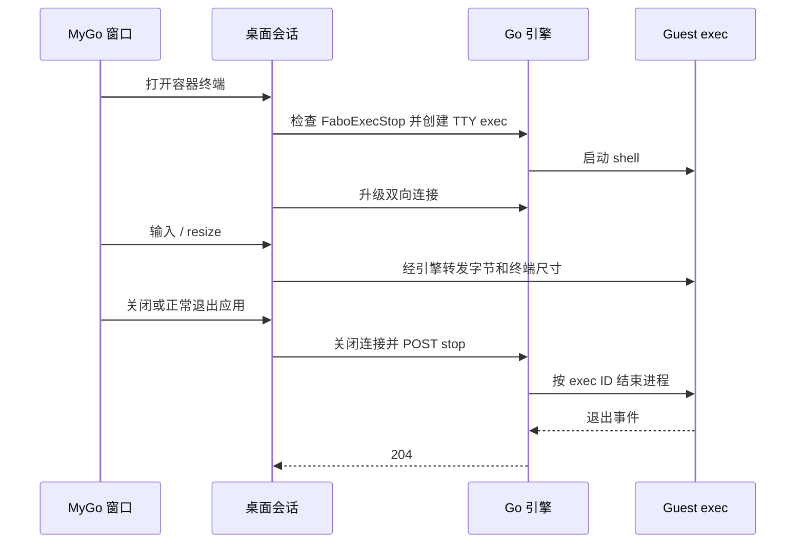

# 连续终端与日志

原来的容器终端每次启动 `sh -c`，无法保留工作目录、环境变量或运行交互程序；日志则反复读取固定尾部，Pod 日志还需要手动刷新。MyGo 现在提供原生 PTY 终端和持续日志订阅，沿用现有 Go 引擎及 Docker exec / logs 接口。

参考为本地 Fabo `a649319` 的 `ui/term.rs`、`ui/termwire.rs`、`ui/detail.rs` 和 `ui/k8s.rs`。上游内嵌终端主要运行宿主 shell；本实现另将容器详情中的命令输入升级为交互式容器 TTY。

## 使用入口

- **宿主终端**：侧栏「终端」，选择已安装的 shell，点击「新建终端」。各会话有独立的 shell、环境和工作目录，可从会话菜单切换；「关闭会话」结束当前 shell。
- **容器终端**：容器详情 →「终端」自动连接 `/bin/sh`。支持连续输入、ANSI 颜色、控制键和窗口 resize；切换详情页或导航页面保留会话。「重新连接」结束旧 exec 后创建新会话；「关闭终端」只结束该 exec，不停止容器。镜像需包含 `/bin/sh`。
- **日志**：容器「日志」和 Pod「日志」持续追加输出。容器的「跟随」仅控制自动滚动，关闭后继续接收。重新连接 / 刷新会建立新订阅；切换目标或离开日志详情结束旧订阅。Pod 可切换容器，或查看上一次运行。

会话自然退出后保留终端画面和退出码，用户自行新建或重连。容器停止、被删除或被桌面识别为重新启动后，回收其旧终端。宿主终端可以在引擎离线时使用，不会因打开页面自动运行命令。

## 实现边界

`desktop/terminal.go` 管理终端会话和界面；`exec_stream.go` 封装升级后的双向 HTTP 连接、resize 和 exec 回收；`log_stream.go` 管理日志订阅及有界缓冲。MyGo 的 `plugins/terminal` 负责终端模拟、原生绘制、键盘、选择和粘贴。

每个终端会话由 worker 持有资源，通过锁保护的快照向主线程报告启动、退出和错误。切换页面不复制终端。已关闭的会话仍跟踪到清理完成，避免刚关闭一个会话就退出应用时丢失回收任务。正常关闭窗口、应用退出及 SIGTERM 都取消会话，并等待回收，最多 7 秒；失败写入运行日志。

宿主 shell 在独立 PTY 中运行，macOS 使用 login shell；继承用户环境，将当前安装的工具路径放在初始 PATH 前面，不修改 shell 配置文件。宿主 PTY 的关闭、hangup 和必要时的进程组终止由 MyGo 组件处理。

### 容器 exec 的关闭契约

Docker 的 TTY 连接断开表示 detach，Go guest 也不会把 TTY stdin 关闭视为进程退出。桌面主动关闭终端 / Pod 日志时，必须另行结束它创建的 exec，不能只关闭连接。

- `/info` 的 `FaboExecStop: true` 表示引擎支持该回收能力。桌面创建持续 exec 前检查它；旧引擎会收到「从更新后的 app 重启引擎」的提示，不创建无法回收的会话。
- `POST /fabo/exec/{id}/stop` 仅操作可公开 inspect 的 exec，不操作内部构建或健康检查 exec。不存在 / 内部记录返回 404；已退出记录返回 204，并保留 inspect 结果。
- 未启动的记录在 stop 时撤销；stop 与 start 使用同一容器操作锁，避免撤销后又启动。
- 运行中的 exec 通过原 guest 协议发送 SIGKILL，并等待退出事件，最长 5 秒；不停止它所属的容器。客户端也有有界清理超时，失败保留错误。
- 普通 Docker exec / attach 的断线语义没有改变。正常桌面退出通过显式 stop 请求回收；本轮没有为强制终止或进程崩溃增加另一套服务器端会话协议。



### 日志订阅

容器使用 `GET /containers/{id}/logs?follow=1`，初始尾部 5,000 行；Pod 在既有 k3s 节点中运行 `kubectl logs --follow`，初始尾部 2,000 行，与上游对应入口一致。上一次运行不加 `--follow`。列表查询仍有 guest 内 20 秒 timeout，持续日志不经过该有限命令包装。

被动读取（包括 Pod exec 的创建、start、inspect 和清理）携带 `X-Fabo-Background: 1`。连接启动有超时，已建立的安静日志流 / 终端没有总时长超时。Docker 非 TTY 输出按 8 字节帧头增量解码，支持帧头、UTF-8 和行尾跨读取；非法 / 截断帧报告错误。

每个日志源独立持有数据与取消上下文；主线程仅取快照，并检查目标身份，旧订阅不会把内容写入新目标。约 60 ms 合并一次重绘；缓冲保留最多 5,000 行 / 1 MiB，含无换行的末尾输出，超过时丢弃最旧内容。首次加载与缓冲截断是两个独立限制，不等同于保存完整日志。

源退出、传输错误和 kubectl 非零退出都会结束当前订阅并显示原因，不在每帧自动重试。Pod 换 UID 后重置容器和上一次运行选择，避免沿用已重建 Pod 的旧选择。

## 打包与验证

终端运行库为 MyGo v0.8.3 绑定的 `libghostty-vt`。macOS 打包脚本按 `packaging/cli-pins.env` 的固定 SHA-256 下载，放入 app 的 Resources，并在签 app 前单独签名；同时携带 `Ghostty.LICENSE`。正式 app 不在用户打开终端时下载运行库。更新 MyGo 时必须核对其 `plugins/terminal/mygo-plugin.json`，同步两个 Mac 架构的 pin。

源码运行时 MyGo 可按自身规则查找 / 缓存下载运行库。涉及真实 shell 和原生运行库的 PTY 测试显式开启，普通 API / 分帧 / 缓冲 / 取消测试无需该下载：

```sh
make check
FABO_TERMINAL_TEST=1 go -C desktop test -race ./...
FABO_SIGN_IDENTITY=- make app-dev FLAVOR=streams
```

2026-11-14，当前源码的 macOS 原生窗口配合隔离 Go VM 的 17 项专项验收全部通过，覆盖终端输入、状态保留、实际 resize、Ctrl+C、静默保持、非零退出码、真实 shell PID 回收、宿主多会话、持续 Pod 日志、旧订阅回收及 SIGTERM 退出。截图和逐项结果保留在 `target/desktop-streams-check/`；测试 VM、临时配置和进程已清理。Linux / Windows 仅交叉编译，未实机运行。

尚未复刻上游底部终端面板、分屏布局及完整终端搜索等入口；本轮没有扩展全量端到端回归、物理 USB 或真实私人仓库验证。
