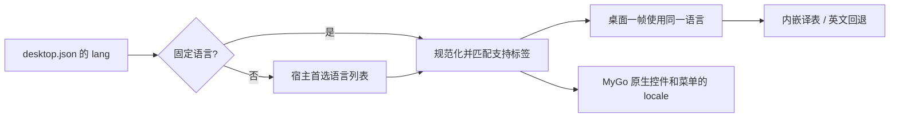

# 桌面多语言

桌面沿用 Kiri 的 15 种语言范围。设置 → 外观 → 语言可以选择跟随系统或固定语言，立即切换并写入当前安装状态目录中的 `desktop.json`。各安装 flavor 分别保存设置，不修改 shell、容器、Kubernetes 对象或 Docker 配置。

| 语言 | 保存的标签 |
| --- | --- |
| 英文 | `en` |
| 简体中文 | `zh-Hans` |
| 繁体中文 | `zh-Hant` |
| 德语 | `de` |
| 西班牙语 | `es` |
| 法语 | `fr` |
| 巴西葡萄牙语 | `pt-BR` |
| 意大利语 | `it` |
| 波兰语 | `pl` |
| 俄语 | `ru` |
| 土耳其语 | `tr` |
| 日语 | `ja` |
| 韩语 | `ko` |
| 越南语 | `vi` |
| 印度尼西亚语 | `id` |

选择器显示各语言的自称，便于切换回来。原来的 `lang: "zh"` 仍解释为简体中文，不要求重置设置。

## 匹配与回退

参考本地上游 `a649319` 的 `crates/kiri/src/ui/lang.rs`：

- 系统模式按宿主首选语言列表依次查找支持的语言，无匹配时使用英文。
- 接受大小写、下划线、地区和 locale 编码后缀，例如 `fr_CA.UTF-8` 对应 `fr`。
- `zh-TW`、`zh-HK`、`zh-MO`、`zh-Hant` 对应繁体；显式 `zh-Hans` 优先，其余中文对应简体。
- 葡萄牙语对应 `pt-BR`，旧印度尼西亚语标签 `in` 对应 `id`。
- 未知的显式设置值和缺少的消息回退到英文，不以其他语言冒充译文。

桌面文案、托盘的打开入口和 MyGo 的语言设置保持同步；MyGo 自带控件的具体词条由组件自身提供。运行日志、后端错误原文、容器输出、对象名称、文件路径和技术协议标识不翻译。首次语言选择引导属于独立的待对齐流程，本轮没有加入。

## 译表维护

`desktop/language.go` 管理支持列表、标签解析和查询，`desktop/languages/*.json` 按英文消息键保存 14 份内嵌译表。简体中文保留现有 `tr(中文, English)` 调用契约，同时提供对应目录文件，测试检查二者一致。当前每份目录有 407 条消息。

译表优先复用本地 Kiri `ui/lang/*.json` 的对应文案，适配品牌、移除仅用于 HTML 的标签，并把命名占位符转换成 Go `fmt` 参数；MyGo 独有的终端、容器设置及其他缺口补充本地译文。繁体新增词条由简体转换后核对界面，与上游已有词条合并。译表随程序发布，运行时不下载，也不调用翻译服务。

增加文案时：

1. 在现有渲染边界使用 `tr(中文, English)`，保持英文键稳定。
2. 同步全部 14 份目录。不要翻译参数、变量名、路径或协议标识。
3. 保留 `fmt` 参数的类型和位置。需要调换顺序时使用 `%[2]s`；带精度的位置参数写成 `%.0[2]f`。
4. 运行 `go -C desktop test ./...`。目录测试从实际 Go 调用和双语导航 / 设置项提取消息，检查完整覆盖及参数兼容；还覆盖系统匹配、旧设置、回退、保存和各语言渲染。

macOS app 的 `CFBundleLocalizations` 与支持列表一致。新增语言时同步该列表及 `desktop/language.go`，并运行 `make check` 和原生窗口验收。本轮 macOS 原生窗口 17 项专项通过，覆盖所有非英文语言的切换和保存、重启恢复、系统选项及旧 `zh` 设置。`make check`、desktop race 和 app ad hoc 签名检查通过；证据保存在 `target/language-check/`。Linux / Windows 本轮仅交叉编译，未实机验收；CLI、引擎和 guest 的输出没有在本轮国际化。
