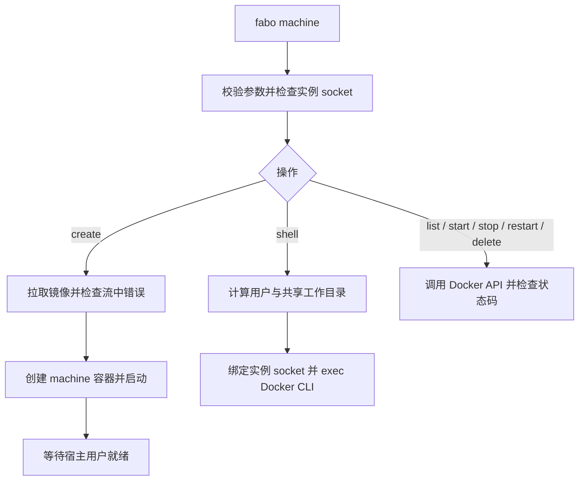

# Linux machine 命令

`fabo machine` 提供持久运行的 Linux 开发环境。machine 使用普通 Docker 容器实现，宿主用户可在相同路径访问 home 下的文件。Go 入口位于 `engine/cmd/fabo/machine.go`，行为对照本机 Kiri 源码的 `crates/kiri/src/machine.rs`。

```sh
fabo machine create dev --distro alpine
fabo machine list
fabo machine shell dev
fabo machine shell dev -- sh -c 'id; pwd'
fabo machine stop dev
fabo machine start dev
fabo machine restart dev
fabo machine delete dev
```

## 核心规则

- 名称使用 ASCII 字母、数字和连字符，以字母或数字开头。容器名是 `machine-NAME`，标签为 `dev.fabo.machine=NAME`。`list` 仅列出带该标签的容器，包含停止状态；`ls` 和 `rm` 分别是 `list` 和 `delete` 的别名。
- 默认镜像为 `ubuntu:24.04`。`--distro` 支持 `ubuntu`、`debian`、`alpine`、`fedora`、`arch`、`rocky`、`opensuse`；`--image IMAGE` 支持自定义镜像，包括带 registry 端口或 digest 的引用。沿用上游行为，发行版简称在两个选项中均可使用，两个选项均可接受自定义镜像。
- 创建时拉取镜像，写入容器配置并启动，然后最多等待约 30 秒确认宿主用户已建立。HTTP 错误、拉取流中的错误和用户初始化失败都返回非零退出码。启动或初始化失败时保留容器，供查看日志或删除，不自动销毁其数据。
- 容器中使用宿主的 `USER`、UID、GID；UID 为 0 时使用 `root`。初始化为其配置免密 sudo；精简镜像缺少 sudo 时在后台安装，因此刚创建成功时 sudo 可能尚未就绪。自定义镜像需要支持相应的 shell、账户及包管理命令。
- macOS 绑定 `/Users:/Users`，Linux 绑定 `/home:/home`。shell 在宿主工作目录位于共享目录内时沿用该目录，否则进入 `/Users/USER`、`/home/USER` 或 `/root`。这与宿主 `HOME` 环境变量的任意覆盖不同。
- shell 复用 Docker CLI；有终端时使用 `exec -it`，管道输入使用 `exec -i`。默认启动 bash 或 sh 的 login shell；`--` 后的参数原样传入。标准输入输出、信号和退出码由现有 Docker 透传路径保留。
- 所有操作使用当前安装的 socket，支持 `FABO_SOCKET`。shell 设置 `DOCKER_HOST` 并清除 `DOCKER_CONTEXT`，避免误连其他实例。引擎离线时报错，不自动启动或修改 Docker context。
- 停止保留可写层；启动和停止对 Docker 的 `304` 返回成功。删除强制移除容器及其匿名卷；共享的宿主文件不会删除。
- `--systemd` 启用 privileged、`/run`、`/run/lock`、`/tmp` tmpfs、`container=docker` 和 `SIGRTMIN+3` 停止信号；镜像缺少 systemd 时先安装。创建成功仅表示容器与用户已就绪，systemd 服务初始化可能仍在继续。



## 验证

```sh
go -C engine test -race ./cmd/fabo
make check
```

自动测试覆盖发行版与参数、镜像引用、HTTP 请求和错误、拉取流失败、创建中断、用户就绪、systemd 配置、列表过滤、重复启停、删除失败、shell 工作目录、子进程标准输入输出和退出码，以及超时与非法响应。

实机验证使用独立的 Go 引擎 socket、状态目录、数据盘和 Docker 配置；不能对日常使用的 Fabo 实例运行这些生命周期测试。当前验证结果和平台限制见[功能对齐基线](compatibility-baseline.md)。
