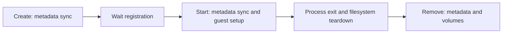

# 容器生命周期性能调查（2026-11-14）

结论：主要差距来自磁盘同步策略。用户确认后，已将虚拟磁盘与 saveJSON 状态文件的默认同步策略改为 fsync，尚未部署。正式实现及同步策略差异见本次提交的源码。Go 子进程启动不是本轮最大的耗时来源。

## 环境与口径

Fabo 源码、机器、工具链和产物哈希见 environment.json。Kiri 是本机安装的 0.2.0 二进制；本地上游源码用于解释行为，不保证与安装二进制逐行一致。两引擎使用相同 SHA256 的 Linux 内核、2 vCPU、2048 MiB、独立 VM 和独立数据盘，均不共享现用应用状态。镜像固定为 alpine@sha256:f59abe656b692d901e184be3445e084786602108599d2a51d229c0f5a48c71bf。

Python 客户端使用相同请求链：create → 注册 wait removed → start → 读完 removed 响应并验证退出码。每组 5 次预热 + 100 次采样。镜像提前拉取，不计下载和 VM 冷启动；保留全部样本。顺序测试，宿主仍有其他应用运行，不能作为跨机器性能承诺。阶段可能重叠，不能把各阶段 p50 相加当总 p50。



| 方案 | network none p50 | p99 | 说明 |
| --- | ---: | ---: | --- |
| Fabo 原版 | 34.92 ms | 43.77 ms | phases-baseline.json |
| 原版加临时计时 | 32.77 ms | 36.53 ms | 30 次，不用于性能排名 |
| 改为父进程挂载 OverlayFS | 32.21 ms | 43.21 ms | 等待从 wait 转移到 unmount，无实质收益，已撤回 |
| Cached + Full 虚拟磁盘 | 33.23 ms | 41.37 ms | 保持强同步，缓存本身不是主要收益来源 |
| Cached + Fsync 虚拟磁盘 | 14.98 ms | 20.24 ms | 状态文件仍为原有同步策略 |
| 虚拟磁盘 + 状态文件均 fsync | 3.15 ms | 5.71 ms | 候选补丁；复测 p50 2.91 ms、p99 8.11 ms |
| Kiri 0.2.0 | 1.29 ms | 2.04 ms | kiri-none.json |

bridge：原版 Go CLI 自带 API 基准 p50 64.09 ms；Python 客户端候选 32.18 ms，Kiri 31.98 ms。原版 bridge 与其他两者客户端不同，不能据此给出精确加速比。原版同一 Go CLI 的 none API p50 33.14 ms，接近 Python 的 34.92 ms。

## 归因

- host created / starting / running 保存各执行 `os.File.Sync()`。本机 Go 的 Darwin 实现使用 F_FULLFSYNC，而不是普通 fsync。临时计时显示每次约数毫秒；原始分段统计见 trace-summary.json。
- guest wait 耗时约 20 ms，显式 cleanup + remove 仅约 0.2–0.4 ms。改为父进程挂载后，同一耗时转移到了 unmount，说明不是单纯 Go Wait/调度开销。
- 仅把虚拟磁盘从 Cached + Full 改成 Cached + Fsync，退出尾部大幅缩短；再将宿主状态文件 Sync 改成 syscall.Fsync，生命周期降至约 3 ms。
- 两项策略均对齐到 fsync 后仍比 Kiri 慢约 1–2 ms，后续才值得拆解 Go re-exec、guest mount 和 RPC。

## 持久性边界

Apple Virtualization SDK 头文件明确：Full 保证已同步数据进入永久介质；Fsync 不保证数据离开磁盘内部缓存。Go 元数据从 F_FULLFSYNC 改为 fsync 也有对应的掉电保证差异。这不是“免费优化”，必须由产品策略选择。实验没有采用无同步模式，没有跳过删除完成通知，也没有删除 sync 调用。

用户明确选择将默认值也改为 fsync，因此未新增配置开关。macOS 虚拟磁盘使用 Cached + Fsync；saveJSON 使用 syscall.Fsync，保留临时文件写入、同步、关闭、原子替换及失败返回流程。Linux 的 saveJSON 仍使用 fsync 级别同步。现有状态文件与数据盘格式不变，无需迁移；虚拟磁盘策略在新 daemon / VM 启动后生效。

## 验证与复现

`smoke.json` 包含 8 项实际检查：退出码 0/1/42、输出 drain、重复启动、重启后状态/文件保留及清理。常规重启检查不能证明断电安全。正式实现的构建、make check 和真实 VM 回归结果见下方最终验收。

在专用引擎已启动、镜像已存在时，从仓库根目录运行：

```sh
python3 scripts/perf/lifecycle.py \
  --socket /path/to/private/docker.sock \
  --image alpine@sha256:f59abe656b692d901e184be3445e084786602108599d2a51d229c0f5a48c71bf \
  --runs 100 --network none --out /tmp/lifecycle.json --max-p50-ms 10
```

10 ms 是本机本次实验的回归门槛，不是跨机器保证。原版实测命令退出 1（threshold-baseline.json/log），fsync 实验版退出 0（threshold-experiment.json）。脚本只创建 AutoRemove 测试容器；失败时只清理它创建的容器，不拉镜像或改 Docker context。

正式代码不含诊断输出。全部 `[DEBUG-perf]` 临时计时已从引擎源码清除。隔离实例在交付前停止；日常 Fabo 未重启。

## 最终验收：默认 fsync 已实现

从当前性能工作区重新编译了无诊断输出的 daemon、guest、initramfs。签名检查通过；产物唯一绝对路径、mtime、SHA256 见 final-artifacts.json。未打包或替换已安装应用，未提交或合并。

- `make check` 全部通过：engine vet/race 测试、desktop vet/测试、Linux ARM64 vet 与测试编译。交叉检查不等于 Linux 运行时验收。
- `TestSaveJSONReplacement` 覆盖成功替换、序列化失败保留原记录、rename 失败及临时文件清理；原有状态恢复测试通过。
- 正式构建真实 VM 的 12 项检查全部通过，见 final-smoke.json：退出码 0/1/42、缺失命令、输出完整、bridge 地址、重复启动、退出状态、重启恢复、可写层、卷数据及测试资源清理。
- 同一客户端、镜像和 VM 资源下，100 次 + 5 次预热：none p50 **4.0947 ms**、p99 **21.5733 ms**，bridge p50 **33.7481 ms**、p99 **55.8483 ms**。相较首次原版 none p50 34.9162 ms 降低约 88%；本机存在其他负载，尾延迟仍有波动，未声明固定倍数保证。正式 none 回归命令带 10 ms p50 门槛并通过。
- 未运行全量 `tests/e2e.sh`，未验证真实断电或 Windows 宿主。无持久化 schema 变更。隔离实例和测试容器/卷已停止或清理。
