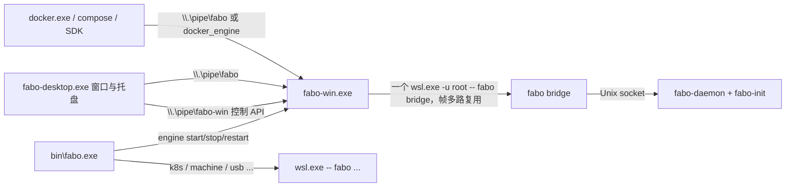

# Fabo for Windows

Fabo 在 Windows 上把引擎跑在 WSL 2 的一个发行版里，Windows 一侧只做三件事：在命名管道上提供 Docker API 并把连接搬进 WSL、管理 WSL 里的引擎和首次设置、显示窗口与托盘。全部是 Go，对照上游 Kiri 的 `crates/kiri-win/` 与 `crates/kiri/src/bridge.rs`、`wsl.rs`。

## 组成



| 文件（安装在 `%LOCALAPPDATA%\Fabo`） | 来源 | 作用 |
| --- | --- | --- |
| `fabo-win.exe` | `engine/cmd/fabo-win` | 常驻宿主，无窗口（`-H windowsgui`）。服务 `\\.\pipe\fabo`；没有其他引擎时也服务 `\\.\pipe\docker_engine`，Docker Desktop 等启动后让出；控制管道 `\\.\pipe\fabo-win`；首次设置、引擎启停与守护、Windows 代理推送、更新 |
| `fabo-desktop.exe`、`ghostty-vt.dll` | `desktop/` | MyGo 窗口与托盘。设置未完成时整窗显示首次设置；引擎启停走控制管道；凭据存 Windows 凭据管理器；单实例；登录自启时带 `-hidden` 只进托盘。Windows 上不提供打包 / 解包、调试终端和从 OrbStack / Docker Desktop 导入（`bin\fabo.exe` 做不到），子进程不弹控制台 |
| `bin\fabo.exe` | `engine/cmd/fabo/*_windows.go` | `fabo` 命令：docker 子命令交给同目录 `docker.exe`，`k8s`、`machine`、`usb`、`import`、`raw`、`share`、`bench` 交给 WSL 里的 Linux `fabo`，`engine start/stop/restart` 交给 fabo-win |
| `bin\docker.exe`、`bin\cli-plugins\` | `packaging/cli-pins.env` | docker CLI、Compose、buildx，按 SHA-256 固定 |
| `fabo-linux.tar.gz` | `scripts/fabo-linux.sh` | Fabo Linux：Alpine minirootfs 加 Linux 引擎，导入为 WSL 发行版 `fabo` |
| `fabo`、`fabo-daemon`、`fabo-init`、`fabo-start`、`install.sh` | `engine/cmd/*`、`contrib/wsl` | 装进用户自己的发行版（Ubuntu），以及更新后同步进 WSL |
| `fabo.ps1`、`setup-tools.ps1`、`fabo-admin.ps1` | `contrib/windows` | 卸载与更新助手、设置的 Docker 工具一步、需要管理员的一步（装 WSL） |

### 桥接协议

`engine/internal/wslbridge` 同时实现两端：帧是 `kind(1) | id(u32 BE) | len(u32 BE) | data`，种类 OPEN / DATA / EOF / CLOSE / ACK，与上游逐字节一致。每个连接每个方向最多 4 MiB 未确认，接收方每交出 1 MiB 回一个 ACK；桥启动时对连接 0 发 ACK 表示支持流控。EOF 单独成帧，所以 `docker run` / `attach` 需要的半关闭能穿过 WSL（WSL 的 localhost TCP 转发会丢掉半关闭）。相对上游的改动：WSL 端在连接两个方向都 EOF 后自行回收（上游会留到桥进程退出）。

命名管道用 go-winio 的 message 模式：`CloseWrite` 先 Flush 再写空消息作为 EOF；安全描述符只允许当前用户、SYSTEM 和管理员；拒绝远程客户端；名字已被占用时不启动。两次半关闭之后最多等 2 秒让客户端先关，避免它在读到 EOF 前被断开（上游 `linger`）。

### 引擎在 WSL 里的生命周期

- 有 systemd 的发行版（Ubuntu）用 `install.sh` 装的 `fabo.service`；Fabo Linux 没有 systemd，用 `fabo-start start|stop|restart`。
- 启动、停止、重启、守护和设置里的拉起共用一把锁，依次执行（两个 `fabo-start` 重叠会让后一个删掉前一个刚建的 socket）。
- fabo-win 每 15 秒检查一次引擎（经自己的管道 `GET /_ping`），设置已完成、用户没点停止时自动拉起。拉起前用 `install.sh --sync` 把安装目录里本版本的引擎同步进 WSL（只复制不同的文件）。
- `fabo engine restart`（窗口里「重启引擎」）同步后重启引擎，并重开桥，使 `fabo bridge` 也换成新版本。
- WSL 里的引擎是宿主进程 agent，没有 VM 可唤醒，所以窗口的「启动」「停止」由 fabo-win 在 WSL 里执行，而不是调用引擎的 `/fabo/wake`、`/fabo/stop`。

### 首次设置

步骤与上游 `setup.rs` 一致，状态存在 `%LOCALAPPDATA%\Fabo\setup.json`，重启 Windows 后从断点继续：

1. WSL：从 GitHub 下载固定版本的 WSL MSI 并校验 SHA-256（固定值已与 GitHub 资产 digest 核对）；`fabo-admin.ps1 -Wsl` 以管理员身份在用户不可写的副本上再校验一次哈希和 Microsoft 签名，开启「虚拟机平台」并安装；需要重启时登记 RunOnce，重启后 Fabo 自动打开继续。
2. Linux：Fabo Linux（随包，导入为 `fabo`）或 Ubuntu（已有的直接用，否则下载固定的 Ubuntu 26.04.1 WSL 镜像，固定值已与 ubuntu.com 的 SHA256SUMS 核对），后者跑 `install.sh` 装引擎。
3. 引擎：启动并经管道跑 `docker run --rm alpine echo hello`，失败时显示引擎自己的错误。
4. Docker 工具：`setup-tools.ps1` 把 `bin` 加到用户 PATH 末尾、Compose / buildx 写进 `cliPluginsExtraDirs`（先备份 `config.json`）、建 `fabo` context 与 `fabo-build` builder，可选设为默认。
5. 就绪：可选「登录时启动 Fabo」（`HKCU\...\Run` 的 `Fabo`，运行 `fabo-win.exe --background`）。

设置未完成时，docker 连到管道会收到 503 和「Fabo's setup isn't finished」。fabo-win 运行或导入的每个随包文件都先对照构建时嵌入的 SHA-256 清单；正式构建没有清单时拒绝运行这些文件。

### 更新

feed 地址在构建时由 `FABO_UPDATE_URL` 注入，留空则窗口里没有更新（本仓库还没有发布更新源，见 [发版说明](release.md)）。feed 格式 `{"version","url","sha256","size","notes_url"}`，只接受 HTTPS。下载后校验 SHA-256，再用 `msi.dll` 读出 UpgradeCode、平台（x64 / Arm64）和 ProductVersion，必须与 Fabo 的 UpgradeCode、本机架构和 feed 承诺的更新版本一致才暂存到 `update\`。「立即重启」或退出时由 `fabo.ps1 -Update` 等 fabo-win 退出后静默升级并重新打开 Fabo；启动时发现没尝试过的暂存更新也只装一次。MSI 尚未签名，这是与 macOS 更新的主要差别。

MSI 的 UpgradeCode 是 Fabo 自己的 `839A68B8-98E7-4BBD-B1DE-DAB0B047B7D4`，不是上游 Kiri 的：沿用 Kiri 的会让 Fabo 的 MSI 把已装的 Kiri 当成旧版 Fabo 卸掉。三个 Component GUID 也已换新。

## 构建

```sh
make windows                    # target/windows/fabo-windows-x86_64，并用 scripts/check-wxs.py 核对 fabo.wxs
make windows WIN_ARCH=arm64     # Windows on Arm；docker.exe 从 docker/cli 源码构建，须与固定的 SHA-256 一致
FABO_UPDATE_URL=https://…/latest-windows-x86_64.json make windows
```

`scripts/windows-bundle.sh` 在 macOS 或 Linux 上完成除 MSI 之外的一切：交叉编译 Linux 引擎和三个 Windows 程序（带图标与版本资源，`scripts/winres` 生成 `.syso`，构建后删除）、下载并校验固定版本的 docker CLI / Compose / buildx / `ghostty-vt.dll`、用 `engine/cmd/fabo-mkrootfs` 流式生成 Fabo Linux（不解包，文件属主保持 root），最后带着其余文件的 SHA-256 清单构建 `fabo-win.exe`。

MSI 只能在 Windows 上构建（WiX 依赖 Windows Installer 自身的库）：

```powershell
dotnet tool install --global wix
wix extension add -g WixToolset.UI.wixext WixToolset.Util.wixext
# 把 Mac 上做好的 target\windows 复制过来，或在 Windows 上用 Git Bash 跑 scripts/windows-bundle.sh
powershell -ExecutionPolicy Bypass -File scripts\windows-msi.ps1 -Version 0.6.0 [-Arch arm64]
```

产物是 `target\windows\Fabo-<version>-<arch>.msi` 和更新源条目 `target\windows\latest-windows-<arch>.json`（`FABO_RELEASE_BASE` 指定发布地址，默认 GitHub Release）。WiX 的扩展版本要与 `wix` 主版本一致。本机（macOS）没有 WiX，MSI 尚未实际构建过。

## 开发与调试

- `fabo-win.exe --distro NAME` 跳过设置直接桥接到已有发行版；`--pipe`、`--socket` 换管道名和 WSL 里的 socket。
- `FABO_WIN_DIR` 换掉 `%LOCALAPPDATA%\Fabo`（`setup.json`、`fabo-win.log`、下载）。
- 日志：`%LOCALAPPDATA%\Fabo\fabo-win.log`（UTC 毫秒时间戳，与 WSL 里 `/var/log/fabo.log` 对得上）。
- 开发构建（`go build`，无清单）直接使用安装目录里的文件，不校验哈希；`scripts/windows-bundle.sh` 的构建会校验。
- `installer/windows/verify.ps1` 静默安装、检查、卸载最新的 MSI（不启动 Fabo，不碰 WSL）。

## 需要在真实 Windows 上验证

以下都只在 macOS 上交叉编译和单元测试过，没有在 Windows 上运行过：

| # | 项目 | 怎么验 |
| --- | --- | --- |
| 1 | MSI 构建 | `scripts\windows-msi.ps1`（x64 与 arm64），确认 WiX 无错误；检查对话框位图、准备页的目录 / 大小 |
| 2 | 安装与卸载 | 非管理员会话跑 `installer\windows\verify.ps1`；再手工装一次，开始菜单启动 |
| 3 | 首次设置：无 WSL 的电脑 | 下载进度、UAC 提示（拒绝时的报错）、`fabo-admin.ps1 -Wsl` 退出码、需要重启时 RunOnce 续跑 |
| 4 | 首次设置：Fabo Linux 与 Ubuntu 两条路 | 已有 Ubuntu、下载 Ubuntu（`--install --from-file` 与旧 WSL 的 `--import` 回退）、`install.sh` 在 systemd 下装服务 |
| 5 | 命名管道与半关闭 | `docker run --rm alpine echo hello`、`docker run -i alpine wc -c < 大文件`、`docker attach`、`docker logs -f` 后 Ctrl+C、`docker compose up` 多服务；输出末尾不丢、不报 “No process is on the other end of the pipe” |
| 6 | 管道安全 | 另一个本地用户打不开 `\\.\pipe\fabo`；先占用管道名时 fabo-win 拒绝启动并写日志 |
| 7 | docker_engine 让位 | 无 Docker Desktop 时 SDK（如 Python docker）直连成功；启动 Docker Desktop 后 Fabo 让出，已有连接不断 |
| 8 | WSL 启停 | `wsl --shutdown` 后 15 秒内引擎自动恢复；窗口「停止」后不再自动拉起，「启动」恢复；Windows 重启后（开启登录自启）docker 可用 |
| 9 | 窗口 | 设置向导各步、托盘打开 / 退出（退出后 docker 不再可用）、再次打开 Fabo 只出一个窗口、登录自启时只出现托盘不弹窗口、运行 `fabo` / `docker` 子进程时不闪控制台、终端（`ghostty-vt.dll`）可用、15 种语言 |
| 10 | 凭据 | 设置 → 仓库登录后 `cmdkey /list` 能看到条目，设置页的账号列表也列出它（`CredEnumerate` 返回的目标名可能带 `LegacyGeneric:target=` 前缀，代码已去掉）；配置 `"credsStore": "wincred"` 的 docker CLI 能读到同一条；拉私有镜像 |
| 11 | `bin\fabo.exe` | `fabo version`、`fabo compose up`、`fabo k8s status`、`fabo machine shell NAME`、`fabo engine restart`、Ctrl+C 传给 docker |
| 12 | 更新 | 用自建 HTTPS feed：可用 → 下载 → 立即重启后版本更新、引擎提示重启；伪造 UpgradeCode / 平台 / 旧版本的 MSI 被拒；退出时安装 |
| 13 | 系统代理 | 非回环的 Windows 代理：拉镜像和容器出网都经过它；127.0.0.1 上的代理（Clash 等）：被跳过，直连仍可拉 `alpine` |
| 14 | 卸载清理 | 卸载后 `fabo` 发行版注销、PATH / context / Run 项清除、`%LOCALAPPDATA%\Fabo` 删除；升级时数据保留 |
| 15 | `tests/wsl.sh` | 在 Windows 上整套重跑 |

## 尚未移植

| 功能 | 上游位置 | 现状 |
| --- | --- | --- |
| `*.fabo.local` 名称（NRPT 规则加 127.0.0.1:53 DNS 应答） | `crates/kiri-win/src/dns.rs` | 未移植；`fabo-admin.ps1 -Dns` 已在，Go 宿主未调用 |
| Windows 回环地址上的代理中继（`fabo hostrelay`） | `crates/kiri-win/src/relay.rs`、`crates/kiri/src/hostrelay.rs` | 未移植；代理在 Windows 的 127.0.0.1 上时 fabo-win 不把它推给引擎，拉镜像和容器直连 |
| USB（usbipd-win） | `crates/kiri-win/src/usb.rs` | 未移植；`fabo usb` 只能看到已手动 `usbipd attach --wsl` 的设备 |
| 设置 → 资源（`.wslconfig` 的 CPU / 内存） | `crates/kiri-win/src/wslconfig.rs` | 未移植 |
| 诊断日志 / 报告 | `crates/kiri-win/src/diag.rs` | 未移植；日志在 `fabo-win.log` 与 WSL 的 `/var/log/fabo.log` |
| 设置里「用 Docker 还是 Fabo 构建」 | `crates/kiri/src/buildwith.rs` | Windows 上未提供；设为默认时 `docker build` 用 Fabo 引擎 |
| 打包 / 解包、调试终端、从其他引擎导入 | `crates/kiri/src/pack.rs`、`debug.rs`、`import.rs` | Windows 窗口里隐藏；需要 Windows 侧实现（路径在 Windows，工具在 WSL） |
| MSI 与 exe 签名 | — | 未签名；更新只靠 HTTPS feed 与 SHA-256 |
