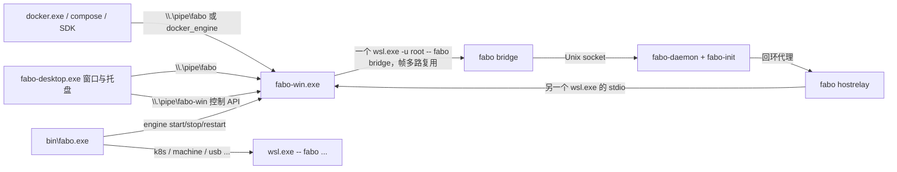

# Fabo for Windows

Fabo 在 Windows 上把引擎跑在 WSL 2 的一个发行版里，Windows 一侧只做三件事：在命名管道上提供 Docker API 并把连接搬进 WSL、管理 WSL 里的引擎和首次设置、显示窗口与托盘。全部是 Go，对照上游 Kiri 的 `crates/kiri-win/` 与 `crates/kiri/src/bridge.rs`、`wsl.rs`。

## 组成



| 文件（安装在 `%LOCALAPPDATA%\Fabo`） | 来源 | 作用 |
| --- | --- | --- |
| `fabo-win.exe` | `engine/cmd/fabo-win` | 常驻宿主，无窗口（`-H windowsgui`）。服务 `\\.\pipe\fabo`；没有其他引擎时也服务 `\\.\pipe\docker_engine`，Docker Desktop 等启动后让出；控制管道 `\\.\pipe\fabo-win`；首次设置、引擎启停与守护、Windows 代理推送与回环代理中继、更新 |
| `fabo-desktop.exe`、`ghostty-vt.dll` | `desktop/` | MyGo 窗口与托盘。设置未完成时整窗显示首次设置；引擎启停走控制管道；凭据存 Windows 凭据管理器；单实例；登录自启时带 `-hidden` 只进托盘。Windows 上不提供打包 / 解包、调试终端和从 OrbStack / Docker Desktop 导入（`bin\fabo.exe` 做不到），子进程不弹控制台 |
| `bin\fabo.exe` | `engine/cmd/fabo/*_windows.go` | `fabo` 命令：docker 子命令交给同目录 `docker.exe`，`k8s`、`machine`、`usb`、`import`、`raw`、`share`、`bench` 交给 WSL 里的 Linux `fabo`，`engine start/stop/restart` 和 `domains [local on\|off]` 交给 fabo-win |
| `bin\docker.exe`、`bin\cli-plugins\` | `packaging/cli-pins.env` | docker CLI、Compose、buildx，按 SHA-256 固定 |
| `fabo-linux.tar.gz` | `scripts/fabo-linux.sh` | Fabo Linux：Alpine minirootfs 加 Linux 引擎，导入为 WSL 发行版 `fabo` |
| `fabo`、`fabo-daemon`、`fabo-init`、`fabo-start`、`install.sh` | `engine/cmd/*`、`contrib/wsl` | 装进用户自己的发行版（Ubuntu），以及更新后同步进 WSL |
| `fabo.ps1`、`setup-tools.ps1`、`fabo-admin.ps1` | `contrib/windows` | 卸载与更新助手、设置的 Docker 工具一步、需要管理员的两件事（`-Wsl` 装 WSL、`-Dns` 增删 `.fabo.local` 的 NRPT 规则） |

### 桥接协议

`engine/internal/wslbridge` 同时实现两端：帧是 `kind(1) | id(u32 BE) | len(u32 BE) | data`，种类 OPEN / DATA / EOF / CLOSE / ACK，与上游逐字节一致。每个连接每个方向最多 4 MiB 未确认，接收方每交出 1 MiB 回一个 ACK；桥启动时对连接 0 发 ACK 表示支持流控。EOF 单独成帧，所以 `docker run` / `attach` 需要的半关闭能穿过 WSL（WSL 的 localhost TCP 转发会丢掉半关闭）。相对上游的改动：WSL 端在连接两个方向都 EOF 后自行回收（上游会留到桥进程退出）。

命名管道用 go-winio 的 message 模式：`CloseWrite` 先 Flush 再写空消息作为 EOF；安全描述符只允许当前用户、SYSTEM 和管理员；拒绝远程客户端；名字已被占用时不启动。两次半关闭之后最多等 2 秒让客户端先关，避免它在读到 EOF 前被断开（上游 `linger`）。

### 代理中继

Windows 的代理软件大多监听在 Windows 自己的 `127.0.0.1` 上；WSL 默认的 NAT 网络里，发行版的 `127.0.0.1` 是它自己的，Windows 防火墙也挡着 WSL 网络访问 Windows 端口，所以引擎直接用这个地址会拉不了镜像。对照上游 `crates/kiri-win/src/relay.rs`（Windows 端）与 `crates/kiri/src/hostrelay.rs`（WSL 端），两端都在 `engine/internal/hostrelay`：

- fabo-win 每次推代理（`PUT /fabo/proxy/system`）前，从 Windows 代理和设置 → 网络里正在使用的自定义代理中找出回环地址的端口。有这样的端口时启动一个 `wsl.exe -d <发行版> -u root -- fabo hostrelay`，对每个端口发 LISTEN；`fabo hostrelay` 在发行版的 `127.0.0.1` 上随机端口监听，回 LISTENING（Windows 端口、WSL 端口），每个进来的连接以 OPEN 发回 Windows，fabo-win 只拨自己要求过的端口。推给引擎的 `relay` 是这张映射，引擎拉镜像和容器（经 guest 的 `127.0.0.2` 隧道）都拨 WSL 里的那个端口。
- 帧沿用桥的 `kind(1) | id(u32 BE) | len(u32 BE) | data`，种类 OPEN 1 / DATA 2 / EOF 3 / CLOSE 4 / LISTEN 6 / LISTENING 7，载荷（端口均为 u16 BE）与上游逐字节一致；没有 ACK，每个连接排队最多 64 帧，满了读帧的一方等待（与上游相同）。
- 推送时机：每分钟一次；引擎启动、重启成功后；设置的引擎步骤在测试 pull 之前；窗口保存代理设置后（控制管道 `POST /proxy`）；曾经回过 LISTENING 的中继自行结束时（`wsl --shutdown` 等）。引擎没在运行时不推送，也不起中继，免得把 WSL 一直拉着。
- 等中继应答最多 10 秒。没拿到映射的回环代理（WSL 里是没有 `hostrelay` 的旧 `fabo`、超时）不推给引擎，拉镜像和容器直连；`relay` 字段总是带上（可能是 `{}`），且不含 0（引擎会拒绝），这样旧映射不会残留在引擎里。

相对上游的改动：

- 不再需要中继时（代理关掉或不在回环上）先把不带中继的代理推给引擎，再停中继；要求的端口里有不再需要的，或发行版变了，就重启中继。上游的监听只增不减、换发行版时旧中继不停。
- fabo-win 退出前同样先撤回再停中继；停中继是关它的 stdin，2 秒没结束再结束 `wsl.exe`。`fabo hostrelay` 在 stdin 结束时关掉全部监听和连接（上游靠进程退出回收）。
- 上游把没拿到映射的回环代理照原样推给引擎；这里不推，改为直连。
- `fabo engine restart` 也重启中继，使它换成刚同步进 WSL 的 `fabo`。

### 引擎在 WSL 里的生命周期

- 有 systemd 的发行版（Ubuntu）用 `install.sh` 装的 `fabo.service`；Fabo Linux 没有 systemd，用 `fabo-start start|stop|restart`。
- 启动、停止、重启、守护和设置里的拉起共用一把锁，依次执行（两个 `fabo-start` 重叠会让后一个删掉前一个刚建的 socket）。
- fabo-win 每 15 秒检查一次引擎（经自己的管道 `GET /_ping`），设置已完成、用户没点停止时自动拉起。拉起前用 `install.sh --sync` 把安装目录里本版本的引擎同步进 WSL（只复制不同的文件）。
- `fabo engine restart`（窗口里「重启引擎」）同步后重启引擎，并重开桥，使 `fabo bridge` 也换成新版本。
- WSL 里的引擎是宿主进程 agent，没有 VM 可唤醒，所以窗口的「启动」「停止」由 fabo-win 在 WSL 里执行，而不是调用引擎的 `/fabo/wake`、`/fabo/stop`。

### 首次设置

步骤与上游 `setup.rs` 一致，状态存在 `%LOCALAPPDATA%\Fabo\setup.json`，重启 Windows 后从断点继续：

1. WSL：从 GitHub 下载固定版本的 WSL MSI 并校验 SHA-256（固定值已与 GitHub 资产 digest 核对）；`fabo-admin.ps1 -Wsl` 以管理员身份在用户不可写的副本上再校验一次哈希和 Microsoft 签名，开启「虚拟机平台」并安装；需要重启时登记 RunOnce，重启后 Fabo 自动打开继续。
2. Linux：Fabo Linux（随包，导入为 `fabo`）或 Ubuntu（已有的直接用，否则下载固定的 Ubuntu 26.04.1 WSL 镜像，固定值已与 ubuntu.com 的 SHA256SUMS 核对），后者跑 `install.sh` 装引擎。
3. 引擎：启动并经管道跑 `docker run --rm alpine echo hello`，失败时显示引擎自己的错误。
4. Docker 工具：`setup-tools.ps1` 把 `bin` 加到用户 PATH 末尾、Compose / buildx 写进 `cliPluginsExtraDirs`（先备份 `config.json`）、建 `fabo` context 与 `fabo-build` builder，可选设为默认。
5. 就绪：可选「登录时启动 Fabo」（`HKCU\...\Run` 的 `Fabo`，运行 `fabo-win.exe --background`）。

设置未完成时，docker 连到管道会收到 503 和「Fabo's setup isn't finished」。fabo-win 运行或导入的每个随包文件都先对照构建时嵌入的 SHA-256 清单；正式构建没有清单时拒绝运行这些文件。

### 容器域名 `*.fabo.local`

对照上游 `crates/kiri-win/src/dns.rs`，实现在 `engine/cmd/fabo-win/dns.go`（逻辑）与 `dns_windows.go`（系统调用）。不开时容器在 `<name>.fabo.localhost`，Windows 的浏览器无需设置就解析到本机；开了之后是 `<name>.fabo.local`：

- fabo-win 启动（确认是唯一实例）后在 `127.0.0.1:53` 上用 `SO_EXCLUSIVEADDRUSE` 绑 UDP，只答 `fabo.local` 及其子域：A 记录给 `127.0.0.1`，其他类型无记录，别的名字 REFUSED，从不转发。应答函数与 macOS 引擎共用 `engine/internal/domaindns`。Windows 的网络共享（ICS）占的是 `0.0.0.0:53`，回环地址仍能绑上；绑不上只记日志，Fabo 照常运行。
- 名称解析策略（NRPT）没有端口字段，所以应答必须在 53，而不是 macOS 的 53535。规则由 `fabo-admin.ps1 -Dns -Suffix fabo.local [-Off]` 以管理员身份增删（先删同名空间的旧规则再加，失败时不会留下旧规则），之后 `Clear-DnsClientCache`。
- 127.0.0.1 上的请求由 WSL 把引擎域名路由器的端口从 WSL 回环转到 Windows 回环，路由器两个后缀都认。
- 开关状态每次从机器读：注册表 `HKLM\SYSTEM\CurrentControlSet\Services\Dnscache\Parameters\DnsPolicyConfig` 下有 `.fabo.local` 的规则，**且**本进程占着 53 端口，才算开。不往 `setup.json` 存，崩溃重启后无需对账；脚本跑完也重新读注册表，不只信退出码。
- 控制管道 `GET /domains`、`POST /domains/on|off`；`bin\fabo.exe domains [local on|off]` 转给它，窗口的设置 → 域名经它读写（与 macOS 共用同一套界面，Windows 上不显示 HTTPS 一行，上游也只在 Mac 上提供）。开启时 53 端口不在手上直接报错、不弹 UAC；关闭总可以执行；拒绝 UAC 不算错误；切换进行中再请求返回 409。
- 退出 Fabo 不删规则（删要再弹 UAC，上游同样）：Fabo 不运行时 `*.fabo.local` 解析失败，只影响这一个后缀。卸载时 `fabo.ps1 -Uninstall` 最后一步请求批准删除规则。已知的半截状态：规则在但 53 端口被别的程序占着，界面显示「关」，界面上的开关停在 `fabo.localhost`，删规则要在命令行跑 `fabo domains local off`（上游界面同样删不了，命令行是 Fabo 新增的出路）。
- 与上游的差异：首次打开时不主动询问是否开启（MyGo 窗口在 macOS 上也没有这个询问）；应答 TTL 60 秒（上游 5 秒，切换时脚本会清 DNS 缓存）。

### 用 Docker 还是 Fabo 构建

普通 `docker build` 用哪个构建器，与 macOS 共用 `engine/internal/buildwith`（对照上游 `crates/kiri/src/buildwith.rs` 与 kiri-win 的接线）。fabo-win 改的是用户自己的 `%USERPROFILE%\.docker\config.json`（`DOCKER_CONFIG` 优先）里的 `aliases.builder` 和 buildx 的 `buildx\current`（`BUILDX_CONFIG` 优先），接管前的原样先存进 `%LOCALAPPDATA%\Fabo\build.json`；另把 `fabo-build` 复制成名为 `fabo` 的 builder，使 `docker --context fabo build` 落在 Fabo。

- 选择 Fabo：`docker build`、`docker compose build`、`docker buildx build` 不论 docker 用哪个 context 都在 Fabo 上构建；选择 Docker：构建跟随 docker 的 context，并把接管前的 alias 和当前 builder 原样放回（之后被 `docker buildx use` 改过的不动）。
- 没有其他引擎、也没人选过时，fabo-win 启动和设置完成时自动选 Fabo；装有 Docker Desktop / Rancher Desktop / Podman、PATH 上另有 `docker.exe`，或 `\\.\pipe\docker_engine` 被别的程序占着时不自动接管，窗口问一次（Esc 等于继续用 Docker），之后在 设置 → 构建 里切换。管道是否被别人占着取自 fabo-win 自己争用 `docker_engine` 的结果，不打开管道探测：fabo-win 没有别的引擎时自己就在服务这个管道，上游「管道存在即另有引擎」的判断在这里会把 Fabo 自己算进去。
- 归还：退出（托盘退出、为更新退出）时若构建仍全部交给 Fabo，以及 `fabo-win.exe` 所在目录被改名 / 移走 / 删除（每 30 秒看一次，连续两次不在）时，把 alias 和当前 builder 还回去并保留选择，下次启动再接管；卸载时 `fabo.ps1` 在删 builder 之前运行 `fabo-win.exe --uninstall-builds`，还回去并删掉 `fabo` 这个复制和 `build.json`。读到带 BOM 的 `config.json` 照常解析，未知字段与大数字原样保留，写回时不带 BOM（docker CLI 不认 BOM）。
- 相对上游的改动：上游正常退出不归还，Fabo 退出时归还（否则 Fabo 不在时 `docker build` 指向没人服务的 builder）；Fabo 运行期间用户已 `docker buildx use` 了别的 builder 时退出不动，下次启动也不重新接管。代价是 Fabo 关闭期间用户自己 `docker buildx use` 的选择会在下次启动时被重新接管（接管前的样子仍记在 `build.json`，切回 Docker 时还原）。另一引擎的判断比上游多一条：PATH 上有不是 Fabo 的 `docker.exe`（首次设置的「另有 Docker」）也算，窗口会问而不自动接管，相当于上游在设置向导里问的那一次。Windows 的 `bin\fabo.exe` 没有 `build-with` 命令（上游 Windows 也没有），只在窗口里切换。首次设置向导里不问这一项（上游的 `setup-build`），设置完成后由窗口问。

### 更新

feed 地址在构建时由 `FABO_UPDATE_URL` 注入，留空则窗口里没有更新（本仓库还没有发布更新源，见 [发版说明](release.md)）。feed 格式 `{"version","url","sha256","size","notes_url"}`，只接受 HTTPS。下载后校验 SHA-256，再用 `msi.dll` 读出 UpgradeCode、平台（x64 / Arm64）和 ProductVersion，必须与 Fabo 的 UpgradeCode、本机架构和 feed 承诺的更新版本一致才暂存到 `update\`。「立即重启」或退出时由 `fabo.ps1 -Update` 等 fabo-win 退出后静默升级并重新打开 Fabo；启动时发现没尝试过的暂存更新也只装一次。MSI 与 exe 不做代码签名，更新的可信性来自 HTTPS feed、SHA-256 和上述 MSI 属性校验。

MSI 的 UpgradeCode 是 Fabo 自己的 `839A68B8-98E7-4BBD-B1DE-DAB0B047B7D4`，不是上游 Kiri 的：沿用 Kiri 的会让 Fabo 的 MSI 把已装的 Kiri 当成旧版 Fabo 卸掉。三个 Component GUID 也已换新。

### USB（usbipd-win）

WSL 2 经 [usbipd-win](https://github.com/dorssel/usbipd-win)（4.x，微软推荐的工具）拿到 USB 设备，对照上游 `crates/kiri-win/src/usb.rs`。窗口的「USB 设备」页在 Windows 上走控制管道（macOS / Linux 走启动器，见下），引擎停止时页面照常显示（只依赖 fabo-win），已在 WSL 里的设备仍可还回：

- `GET /usb`：`usbipd state` 的设备（未插着的跳过），每台的总线 ID、名称、`vid:pid`、序列号、是否在 Fabo 里（已 attach 到 WSL）、是否已共享（已 bind）、fabo-win 何时 attach 的；没装 usbipd-win 时 `missing`；正在进行的动作在 `busy` 里，重开窗口也能看到。
- `POST /usb/attach`、`/usb/detach`（`{"value":"<总线 ID>"}`）、`/usb/install`。

状态只以每次重读的 `usbipd state` 为准，fabo-win 只记 attach 时间（重启后之前 attach 的设备不显示时间）。交给 Fabo 的顺序是：校验总线 ID（只接受 `数字-数字`）→ 设备还在 → 引擎在跑（否则直接报错，不弹 UAC）→ 未共享时以管理员运行 `usbipd bind --busid`（Windows 弹 UAC；拒绝时什么都不改，窗口不报错）→ `usbipd attach --wsl --busid`。attach 失败时设备保持「已共享、在这台电脑上」，不留半 attach 状态，下次不再弹 UAC；usbipd 报错但设备实际已 attach 时按成功处理。同一设备同时只允许一个动作（再点返回 409），列表不等待动作（UAC 弹着时页面照常刷新）。还回（`usbipd detach`）后设备仍保持共享。

「安装 usbipd-win」用 `%LOCALAPPDATA%\Microsoft\WindowsApps\winget.exe install --exact --id dorssel.usbipd-win`，安装程序自己请求批准；结果以装完后 `usbipd.exe` 是否存在为准。

与上游的有意差异：

- 只认 `%ProgramFiles%\usbipd-win\usbipd.exe`，不从 PATH 找（要以管理员运行它，不用用户可写目录里的同名程序）；winget 用 WindowsApps 下的执行别名（上游拼成 System32 下的路径）。
- 不显示设备在 WSL 里的路径（上游经引擎的 `/kiri/usb/nodes` 按 `vid:pid` 和序列号匹配）：Fabo 引擎没有这个接口，页面底部给出通用的 `--device` 写法。
- 不按名称猜设备类型和图标，不显示上游的 beta 横幅。
- 同一个页面在 macOS / Linux 上改走启动器的 `fabo usb list --json` 与 `fabo usb attach|detach`（见 `docs/desktop-overview.md` 的 USB passthrough on macOS），输出形状与 `GET /usb` 相同，多一个 `can` 字段区分能否移动设备。

### 设置 → 资源（`.wslconfig`）

对照上游 `wslconfig.rs`。Windows 上引擎跑在 WSL 唯一的虚拟机里，CPU 和内存是 `%USERPROFILE%\.wslconfig` 中 `[wsl2]` 段的 `processors` 和 `memory`（未设时为全部 CPU、一半内存），所有 WSL 发行版共用。窗口的「资源」页在 Windows 上改由 fabo-win 的控制管道提供：`GET /resources`（形状与引擎的 `/fabo/resources` 相同）、`POST /resources`、`POST /resources/restart`。

- 改写 `.wslconfig` 的逻辑在 `engine/internal/winhost/wslconfig.go`，平台无关、有单元测试。只改这两个键的值：保留缩进、键名大小写、行尾 `# 注释`、其他段落和键、每行原有的换行符（新行跟随文件的 CRLF / LF）、UTF-8 BOM；值没变就不写。缺键时插在第一个 `[wsl2]` 段最后一行之后，缺段时追加到文件末尾。
- 写入先写同目录临时文件再改名，进程内加锁。只有「文件不存在」算空文件；读失败、UTF-16 或非 UTF-8 一律报错并原样保留（上游会把读不出的文件当空文件覆盖）。
- 运行中的值只在引擎所在发行版正在运行时读取（先用不会启动 WSL 的 `wsl -l --running` 判断），这一步读取本身不会拉起 WSL（窗口原有的引擎轮询经管道连桥时仍可能拉起，与本功能无关）。Linux 报告的内存比设置少一点，差额在 1/16 以内按设置显示（上游 `as_set`）。
- 保存后在下次 WSL 启动时生效。WSL 在运行且值不一致时显示「重启 WSL 以生效」，确认框说明会停止所有 WSL 发行版；重启在引擎操作的同一把锁下执行 `wsl --shutdown`、重置桥、再拉起引擎，守护循环不会在中途把 WSL 拉起来。

### 诊断

对照上游 `diag.rs`，只做 Windows 这一份。设置里的「诊断」只在 Windows 上出现：

- 「打开日志文件夹」：资源管理器打开 `%LOCALAPPDATA%\Fabo`（`fabo-win.log` 所在）。
- 「生成报告」：版本、Windows 版本、架构，可选的容器列表，`fabo-win.log` 的最后 512 KiB，以及 WSL 里引擎日志的最后 512 KiB（Fabo Linux 是 `/var/log/fabo.log`，systemd 的发行版是 `journalctl -u fabo`），存到桌面（`FOLDERID_Desktop`）的 `Fabo report <UTC 时间>.txt` 并在资源管理器里选中。发行版没在运行时不读引擎日志（不拉起 WSL），报告里写明未读取的原因。
- 脱敏在 `engine/internal/redact`（上游 `redact.rs` 的逐函数移植，含全部上游用例），整份报告最后统一过一遍：用户目录的各种写法（`C:\Users\名字`、JSON 里的双反斜杠、`/mnt/c/Users/名字`、`/home/名字`）换成 `~`，WSL 里 `share.json` 的共享 token 按原文去掉，再按模式去掉 Bearer / Authorization、token / password / secret / cookie 等键的值、URL 里的用户信息、私钥、JWT、邮箱和带前缀的 token（含 Fabo 的 `ft_`）。
- 与上游的差异：不移植窗口里的日志查看器（`diaglogs`，Go 引擎的日志格式也与上游解析的不同），不提供上传到 Kiri Cloud（`diagsend`、`install_id`）和崩溃文件入口。

## 构建

```sh
make windows                    # target/windows/fabo-windows-x86_64，并用 scripts/check-wxs.py 核对 fabo.wxs
make windows WIN_ARCH=arm64     # Windows on Arm；docker.exe 从 docker/cli 源码构建，须与固定的 SHA-256 一致
FABO_UPDATE_URL=https://…/latest-windows-x86_64.json make windows
```

`scripts/windows-bundle.sh` 在 macOS 或 Linux 上完成除 MSI 之外的一切：交叉编译 Linux 引擎和三个 Windows 程序（带图标与版本资源，`scripts/winres` 生成 `.syso`，构建后删除）、下载并校验固定版本的 docker CLI / Compose / buildx / `ghostty-vt.dll`、用 `engine/cmd/fabo-mkrootfs` 流式生成 Fabo Linux（不解包，文件属主保持 root），最后带着其余文件的 SHA-256 清单构建 `fabo-win.exe`。

MSI 只能在 Windows 上构建（WiX 依赖 Windows Installer 自身的库）：

```powershell
dotnet tool install --global wix
wix extension add -g WixToolset.UI.wixext WixToolset.Util.wixext
# 把 Mac 上做好的 target\windows 复制过来，或在 Windows 上用 Git Bash 跑 scripts/windows-bundle.sh
powershell -ExecutionPolicy Bypass -File scripts\windows-msi.ps1 -Version 0.6.0 [-Arch arm64]
```

产物是 `target\windows\Fabo-<version>-<arch>.msi` 和更新源条目 `target\windows\latest-windows-<arch>.json`（`FABO_RELEASE_BASE` 指定发布地址，默认 GitHub Release）。WiX 的扩展版本要与 `wix` 主版本一致。本机（macOS）没有 WiX，MSI 尚未实际构建过。

## 开发与调试

- `fabo-win.exe --distro NAME` 跳过设置直接桥接到已有发行版；`--pipe`、`--socket` 换管道名和 WSL 里的 socket。
- `FABO_WIN_DIR` 换掉 `%LOCALAPPDATA%\Fabo`（`setup.json`、`fabo-win.log`、下载）。
- 日志：`%LOCALAPPDATA%\Fabo\fabo-win.log`（UTC 毫秒时间戳，与 WSL 里 `/var/log/fabo.log` 对得上）。
- 开发构建（`go build`，无清单）直接使用安装目录里的文件，不校验哈希；`scripts/windows-bundle.sh` 的构建会校验。
- `installer/windows/verify.ps1` 静默安装、检查、卸载最新的 MSI（不启动 Fabo，不碰 WSL）。

## 需要在真实 Windows 上验证

以下都只在 macOS 上交叉编译和单元测试过，没有在 Windows 上运行过：

| # | 项目 | 怎么验 |
| --- | --- | --- |
| 1 | MSI 构建 | `scripts\windows-msi.ps1`（x64 与 arm64），确认 WiX 无错误；检查对话框位图、准备页的目录 / 大小 |
| 2 | 安装与卸载 | 非管理员会话跑 `installer\windows\verify.ps1`；再手工装一次，开始菜单启动 |
| 3 | 首次设置：无 WSL 的电脑 | 下载进度、UAC 提示（拒绝时的报错）、`fabo-admin.ps1 -Wsl` 退出码、需要重启时 RunOnce 续跑 |
| 4 | 首次设置：Fabo Linux 与 Ubuntu 两条路 | 已有 Ubuntu、下载 Ubuntu（`--install --from-file` 与旧 WSL 的 `--import` 回退）、`install.sh` 在 systemd 下装服务 |
| 5 | 命名管道与半关闭 | `docker run --rm alpine echo hello`、`docker run -i alpine wc -c < 大文件`、`docker attach`、`docker logs -f` 后 Ctrl+C、`docker compose up` 多服务；输出末尾不丢、不报 “No process is on the other end of the pipe” |
| 6 | 管道安全 | 另一个本地用户打不开 `\\.\pipe\fabo`；先占用管道名时 fabo-win 拒绝启动并写日志 |
| 7 | docker_engine 让位 | 无 Docker Desktop 时 SDK（如 Python docker）直连成功；启动 Docker Desktop 后 Fabo 让出，已有连接不断 |
| 8 | WSL 启停 | `wsl --shutdown` 后 15 秒内引擎自动恢复；窗口「停止」后不再自动拉起，「启动」恢复；Windows 重启后（开启登录自启）docker 可用 |
| 9 | 窗口 | 设置向导各步、托盘打开 / 退出（退出后 docker 不再可用）、再次打开 Fabo 只出一个窗口、登录自启时只出现托盘不弹窗口、运行 `fabo` / `docker` 子进程时不闪控制台、终端（`ghostty-vt.dll`）可用、15 种语言 |
| 10 | 凭据 | 设置 → 仓库登录后 `cmdkey /list` 能看到条目，设置页的账号列表也列出它（`CredEnumerate` 返回的目标名可能带 `LegacyGeneric:target=` 前缀，代码已去掉）；配置 `"credsStore": "wincred"` 的 docker CLI 能读到同一条；拉私有镜像 |
| 11 | `bin\fabo.exe` | `fabo version`、`fabo compose up`、`fabo k8s status`、`fabo machine shell NAME`、`fabo engine restart`、Ctrl+C 传给 docker |
| 12 | 更新 | 用自建 HTTPS feed：可用 → 下载 → 立即重启后版本更新、引擎提示重启；伪造 UpgradeCode / 平台 / 旧版本的 MSI 被拒；退出时安装 |
| 13 | 系统代理与代理中继 | 非回环的 Windows 代理：拉镜像和容器出网都经过它。127.0.0.1 上的代理（Clash 等）：`fabo-win.log` 出现 `Windows 127.0.0.1:<端口> is 127.0.0.1:<端口> in WSL`，拉镜像和开了「传给容器」的容器经它出网（在代理软件的连接列表里能看到）；设置 → 网络改成自定义 `http://127.0.0.1:<端口>` 保存后立即生效；关掉 Windows 代理后一分钟内 WSL 里 `ss -ltnp` 不再有 `fabo hostrelay` 的监听，拉镜像直连；`wsl --shutdown` 后引擎恢复时中继随之恢复；托盘退出后 WSL 里没有残留的 `fabo hostrelay` 进程；WSL 里是旧版 `fabo`（没有 `hostrelay`）时日志记一次 `no answer`，直连仍可拉 `alpine` |
| 14 | 卸载清理 | 卸载后 `fabo` 发行版注销、PATH / context / Run 项清除、`%LOCALAPPDATA%\Fabo` 删除；选过「用 Fabo 构建」时 `config.json` 的 `aliases.builder` 与 `buildx\current` 回到接管前、`buildx\instances\fabo` 删除（`%TEMP%\fabo-uninstall.log` 里有「docker build given back its own builder」）；升级时数据保留 |
| 15 | `tests/wsl.sh` | 在 Windows 上整套重跑 |
| 16 | `*.fabo.local` | 设置 → 域名切到 `fabo.local`：UAC 同意后 `Get-DnsClientNrptRule` 有 `.fabo.local`、`Resolve-DnsName web.fabo.local` 得 127.0.0.1、浏览器打开运行中容器的 `http://<name>.fabo.local`；拒绝 UAC 时不报错、状态不变；切回关闭后规则消失；绑定 53 时不弹防火墙提示；UAC 框出现在前台（提权由无窗口的 fabo-win 发起，不是窗口进程） |
| 17 | `*.fabo.local` 端口被占与恢复 | 先让别的程序独占 `127.0.0.1:53` 再启动：日志有 `dns on 127.0.0.1:53`，开启时报端口被占且不弹 UAC，`fabo domains local off` 仍能删规则；退出 Fabo 再打开后应答恢复；`fabo domains` / `fabo domains local on` 在命令行可用；卸载后规则被删 |
| 18 | `*.fabo.local` 与 ICS | 开着网络共享（ICS 占 `0.0.0.0:53`）时启动：`127.0.0.1:53` 仍应绑定成功、名字可解析（上游注释的说法，加了 `SO_EXCLUSIVEADDRUSE` 后需实测） |
| 19 | USB（usbipd-win） | 未装 usbipd-win 时页面提示安装，「安装 usbipd-win」经 winget 装好后列出设备；首次「交给 Fabo」弹 UAC，批准后设备进 WSL（容器 `--device /dev/ttyUSB0` 可用），拒绝时无报错、设备不变；已共享设备再次交给 Fabo 不弹 UAC；「还回」后设备回到 Windows；停止引擎后交给 Fabo 直接报错；`wsl --shutdown` 后设备回到 Windows、页面同步；UAC 弹着时页面仍刷新、重复点击被拒；确认 usbipd-win 版本（4.x 的 `state` 与 `attach --wsl`）；中文 Windows 上含非 ASCII 字符的设备名显示正常；引擎停止时页面仍可「还回」 |
| 20 | 用 Docker 还是 Fabo 构建 | 无其他引擎的电脑：设置完成后 `docker buildx ls` 当前 builder 为 `fabo-build`、`docker build` 进 Fabo；装有 Docker Desktop：窗口问一次，Esc 后不改 `config.json`；设置 → 构建 来回切换后 `config.json`（含带 BOM、带 `credsStore` 和未知字段的）与 `buildx\current` 回到原样；托盘退出后 `docker build` 用回原 builder、再打开 Fabo 又接管；运行中 `docker buildx use` 别的 builder 再退出、重开，该 builder 不被改；运行中把 `%LOCALAPPDATA%\Fabo` 改名，约 1 分钟内 fabo-win 归还并退出 |
| 21 | 设置 → 资源 | 没有 `.wslconfig`、已有 `.wslconfig`（带 BOM、LF、行尾注释、其他段落）各保存一次，确认只改了 `processors` / `memory` 两个值，其余逐字节不变；UTF-16 的 `.wslconfig` 被拒绝且原样保留；WSL 未运行时读取资源不会因 `nproc` / `/proc/meminfo` 拉起 WSL（窗口其他轮询经管道连桥时是否会拉起 WSL 另行确认）；「重启 WSL 以生效」后 `nproc`、`/proc/meminfo` 是新值，引擎自动回来，其他发行版确实被停止 |
| 22 | 诊断 | 「打开日志文件夹」在资源管理器里打开 `%LOCALAPPDATA%\Fabo`；「生成报告」在桌面（含重定向到 OneDrive 的桌面）生成文件并选中；报告里 Fabo Linux 读到 `/var/log/fabo.log`、Ubuntu（systemd）读到 `journalctl -u fabo`；报告中没有用户名、`C:\Users\<名字>` / `/mnt/c/Users/<名字>`、共享 token、密码；WSL 未运行时报告写明未读取，读日志这一步不拉起 WSL |

## 尚未移植

| 功能 | 上游位置 | 现状 |
| --- | --- | --- |
| 打包 / 解包、调试终端、从其他引擎导入 | `crates/kiri/src/pack.rs`、`debug.rs`、`import.rs` | Windows 窗口里隐藏；需要 Windows 侧实现（路径在 Windows，工具在 WSL） |
